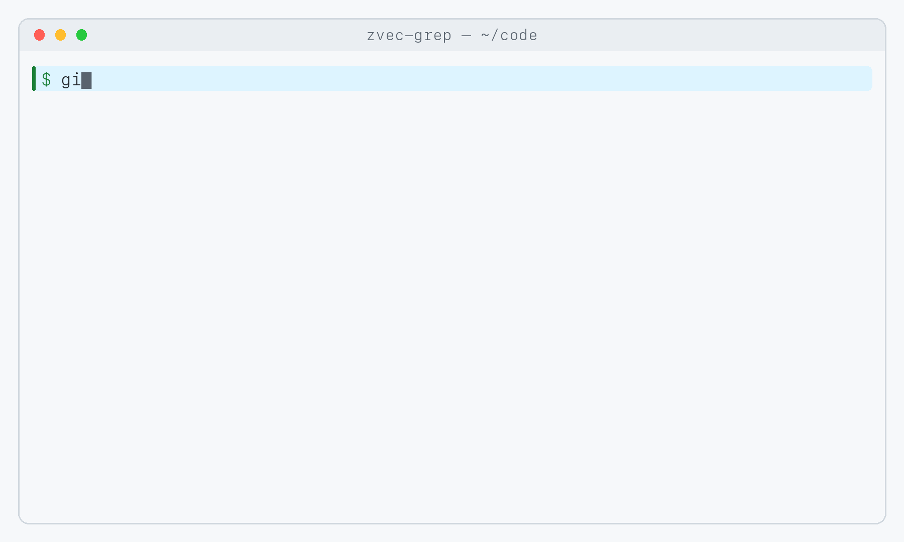
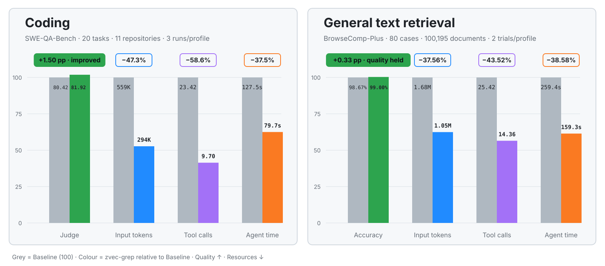
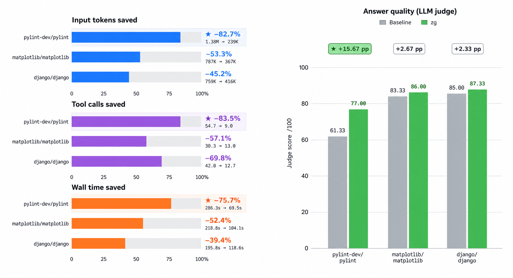

<p align="right">
  <a href="./README.md">English</a> | <a href="./README_CN.md">中文</a> | 日本語
</p>

<div align="center">
  <picture>
    <source media="(prefers-color-scheme: dark)" srcset="./.github/assets/zg-logo-dark.svg">
    
  </picture>
  <p><strong>Know the words—or don’t. Just zg.</strong></p>

  <p>
    <a href="https://www.npmjs.com/package/@zvec/zvec-grep"></a>
    <a href="https://github.com/zvec-ai/zvec-grep/actions/workflows/rust-ci.yml"></a>
    <a href="./LICENSE"></a>
  </p>

  <p>
    <a href="https://trendshift.io/repositories/200612?utm_source=trendshift-badge&amp;utm_medium=badge&amp;utm_campaign=badge-trendshift-200612" target="_blank" rel="noopener noreferrer"></a>
    <a href="https://trendshift.io/repositories/200612?utm_source=trendshift-badge&amp;utm_medium=badge&amp;utm_campaign=badge-trendshift-200612" target="_blank" rel="noopener noreferrer"></a>
  </p>

  <p>
    <a href="#features">💫 <strong>特長</strong></a> |
    <a href="#try-it-yourself">🚀 <strong>試してみる</strong></a> |
    <a href="https://zvec.org/en/docs/zvec-grep/">📚 <strong>ドキュメント</strong></a> |
    <a href="#benchmarks">📊 <strong>ベンチマーク</strong></a> |
    <a href="#community">🤝 <strong>コミュニティ</strong></a>
  </p>
</div>

**zg**（**z**vec-**g**rep）は、[zvec](https://github.com/alibaba/zvec) を基盤に、
ripgrep、BM25、ベクトル検索を
ローカルファーストな 1 つのインターフェースに統合します。ターミナルから直接使うことも、
エージェントに zg を使ってもらうこともできます。

<a id="tour"></a>

## 🎬 動作を見る

<div align="center">
  <picture>
    <source media="(prefers-color-scheme: dark)" srcset="./.github/assets/zvec-grep-tour-dark.gif">
    
  </picture>
</div>

<a id="features"></a>

## 💫 なぜ zg なのか？

- **人にもエージェントにも使いやすい** — 一度インストールして一度インデックスすれば、
  macOS、Linux、Windows 上で、同じワークスペースを CLI からもエージェントからも使えます。
- **キーワードを超えた検索** — 意味で探し、関連度で並べ、必要に応じて
  正確なテキストや正規表現で確かめられます。
- **マルチフォーマット検索** — ソースコード、ドキュメント、構造化データを、
  有用な構造とソースの位置を保ったまま検索できます。
- **検索は少なく、コンテキストも少なく** — 関連度順でソースへのリンク付きの結果が、
  少ないツール呼び出し、少ないトークン、少ないノイズで、
  適切な根拠を浮かび上がらせます。
- **既定ではローカル** — ファイル、インデックス、ローカルモデルはあなたのマシンに残ります。
  リモートの埋め込みサービスにデータが送信されるのは、あなたが許可した場合のみです。

<a id="try-it-yourself"></a>

## 🚀 試してみる

### 1. サンプルの本棚を用意する

```bash
npm install -g @zvec/zvec-grep --allow-scripts=@zvec/zvec-grep

mkdir zg-mystery && cd zg-mystery
curl --retry 3 --retry-all-errors --progress-bar -fL \
  -o alice-in-wonderland.txt https://raw.githubusercontent.com/GITenberg/Alice-s-Adventures-in-Wonderland_11/master/11.txt \
  -o sherlock-holmes.txt https://raw.githubusercontent.com/GITenberg/The-Memoirs-of-Sherlock-Holmes_834/master/834.txt

zg --index --embedding local/potion-retrieval-32m
```

> [!NOTE]
> インデックスは、インデックス対象のプロジェクトルート直下の `.zvec-grep/` に保存されます。

### 2. 検索方法を選ぶ

#### エージェント向け：OpenCode で質問する

[OpenCode](https://opencode.ai/) を設定済みの場合：

```bash
zg --install --target opencode --yes
opencode models
opencode run --model opencode/nemotron-3-ultra-free \
  "An unseen creature left a few marks. What did the detective infer? Cite local evidence."
```

無料モデルの提供状況は変わることがあります。`opencode models` を確認し、
例のモデルを、お使いの環境で現在利用できるものに置き換えてください。

OpenCode は自分で zg を選びます — プロンプトではツールの名前を指定していません。

<details>
<summary><strong>エージェントの実行全体と回答を見る</strong></summary>

```text
⚙ zvec_grep_zvec_grep_search {"root":".../zg-mystery","query":"An unseen creature left a few marks. What did the detective infer?","fts":["marks","unseen creature","inferred","detective"],"fuse":true}
→ Read sherlock-holmes.txt [offset=5440, limit=120]

Answer:
The detective is Sherlock Holmes in *The Adventure of the Crooked Man*.
From the animal's foot-marks, he inferred:

- It was not a dog, cat, monkey, or other familiar creature: its print had
  five foot-pads, long nails, and was nearly as large as a dessert-spoon
  (sherlock-holmes.txt:5479-5486).
- It had a long body and very short legs: nearly two feet long, but with a
  stride of only about three inches (sherlock-holmes.txt:5497-5502).
- It was carnivorous because it climbed the curtain toward a canary's cage
  (sherlock-holmes.txt:5509-5510).
- It was probably from the weasel or stoat tribe, though unusually large
  (sherlock-holmes.txt:5514-5516).

Holmes also inferred that a man entered through the window with it and later
left with the key (sherlock-holmes.txt:5464-5470, 5527-5528).
```

</details>

#### 人間向け：直接検索する

エージェントを介さず、同じ本棚を直接検索します。

```bash
zg --preview detail "An unseen creature left a few marks. What did the detective infer?" --limit 3
```

zg は `sherlock-holmes.txt` の関連する箇所を、
`alice-in-wonderland.txt` より上位に並べて返します。

別々のクエリには、`--hybrid`、`--fts`、`--vector` フラグを繰り返し指定します。
空でない結果グループは、`-- query 2/2: timeout --` のように、元のクエリと位置から始まります。
色付きの出力では、薄い罫線とマゼンタのラベルが使われます。

<a id="benchmarks"></a>

## 📊 ベンチマーク

各ベンチマークは、タスク、エージェント/モデル、プロンプト、
環境、制限を一定に保った A/B ペアの実行を用います。違いは、zg へのアクセスと利用ガイダンスだけです。

完全な結果と再現手順の詳細は、[ベンチマークのドキュメント](./benchmarks/README.md)を参照してください。

### 1. ドメイン横断のエージェントベンチマーク

[SWE-QA-Bench](./benchmarks/swe-qa-bench/README.md) は、Claude Code で Claude Opus 5 を使用し、
推論エフォートを high に設定しています。
[BrowseComp-Plus](./benchmarks/browse-comp-plus/README.md) は、Codex で gpt-5.6-sol を使用し、
推論エフォートを medium に設定しています。どちらの zg プロファイルも Qwen3.7 Text
Embedding を使います。

<p align="center">
  <picture>
    <source media="(prefers-color-scheme: dark)" srcset="./.github/assets/benchmark-overall-retrieval-indexed-v4-dark.svg">
    <source media="(prefers-color-scheme: light)" srcset="./.github/assets/benchmark-overall-retrieval-indexed-v4-light.svg">
    
  </picture>
</p>

- **役に立つ理由：** 意味による探索が検索空間を絞り込み、関連度順の語彙検索が
  正確な識別子を押さえ、コンパクトな根拠が、広範囲なスキャン、ツール呼び出しの繰り返し、
  モデルのコンテキストを減らします。
- **汎化する理由：** 同じ検索ループがドメインをまたいで機能します — コードは
  シンボル、シグネチャ、パンくずとともにインデックスされ、文章は
  焦点を絞ったセクションとチャンクとして取得されます。

### 2. 実世界のケーススタディ

<table align="center">
  <tr>
    <td align="center">
      <picture>
        <source media="(prefers-color-scheme: dark)" srcset="./.github/assets/benchmark-repository-top3-v2.png">
        <source media="(prefers-color-scheme: light)" srcset="./.github/assets/benchmark-repository-top3-v2-light.png">
        
      </picture>
    </td>
  </tr>
</table>

- **[Pylint](https://github.com/pylint-dev/pylint) — Python の静的解析：** このタスクは、AST ノードの扱いが、
  型注釈のある属性の初期化と、ない属性の初期化をどう分けているかを尋ねます。
  アーキテクチャ上の入口が事前にわからないため、シンボルを意識した
  検索が有効です。
- **[Matplotlib](https://github.com/matplotlib/matplotlib) — プロットとレンダリング：** このタスクは、`FontInfo` とフォントの
  選択が、数式テキストの複数のレンダリング段階を通る流れをたどります。関連度順の意味的な根拠と
  語彙的な根拠が、ファイルをまたぐデータフローと制御フローの再構築に役立ちます。
- **[Django](https://github.com/django/django) — Web フレームワーク：** このタスクは、ユーザー名の一意性、ORM の
  トランザクション、フォームセットの一括操作を結び付けます。コンパクトで関連度順の根拠が、
  分散した設計上の理由を一つにまとめます。

<details>
<summary><strong>リポジトリへの質問</strong></summary>

| リポジトリ | 質問の種類 | 質問 |
| --- | --- | --- |
| **`pylint-dev/pylint`** | What<br>アーキテクチャの探索 | AST ノードの型の分離を使って、型注釈のあるインスタンス属性の初期化と、ないものの初期化を区別するアーキテクチャ上のパターンは何ですか？ |
| **`matplotlib/matplotlib`** | Where<br>データ / 制御フロー | `FontInfo` NamedTuple は、数式テキストのレンダリングパイプラインの中で、フォントメトリクスとグリフデータをどこで伝播させますか。また、文字のレンダリングの各段階で `postscript_name` と `FT2Font` オブジェクトのどちらを使うかは、どのような制御フローで決まりますか？ |
| **`django/django`** | Why<br>設計上の理由 | User モデルの username フィールドに対する一意制約が Django の ORM のトランザクション処理と相互作用するのはなぜですか。また、フォームセットによる一括操作がある既存のデータベースでこの制約を取り除くと、どのような連鎖的な影響が起こりますか？ |

</details>

> zg が最も力を発揮するのは、根拠が複数のファイルやモジュールにまたがり、
> 対象の場所がわからないときです。特に、コールチェーン、データフロー、アーキテクチャに関する質問で顕著です。
> エージェントが使うタイミングと方法を決めるため、結果はモデルや実行ごとに異なります。
> 繰り返し実行した平均のほうが信頼できます。

<a id="community"></a>

## 🤝 コミュニティに参加する

<div align="center">

| 💬 DingTalk | 📱 WeChat | 🎮 Discord | X (Twitter) |
| :---: | :---: | :---: | :---: |
|  |  | [](https://discord.gg/rKddFBBu9z) | [](<https://x.com/ZvecAI>) |
| スキャンして参加 | スキャンして参加 | クリックして参加 | クリックしてフォロー |

</div>

## ❤️ コントリビューション

コミュニティからの貢献は、いつでも歓迎します — バグ修正、機能、
ドキュメントの改善のどれも、zvec-grep をより良くする力になります。

始めるには、[コントリビューションガイド](./CONTRIBUTING.md)をご覧ください！
