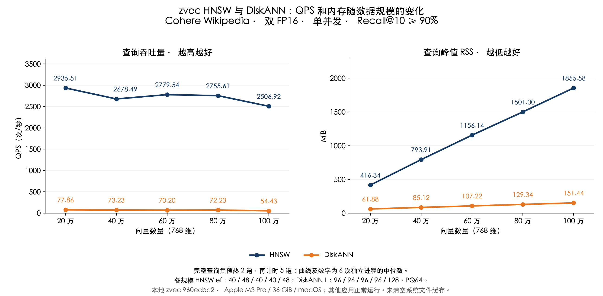

# zvec DiskANN 与 HNSW：Cohere 复测报告

测试日期：2026-11-04。使用本地 zvec 源码 `960ecbc2` 编译的原生库；双 FP16、768 维、cosine、top-10、单并发，DiskANN 启用 PQ64。沿用相同 Cohere 样本、GT、索引和验证集选出的参数，覆盖 20／40／60／80／100 万，测试集 **Recall@10 均 ≥ 90%**。

这次先用完整的 200 条测试查询预热 2 遍，再计时 5 遍，共 1000 次查询。两种引擎均按此流程重新测量，每组 6 个独立进程，取中位数。

| 向量数量 | HNSW QPS | DiskANN QPS | HNSW RSS（MiB） | DiskANN RSS（MiB） | HNSW / DiskANN Recall@10 |
|---|---:|---:|---:|---:|---:|
| 20 万 | 2935.51 | 77.86 | 416.34 | 61.88 | 95.05% / 94.40% |
| 40 万 | 2678.49 | 73.23 | 793.91 | 85.12 | 95.45% / 93.95% |
| 60 万 | 2779.54 | 70.20 | 1156.14 | 107.22 | 94.00% / 94.10% |
| 80 万 | 2755.61 | 72.23 | 1501.00 | 129.34 | 94.25% / 93.35% |
| 100 万 | 2506.92 | 54.43 | 1855.58 | 151.44 | 93.10% / 93.10% |

## 为什么上次百万 HNSW 的 QPS 反而更高

上次只用另外 20 条查询预热，就将测试集第一次完整遍历计入 QPS，混入了缺页开销不同的运行状态。百万组 6 轮恰好是 3 次慢、3 次快：中位数 1205.41 来自中间的 **199.13 和 2211.70** 的平均，不是某次典型运行；不同规模的快慢轮次比例不同，使曲线出现回升。

本次把完整查询集预热与正式计时分开，并逐遍记录耗时和缺页。百万 HNSW 预热后为 **2506.92 QPS**，6 次范围 **2302.92–2552.52**。初次结果及逐遍证据见[详细记录](REPORT_RETEST_NATIVE_CN.md)。

各规模的搜索参数仍与上轮相同，并非固定值：HNSW ef 为 40／48／40／40／48，所以主曲线也不能当作仅改变数据量的实验。另做固定 **ef=48** 对照，20 万至 100 万的 QPS 为 **3153.96 → 2848.18 → 2700.50 → 2575.90 → 2705.81**，本轮未呈严格单调下降，应结合波动范围判断；没有删除或调整任何测量点。

100 万时，DiskANN 查询峰值 RSS 为 **151.44 MiB**，HNSW 为 **1855.58 MiB**，DiskANN 低 **91.84%**；本轮 DiskANN 的 QPS 低于 HNSW。

RSS 为 macOS `/usr/bin/time -l` 的进程峰值驻留内存，含打开索引、预热和查询，不含建库。QPS 仅计预热后的查询阶段。机器为 Apple M3 Pro、36 GiB 内存、macOS，未隔离其他应用，也未清空系统文件缓存。这是固定查询工作集的预热后吞吐量，不代表首次访问、随机新查询或高并发性能。

完整参数、范围、原始数据及复现步骤见[复测详细记录](REPORT_RETEST_NATIVE_CN.md)。
