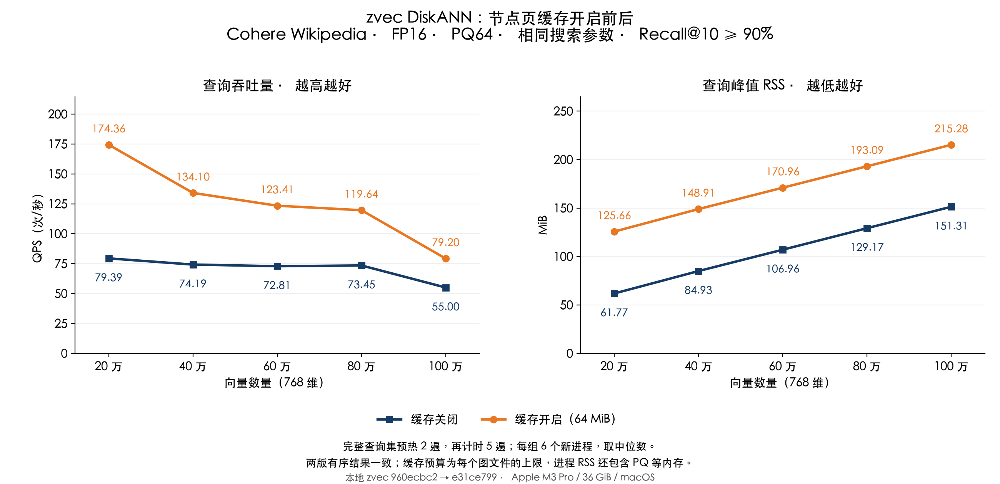
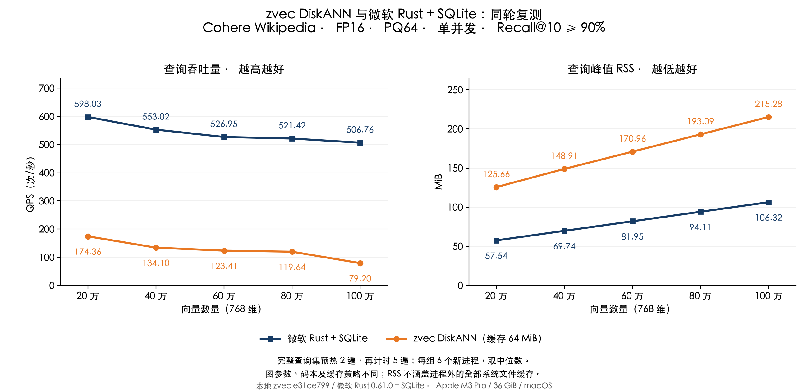

# zvec DiskANN 节点页缓存测试报告

后续在同样的 64 MiB 缓存上继续定位读取瓶颈，加入并行读取并重新对比微软方案，见[并行读取测试报告](REPORT_READ_CN.md)。本文保留本轮缓存实验的原始结果。

测试日期：2026-11-04。Apple M3 Pro、36 GiB 内存、macOS。使用本地 zvec 源码，原版 `960ecbc2`，缓存版 `e31ce799`。

在同一 Cohere 数据、同一索引和搜索参数下，开启 **64 MiB 节点页缓存**后，20 万到 100 万的预热后 QPS 提升到原来的 **1.44–2.20 倍**。百万组 QPS 从 **55.00** 到 **79.20**，进程峰值 RSS 从 **151.31 MiB** 到 **215.28 MiB**。这是用有限的额外内存减少重复读取；没有以降低召回换取速度。

全部正式测量中，zvec 两版的有序 top-10 结果逐项相同，Recall@10 均超过 90%。本轮是固定查询集预热后的单并发对比，不代表首次查询、新工作集或多并发的性能。

## QPS 与 RSS

每个规模、每版各 6 个新进程，表中取中位数。深蓝为缓存关闭，橙色为缓存开启；两条曲线都是 zvec DiskANN。

| 向量数量 | 缓存关闭 QPS | 缓存开启 QPS | QPS 倍数 | 缓存关闭 RSS（MiB） | 缓存开启 RSS（MiB） | 两版 Recall@10 |
|---|---:|---:|---:|---:|---:|---:|
| 20 万 | 79.39 | 174.36 | 2.20× | 61.77 | 125.66 | 94.40% |
| 40 万 | 74.19 | 134.10 | 1.81× | 84.93 | 148.91 | 93.95% |
| 60 万 | 72.81 | 123.41 | 1.69× | 106.96 | 170.96 | 94.10% |
| 80 万 | 73.45 | 119.64 | 1.63× | 129.17 | 193.09 | 93.35% |
| 100 万 | 55.00 | 79.20 | 1.44× | 151.31 | 215.28 | 93.10% |



## 与微软方案的同轮对比

微软组是此前的 **微软 Rust DiskANN 0.61.0 + 自定义 SQLite/PQ 适配层**，并非微软官方原生 SSD 存储实现。本轮也重新跑了 6 个进程／规模，使用相同数据、查询、预热和计时流程；下表未复用旧计时数据。

| 向量数量 | zvec 缓存开启 QPS | 微软 QPS | zvec RSS（MiB） | 微软 RSS（MiB） | zvec / 微软 Recall@10 |
|---|---:|---:|---:|---:|---:|
| 20 万 | 174.36 | 598.03 | 125.66 | 57.54 | 94.40% / 97.55% |
| 40 万 | 134.10 | 553.02 | 148.91 | 69.74 | 93.95% / 96.85% |
| 60 万 | 123.41 | 526.95 | 170.96 | 81.95 | 94.10% / 97.00% |
| 80 万 | 119.64 | 521.42 | 193.09 | 94.11 | 93.35% / 96.65% |
| 100 万 | 79.20 | 506.76 | 215.28 | 106.32 | 93.10% / 96.10% |



百万组中，微软方案的 QPS 是开启缓存后 zvec 的 **6.40 倍**，zvec 仍有差距。双方实际召回率不同，均高于 90%；zvec 图出度为 32，微软为 48，PQ 码本训练方式也不同。微软使用 SQLite 256 KiB 堆页缓存、最多 16 MiB mmap，并可受益于系统文件缓存；其较低的进程 RSS 不代表较低的系统总内存占用。完整实现差异见[此前的方案说明](REPORT_MICROSOFT_CN.md#两套方案的差异)。该微软 PQ 路径只支持本轮静态、无过滤查询，不能据此比较完整产品能力。

## 实际修改

- 为 macOS FileReadStorage 增加按需填充的 4 KiB 节点页缓存。页内含原向量与邻接表，热点页命中后无需再次 `pread`，同一批重复页也会复用首次读取的数据。
- 使用固定四路组相联、second-chance 淘汰，容量包含页数据、条目标记与锁，预算不随向量数量增长；小索引按向量段大小收缩。缓存预算是**每个图文件**的上限，多个集合／字段／分片的预算会累加；不是整个进程的 RSS 上限。
- 缓存锁不覆盖磁盘读取；失败读取不进入缓存，关闭或重开文件时清空缓存。保留文件身份校验、请求顺序、搜索候选数、PQ 和精排计算。
- 未命中仍走原同步读取，并保留 macOS `F_NOCACHE` 与关闭预读设置；没有启用全文件 mmap 或放开系统缓存。已有 BufferPool 路径不重复分配此缓存。

百万组每 1000 次查询，墙钟时间中位数从 **18.182 秒**降至 **12.626 秒**，CPU 时间为 **1.979 / 1.747 秒**，主动上下文切换为 **218545 / 146272 次**。这与缓存减少读取等待的机制一致；本轮未用系统调用追踪计数，不能把 CPU 与墙钟时间的差额全部解释为磁盘耗时。

## 如何选择缓存预算

先在独立验证集对 16／32／64 MiB 各测 2 个进程、覆盖全部 5 个规模；另测 5 个原版验证进程。预先固定的规则是：计算各预算在五个规模的 QPS 几何平均值，选择达到最高值 90% 的最小预算。这里的 90% 是选缓存预算的性能阈值，与召回目标是两个独立条件。选择结果为 **64 MiB**，随后冻结配置再测正式测试集。

| 向量数量 | 16 MiB：QPS / RSS | 32 MiB：QPS / RSS | 64 MiB：QPS / RSS | 验证 Recall@10 |
|---|---:|---:|---:|---:|
| 20 万 | 105.08 / 77.79 MiB | 118.95 / 93.72 MiB | 177.97 / 125.66 MiB | 92.75% |
| 40 万 | 94.74 / 101.09 MiB | 102.13 / 116.98 MiB | 136.53 / 149.06 MiB | 92.40% |
| 60 万 | 88.48 / 123.17 MiB | 92.68 / 139.08 MiB | 115.97 / 171.21 MiB | 92.85% |
| 80 万 | 90.10 / 145.05 MiB | 77.02 / 160.97 MiB | 120.05 / 193.14 MiB | 92.25% |
| 100 万 | 62.04 / 167.06 MiB | 69.90 / 183.08 MiB | 79.06 / 215.10 MiB | 93.10% |

三个预算的验证 QPS 几何平均值依次为 **86.79、90.47、121.75**。所有预算返回的有序结果相同。参数试验只用于缓存大小选择，未用测试集选择 L 或缓存预算。

## 方法与适用范围

沿用此前 Cohere Wikipedia 样本和针对各规模计算的精确 cosine GT；768 维、FP16 存储与查询舍入、PQ64、top-10、单并发、运行时线程数 1。zvec 图出度 32、构图候选数 100；20／40／60／80 万的 L=96，100 万的 L=128。微软方案的图出度为 48、构图候选数 100、L=128、重排数 128，共享此前训练的 PQ64 码本。索引、PQ 编码与码本均未重建，数据和 GT 哈希重新核对，索引文件大小和修改时间在实验前后保持一致。

每个进程先运行 20 条独立预热查询，再将完整 200 条计分查询预热 2 遍，最后计时 5 遍，共 1000 次查询。QPS=1000/累计计时秒数，包含 FP16 转换、向量查询、结果 ID 提取与一致性检查，不包含索引打开和预热。RSS 为 `/usr/bin/time -l` 的进程峰值驻留内存，包含打开、缓存分配、PQ 加载、预热和查询；不包含建库。内存预算与进程 RSS 不是同一个量。

正式阶段先用三份最终二进制重新验证 15 个进程，再做 90 次测量；6 轮中轮换／反转实现顺序，并交替规模顺序。没有拼接历史计时数据，没有清空系统文件缓存或隔离其他应用，RSS 也不包含进程之外的全部系统文件缓存。zvec 两版沿用同一搜索逻辑，仅改变节点页缓存与读取复用，其有序结果已经逐项核验；实际编译版本、源文件和库摘要保存在配置中。

复用预热查询让缓存受益，实际应用若频繁访问不同节点，提升可能较小。预算有限意味着 RSS 增加可预算，但 PQ、键映射和其他内存仍会随索引规模变化；不能承诺整个进程固定内存，也不能用本测试断言不会影响其他应用。

| 向量数量 | 缓存关闭 QPS 范围 | 缓存开启 QPS 范围 | 缓存关闭 RSS 范围（MiB） | 缓存开启 RSS 范围（MiB） |
|---|---:|---:|---:|---:|
| 20 万 | 79.20–79.50 | 172.71–177.93 | 61.53–61.81 | 125.61–125.72 |
| 40 万 | 70.01–76.19 | 109.87–136.79 | 84.81–85.03 | 148.89–148.98 |
| 60 万 | 72.04–73.40 | 116.26–127.34 | 106.89–107.11 | 170.91–171.05 |
| 80 万 | 72.76–74.92 | 116.82–120.91 | 129.08–129.31 | 193.02–193.16 |
| 100 万 | 53.64–55.45 | 75.77–80.21 | 151.16–151.53 | 215.20–215.45 |

| 向量数量 | 微软 QPS 范围 | 微软 RSS 范围（MiB） |
|---|---:|---:|
| 20 万 | 557.45–609.80 | 57.44–57.59 |
| 40 万 | 518.31–560.76 | 69.72–69.81 |
| 60 万 | 506.56–535.41 | 81.88–82.00 |
| 80 万 | 496.53–526.47 | 94.00–94.17 |
| 100 万 | 497.17–510.78 | 106.22–106.41 |

## 使用与复现

本次优化在本地 zvec C++ 源码中，默认预算为 32 MiB；本轮按验证结果显式使用 64 MiB，不把它当作所有集合的通用最优值。重新编译并链接后，在打开集合前设置 `ZVEC_DISKANN_READ_CACHE_MIB=64`；设为 `0` 关闭缓存。值必须是 0–1024 的整数，已有索引不需要重建。已发布的 Rust／Node SDK 二进制尚未替换，不能把本地源码测试当作已发布应用的性能。

[配置与源文件摘要](results/cache-comparison/measure/configuration.json)、[正式逐次记录](results/cache-comparison/measure/runs.json)、[验证预算选择](results/cache-comparison/pilot/selection.json)、[独立核验](results/cache-comparison/audit.json)、[源码补丁](results/cache-comparison/measure/source.patch)、[全部原始结果及 GT](results/cache-comparison/raw-evidence.json.gz)。共核验 140 个有效进程；[26 项 C++ 缓存、读取和端到端测试](results/cache-comparison/cpp-tests.json)通过。初次验证时，一份复制并改写库路径后的微软程序被 macOS 完整性检查拒绝启动；改用已验证的原位置程序后重新开始三组验证。[失败启动记录](results/cache-comparison/startup-failed/run.log)单独保留，不纳入成功查询统计。

复现须保留此前数据和索引目录，并准备分别链接原版／缓存版库的同一 `native-retest` 程序；构建步骤沿用 [本地源码报告](REPORT_NATIVE_CN.md)和[查询计量说明](REPORT_RETEST_NATIVE_CN.md)。`BASE/baseline`、`BASE/optimized` 各放一份固定绝对链接的 `native-retest` 与对应 `libzvec_c_api.dylib`；微软程序、库、索引和 PQ 路径沿用前次记录的原位置，并核对二进制和库摘要；`BASE/pilot`、`BASE/measure` 必须尚不存在。生成报告还需要源码测试记录 `BASE/cpp-tests.json`；复用本次固定源码时可复制已保存的记录，修改源码后需重新运行测试并记录对应提交：

```bash
python3 rust/benchmarks/diskann/run_cache_comparison.py \
  --base "$BASE" --data /tmp/zvec-cohere-million/data \
  --indexes /tmp/zvec-local-cohere-20261104/experiment/indexes \
  --source "$PWD/../zvec" --stage pilot
python3 rust/benchmarks/diskann/run_cache_comparison.py \
  --base "$BASE" --data /tmp/zvec-cohere-million/data \
  --indexes /tmp/zvec-local-cohere-20261104/experiment/indexes \
  --source "$PWD/../zvec" --stage measure
cp rust/benchmarks/diskann/results/cache-comparison/cpp-tests.json "$BASE/cpp-tests.json"
python3 rust/benchmarks/diskann/publish_cache_comparison.py \
  "$BASE" /tmp/zvec-cohere-million/data
```
