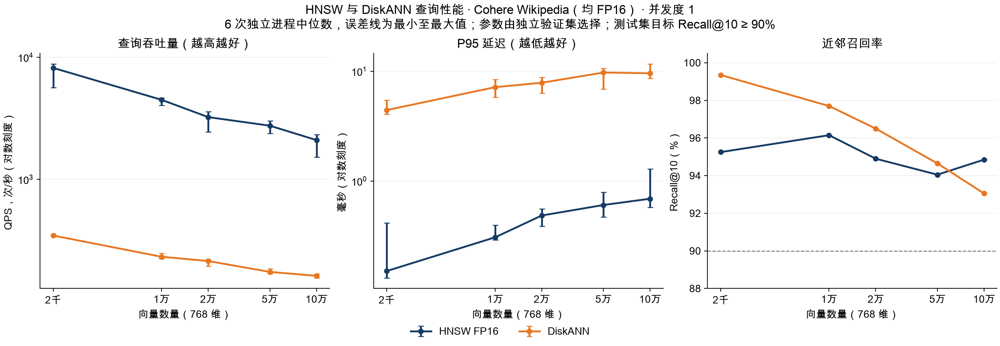
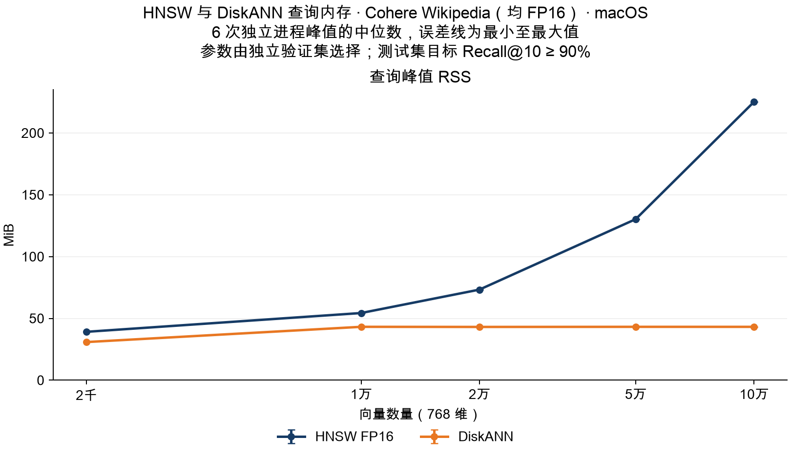
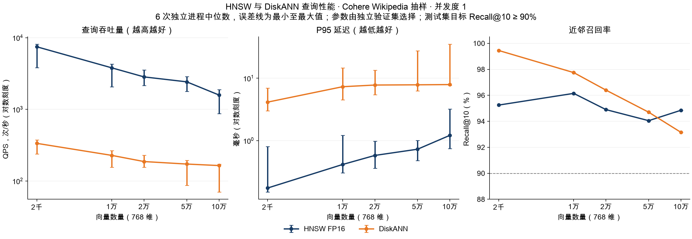
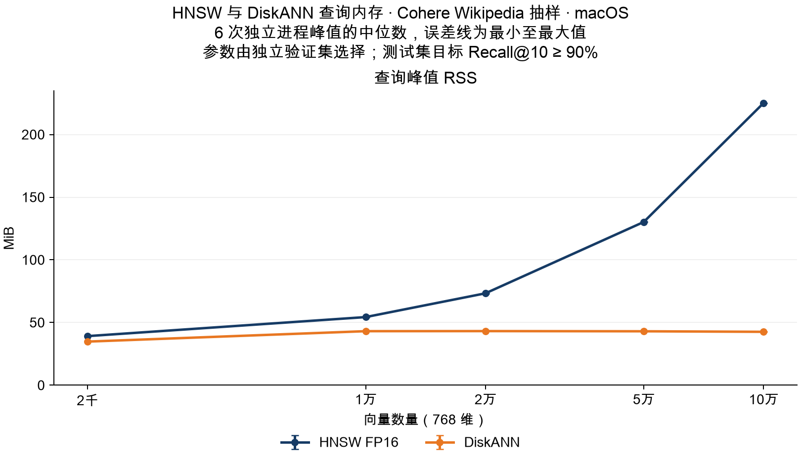
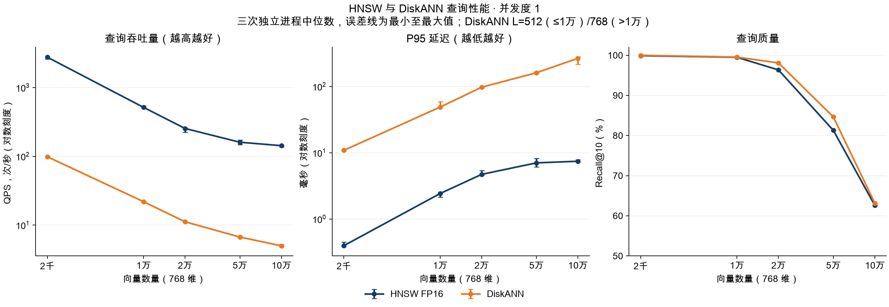
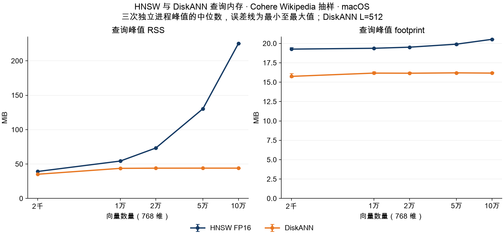

# HNSW 与 DiskANN Cohere Wikipedia 测试报告

> 历史测试：本文的 DiskANN 使用微软 Rust 库和 SQLite 存储，测试代码截至 `a885372`。2026-11-04 后主引擎已切换为 zvec 内置 DiskANN；本文数值不代表新后端性能。

**当前 zvec 原生实现的结果见 [20 万至 100 万 Cohere 测试报告](REPORT_BRIEF_CN.md)及[复测详细记录](REPORT_RETEST_NATIVE_CN.md)，使用本地源码 `960ecbc2` 编译，并将完整查询集预热与正式计时分开。**

**2026-11-04 新增：[DiskANN PQ64 查询对照测试](REPORT_PQ_CN.md)。** 100 万条的本轮对测中，完整向量模式 / PQ64 模式 QPS 为 86.45 / 506.28，RSS 为 41.77 / 105.99 MiB，Recall@10 为 95.95% / 96.10%。以下 HNSW 对照数据对应未启用 PQ 的原实现。

测试日期：2026-11-03（Asia/Shanghai）。FP32 基线：`4d6c155`；FP16 实现：`74c7d39`。本报告使用 Cohere 的真实文本向量，固定抽样并为每个规模重新生成精确 GT，只比较 **HNSW** 与 **DiskANN**，目前覆盖 **2 千至 100 万条**。内存统一使用峰值 **RSS**。最新 20 万至 100 万实验两组均采用 FP16，目标为 **Recall@10 ≥ 90%**；原 2 千至 10 万的 FP16、FP32 和默认参数结果分别保留。

新增 **20 万、40 万、60 万、80 万、100 万**双 FP16 实验已完成，并为每个新规模重算精确 GT。五个规模的两组引擎均达到 90% 召回目标；完整方法、实际召回率、全部波动及图表见[百万规模测试报告](REPORT_MILLION_CN.md)。

**80 万条补充复测：** DiskANN 六次 QPS 中位数为交替运行 **74.17**、随后单独运行 **84.24**，Recall@10 均为 **96.50%**，RSS 仍约 **42.3 MiB**。原测试 **36.23 QPS** 的低谷本次未重现；原曲线保留，全部新旧运行、复测条件及文件审计见[80 万条复测报告](REPORT_RETEST800K_CN.md)。

## 结论

最新百万规模结果：HNSW / DiskANN 的查询峰值 RSS 中位数为 **1854.43 / 41.65 MiB**，QPS 中位数为 **915.12 / 78.75**，实际 Recall@10 为 **94.10% / 95.95%**。本轮 20 万至 100 万范围内，DiskANN 的 RSS 中位数保持在 **41.65–43.06 MiB**；HNSW 则从 **414.58 增至 1854.43 MiB**。

较大规模有明显慢运行，全部保留：例如 80 万条 DiskANN 六次为 **18.98–78.17 QPS**，100 万条 HNSW 为 **49.95–945.58 QPS**。本轮未固定文件缓存状态，不能把中位数当作稳定吞吐量，也不能仅据此断定固定性能拐点；[完整报告](REPORT_MILLION_CN.md)列出了范围与进程级诊断。

原 2 千至 10 万条的双 FP16 实验中，五个规模、两个引擎均达到 90% 目标。10 万条时，HNSW `ef=32` / DiskANN `L=20` 的实际 Recall@10 为 **94.85% / 93.05%**，QPS 中位数为 **2100.10 / 162.41**，峰值 RSS 为 **225.14 / 43.17 MiB**。这是同一组 200 个固定查询的观测结果，不代表全数据集或其他查询分布。

FP16 在这轮明确减少了 DiskANN 的磁盘体积：10 万条数据库从 **394.49 MiB 降到 198.69 MiB**。与前轮 FP32、同为 L=20 的结果相比，RSS 为 **42.60 → 43.17 MiB**，QPS 为 **164.34 → 162.41**，没有观察到进一步降低 RSS 或提高吞吐量。不能把向量存储减半解释为进程常驻内存也减半。

此前默认参数实验使用 DiskANN FP32、`L=512`，Recall@10 为 **99.95%–100.00%**；10 万条时 QPS 为 **15.78**，RSS 为 **44.05 MiB**。该轮降低召回目标主要改善查询速度，RSS 变化较小。不同实验的运行时间和部分重复次数不同，跨轮比值只是观察值，不是严格隔离系统负载的消融结果。生产默认值仍为 `L=512`。

## 新增：20 万至 100 万，双 FP16、90% 召回目标

下表为每个引擎六个独立进程的中位数，内存为各进程峰值 RSS 的中位数。

| 向量数 | HNSW QPS | DiskANN QPS | HNSW RSS MiB | DiskANN RSS MiB |
|---:|---:|---:|---:|---:|
| 200,000 | 2016.25 | 121.05 | 414.58 | 43.06 |
| 400,000 | 1200.45 | 84.97 | 792.25 | 43.02 |
| 600,000 | 1356.58 | 79.97 | 1143.71 | 42.55 |
| 800,000 | 941.98 | 36.23 | 1517.68 | 42.28 |
| 1,000,000 | 915.12 | 78.75 | 1854.43 | 41.65 |

[完整数据与说明](REPORT_MILLION_CN.md) · [QPS、延迟与召回率图](results/million/performance.png) · [查询 RSS 图](results/million/memory.png)

以下保留原 2 千至 10 万条实验的数据和方法，未将新旧运行合并。

## 数据从哪里来

采用 [Big ANN Benchmarks 的 Wikipedia-Cohere 分发版本](https://github.com/harsha-simhadri/big-ann-benchmarks/blob/main/benchmark/datasets.py#L460-L501)。其库包含 3,500 万条英文 Wikipedia 标题与正文的 Cohere 向量；独立查询文件包含 5,000 条 Simple Wikipedia 的 Cohere 向量，维度均为 768。

- 库文件：[wikipedia_base.bin](https://comp21storage.z5.web.core.windows.net/wiki-cohere-35M/wikipedia_base.bin)。
- 查询文件：[wikipedia_query.bin](https://comp21storage.z5.web.core.windows.net/wiki-cohere-35M/wikipedia_query.bin)。
- 实际抽样块编号、源文件 ETag、查询源行号、随机种子和输出 SHA256 记录在 [dataset.json](results/dataset.json)。

分发基准的距离类型为 inner product；本项目使用 cosine，因此本轮显式归一化向量，并按归一化后的实际 FP32 数据重算 cosine GT。这是本地抽样实验，不是官方完整数据集配置的复刻。

## 抽样与 GT 设计

1. 固定种子 `20261103`，使用 NumPy PCG64。从全库的 35,000 个连续数据块中随机选 120 个块，每块 1,000 条，用 HTTP Range 下载约 12 万条候选。它是分块概率抽样，块内样本有关联，不能视为全库逐行独立抽样。
2. 用 FP64 计算范数并归一化，再保存为 FP32。打乱候选顺序，去掉归一化后字节完全相同的向量，选出 100,000 条。在选满这 10 万条前跳过了 14 个重复候选；源行号映射另存本地。
3. 从独立查询文件打乱选出 220 条唯一向量，排除与选中库向量完全相同的记录；本次未遇到需要排除的查询。前 20 条用于预热，后 200 条用于正式测量，五个规模共用这组查询。
4. 以打乱后的库向量前缀构成 2k、10k、20k、50k、100k 五个嵌套子集。对每个子集独立进行全量 FP64 cosine 计算和排序，生成该子集的精确 top-10 文档 ID。
5. 对每个规模的第 1、200 个测量查询，另用逐元素乘加求和重新计算全库分数，结果与矩阵乘法 GT 一致。记录第 10 与第 11 名的最小分数间隔，检查边界同分情况。

**没有复用全库的 GT，也没有先取全库 top-10 再过滤抽样 ID。** 抽样会改变最近邻集合，因此每个规模都有单独的 `truth-N.json`。数据准备和 GT 计算完全在查询计时之外。

Recall@10 表示 ANN 返回结果对精确向量近邻的召回率，不是人工相关性或问答正确率；100% 不等于语义搜索准确率 100%。重新计算 GT 消除了抽样后真值不匹配的问题，但不能保证任意抽样分布下的 ANN 召回率。

默认参数实验完成后，校验了数据清单内全部文件的 SHA256，并逐条检查五个 DiskANN 索引的存储向量与对应 GT 输入一致；同时从 30 份原始结果重新核算召回率与 QPS。[默认参数校验记录](results/audit.json)。新增实验另从原始返回 ID 复核了 20 次验证运行、60 次测试运行，确认使用冻结参数、QPS 公式及汇总中位数/范围一致。[90% 目标校验记录](results/recall90/audit.json)。

两组使用同一份归一化输入，HNSW 始终存为 FP16；DiskANN 的 FP32 与 FP16 实验分别统计，统一对照原始 FP32 精确真值。双 FP16 实验的两组查询输入也都经过 FP16 舍入，但距离内核和累加方式不完全相同。FP32 真值保留了量化引起的召回损失，不能把召回差异全部归因于图算法。

## 测试协议

| 项目 | 设置 |
|---|---|
| 设备 | Apple M3 Pro，36 GiB RAM，macOS 26.6.2 |
| 构建 | Rust 1.98.0，release；两组使用同一查询二进制 |
| 查询 | 768 维，cosine，top-10，无元数据过滤，不返回向量 |
| HNSW | FP16，M=50，efConstruction=500，mmap=true；默认实验用原有 API 默认值，90% 目标实验显式设置 ef |
| DiskANN | FP32 / FP16 分开实验，degree=48，build L=100；默认实验查询 L=512，90% 目标实验由验证集选择 L |
| 只读缓存 | DiskANN SQLite cache 目标 256 KiB，mmap 上限 16 MiB |
| 重复 | 默认实验每组 3 个独立进程；90% 目标实验每组 6 个独立进程 |
| 并发 | 单个在途查询；按进程顺序运行，交替引擎顺序，查询期间不运行建库 |
| 每进程查询 | 20 次预热 + 200 次计时；默认实验 6,000 次，每种精度的 90% 目标实验各 12,000 次计时查询 |
| 系统缓存 | 未清空文件缓存，未人为制造内存压力 |

所有索引均通过生产后端构建。HNSW 各规模分别建库；DiskANN 从上一个已关闭数据库复制快照，再按同一输入顺序追加到下个规模。没有使用额外全量向量缓存或延后刷边的特殊 builder。这里测量查询，不比较增量建库耗时与全量建库耗时。

**QPS = 200 / 计时批次秒数**，包含读取查询向量、查询调用和结果 ID 收集；不包含打开索引、预热和 JSON 输出。查询文件通过有界缓冲读取，不把全部库向量加载进查询进程。P50/P95 计量单次查询调用及 ID 转换，不包含读取查询向量。

每进程将 200 个延迟排序，取零基下标 100 和 190 作为 P50/P95。表中为独立进程指标的中位数，而非合并全部延迟后重算分位数；默认实验为 3 次，90% 目标实验为 6 次。内存指标统一为 `/usr/bin/time -l` 的峰值 RSS，包含打开与预热；MiB = 2²⁰ 字节。图中误差线为各次最小值至最大值，不是置信区间。

## 前轮参考：2 千至 10 万条，双 FP16、90% 召回目标

HNSW 沿用相同的 FP16 图索引。DiskANN 用新的可选 FP16 后端，在同一份原始输入上重新构图：每个分量实际保存为 2 字节 IEEE binary16，768 维每条 **1,536 字节**。五个规模逐条校验存储字节与 NumPy 独立量化结果完全一致，校验记录同时保存了数据库文件大小。

DiskANN 的 FP16 BLOB 按访问需要解码为 FP32，距离仍使用原有 FP64 累加器；它是 FP16 存储，不是纯 FP16 算术内核。构图时使用量化后的值；测试查询先舍入到 FP16，与 HNSW 输入精度一致，转换计入查询延迟。没有把向量舍入后继续存为 4 字节，也没有将整库解码进查询进程。

仍使用同一份独立验证集、同一份测试集及原有 FP32 GT；库子集没有变化，因此不改成针对量化向量重新计算的 GT。沿用下文 90% 目标的候选网格和验证集 92% 门槛，为 FP16 重新选参数；全部参数冻结后，两组均重新测量 **6 个独立进程**，没有复用前轮 HNSW 的计时结果。每组按两轮各 3 次运行并交替引擎顺序，所有索引构建及回归测试完成后才开始查询测量。

| 向量数 | 引擎 | 参数 | 验证 Recall@10 | 测试 Recall@10 | QPS ↑ | P50 ms ↓ | P95 ms ↓ | RSS MiB ↓ |
|---:|---|---|---:|---:|---:|---:|---:|---:|
| 2,000 | HNSW | ef=16 | 94.85% | 95.25% | 8193.76 | 0.12 | 0.15 | 39.16 |
| 2,000 | DiskANN | L=20 | 99.40% | 99.35% | 347.43 | 2.71 | 4.43 | 30.86 |
| 10,000 | HNSW | ef=24 | 95.05% | 96.15% | 4489.22 | 0.21 | 0.31 | 54.35 |
| 10,000 | DiskANN | L=20 | 96.65% | 97.70% | 232.91 | 3.93 | 7.17 | 43.20 |
| 20,000 | HNSW | ef=24 | 94.05% | 94.90% | 3240.63 | 0.29 | 0.49 | 73.28 |
| 20,000 | DiskANN | L=20 | 95.05% | 96.50% | 214.78 | 4.38 | 7.87 | 43.10 |
| 50,000 | HNSW | ef=24 | 92.95% | 94.05% | 2755.03 | 0.33 | 0.61 | 130.30 |
| 50,000 | DiskANN | L=20 | 93.60% | 94.65% | 175.00 | 5.28 | 9.75 | 43.19 |
| 100,000 | HNSW | ef=32 | 93.40% | 94.85% | 2100.10 | 0.46 | 0.69 | 225.14 |
| 100,000 | DiskANN | L=20 | 92.00% | 93.05% | 162.41 | 5.66 | 9.60 | 43.17 |





**DiskANN FP32 与 FP16 的补充对照：** 以下 FP32 是前轮观测，FP16 是新一轮；两轮构图精度、图拓扑、查询舍入和运行时系统状态可能不同，不能把 QPS 差异全部归因于存储位宽。数据库文件大小是磁盘体积，不是 RSS。

| 向量数 | FP32 QPS | FP16 QPS | FP32 RSS MiB | FP16 RSS MiB | FP32 索引文件 MiB | FP16 索引文件 MiB |
|---:|---:|---:|---:|---:|---:|---:|
| 2,000 | 335.49 | 347.43 | 34.79 | 30.86 | 7.91 | 3.99 |
| 10,000 | 227.90 | 232.91 | 43.11 | 43.20 | 39.44 | 19.87 |
| 20,000 | 186.90 | 214.78 | 43.17 | 43.10 | 78.88 | 39.72 |
| 50,000 | 172.49 | 175.00 | 43.02 | 43.19 | 197.21 | 99.32 |
| 100,000 | 164.34 | 162.41 | 42.60 | 43.17 | 394.49 | 198.69 |

FP16 将 10 万条的纯向量载荷从 **292.97 MiB 降到 146.48 MiB**。图边、数据库结构、SQLite 缓存上限和运行时没有同比缩减，而且读取时需要临时解码，所以不能由磁盘体积减半推导出 RSS 也减半。

从 1 万到 10 万条，两轮 DiskANN 的 RSS 都在约 43 MiB 附近；本轮主要确认了存储体积收益，没有证实这个范围内的额外常驻内存收益。尚未做距离解码与 I/O 的分项剖析，不能把速度变化具体归因于某项开销。

**波动范围：** 10 万条时，HNSW 六次 QPS 为 **1522.52–2329.29**，DiskANN 为 **156.57–169.02**。全部运行纳入统计；误差线为最小至最大值，不是置信区间。仍未隔离其他系统活动，也未测试内存压力下其他桌面应用的响应。

FP16 索引为独立数据库，不覆盖已有 FP32 索引。现有应用默认创建格式仍为 FP32，默认查询 L=512；本轮通过可选 Rust API 和基准参数启用 FP16。

## 前轮参考：HNSW FP16 / DiskANN FP32，90% 目标

该轮五个规模、两个引擎都在测试集达到门槛。10 万条时，HNSW `ef=32` / DiskANN `L=20` 的实际 Recall@10 为 **94.85% / 93.15%**，QPS 为 **1584.76 / 164.34**；HNSW 吞吐量约高 **9.6 倍**。峰值 RSS 为 **225.05 / 42.60 MiB**，DiskANN 低约 **81.1%**。以下结果属于前轮，未与新增双 FP16 运行合并。

目标是测试集 Recall@10 **至少 90%**，不是要求两个引擎恰好达到 90%。调参规则在测量前固定：验证集门槛设为 **92%**，为抽样波动预留 2 个百分点；这不是统计置信保证。两组都按候选参数从小到大选择第一个达到门槛的值，没有按测试集结果重新选择参数，也没有修改或丢弃返回结果来凑召回率。

- 验证集：固定新种子 `20261104`，从同一个 Simple Wikipedia 查询文件另取 220 条，20 条预热、200 条验证。源行号和向量均与原有 220 条测试/预热查询不重叠，并排除与库向量完全相同的记录。
- 对这 200 条验证查询，在五个库子集上分别重新计算 FP64 精确 cosine GT；第 1、200 条用独立逐元素求和复核。测试集沿用前轮的 200 条固定查询及其对应精确 GT。
- HNSW 候选 ef：`10/16/24/32/48/64/96/128/192/256/512`。显式关闭线性搜索和 refiner，使用原有 FP16 图索引。
- DiskANN 候选 L：`20/24/32/48/64/96/128/192/256/512`。当前生产实现对 top-10 使用至少 `2 × top-k = 20` 的候选数，因此 20 已是有效下限；较小规模即使最小 L 也可能远高于 90%。
- 十组参数全部冻结后，才开始本轮测试集测量。初轮 3 次 QPS 波动较大，因此保持参数不变，再增加 3 次独立进程；两轮全部 6 次纳入统计。每轮遍历五个规模，合计 60 个测试进程，两个引擎的先后顺序在六次重复间交替。
- 复用前轮已经构建并校验的生产索引；本轮没有建库操作，验证 GT 生成和调参也不在查询计时内。

| 向量数 | 引擎 | 参数 | 验证 Recall@10 | 测试 Recall@10 | QPS ↑ | P50 ms ↓ | P95 ms ↓ | RSS MiB ↓ |
|---:|---|---|---:|---:|---:|---:|---:|---:|
| 2,000 | HNSW | ef=16 | 94.85% | 95.25% | 7469.92 | 0.13 | 0.17 | 39.17 |
| 2,000 | DiskANN | L=20 | 99.45% | 99.45% | 335.49 | 2.85 | 4.14 | 34.79 |
| 10,000 | HNSW | ef=24 | 95.05% | 96.15% | 3797.00 | 0.25 | 0.42 | 54.36 |
| 10,000 | DiskANN | L=20 | 96.70% | 97.75% | 227.90 | 4.14 | 7.31 | 43.11 |
| 20,000 | HNSW | ef=24 | 94.05% | 94.90% | 2837.24 | 0.33 | 0.58 | 73.31 |
| 20,000 | DiskANN | L=20 | 95.15% | 96.40% | 186.90 | 4.94 | 7.78 | 43.17 |
| 50,000 | HNSW | ef=24 | 92.95% | 94.05% | 2421.23 | 0.37 | 0.73 | 130.23 |
| 50,000 | DiskANN | L=20 | 93.75% | 94.70% | 172.49 | 5.64 | 7.84 | 43.02 |
| 100,000 | HNSW | ef=32 | 93.40% | 94.85% | 1584.76 | 0.56 | 1.22 | 225.05 |
| 100,000 | DiskANN | L=20 | 92.10% | 93.15% | 164.34 | 5.96 | 7.91 | 42.60 |





**计时波动仍然明显。** 10 万条时，HNSW 六次 QPS 范围为 **869.45–1887.31**，DiskANN 为 **70.50–171.23**。报告保留全部运行，未挑选最快结果；图中误差线展示完整范围。没有隔离其他系统活动，也没有证明波动具体由哪项因素造成，因此中位数和倍率不应视为稳定容量承诺。

本轮是同一最低召回要求下的参数对比，实际召回率并不完全相等，也不是对所有可能参数的最优 QPS 搜索。六次重复使用同一组 200 条测试查询，增加的是计时重复次数，不是独立查询样本数。

## 默认参数参考：QPS、延迟与召回率

| 向量数 | 引擎 | QPS ↑ | P50 ms ↓ | P95 ms ↓ | Recall@10 ↑ |
|---:|---|---:|---:|---:|---:|
| 2,000 | HNSW | 2735.50 | 0.36 | 0.40 | 99.60% |
| 2,000 | DiskANN | 85.36 | 11.90 | 12.80 | 100.00% |
| 10,000 | HNSW | 1108.63 | 0.89 | 1.11 | 99.70% |
| 10,000 | DiskANN | 35.53 | 27.97 | 31.02 | 100.00% |
| 20,000 | HNSW | 714.39 | 1.40 | 1.72 | 99.55% |
| 20,000 | DiskANN | 25.18 | 39.47 | 46.82 | 100.00% |
| 50,000 | HNSW | 424.45 | 2.36 | 2.93 | 99.90% |
| 50,000 | DiskANN | 17.91 | 55.22 | 67.72 | 100.00% |
| 100,000 | HNSW | 411.51 | 2.42 | 3.19 | 99.75% |
| 100,000 | DiskANN | 15.78 | 63.35 | 81.19 | 99.95% |



## 默认参数参考：查询 RSS

| 向量数 | HNSW RSS MiB | DiskANN RSS MiB |
|---:|---:|---:|
| 2,000 | 39.20 | 35.17 |
| 10,000 | 54.34 | 43.73 |
| 20,000 | 73.33 | 44.00 |
| 50,000 | 130.28 | 44.05 |
| 100,000 | 225.19 | 44.05 |



RSS 包含当前驻留的文件映射页，但不涵盖全部系统文件缓存。这里没有制造系统内存压力，也没有测量浏览器、IDE 等其他应用的响应时间；RSS 降幅不能直接解释为对其他应用的影响有相同降幅。

## 结果说明

**召回率需要用真实向量分布判断。** 抽样只选择现成的文本向量，不会把向量改造成随机方向。本轮的几何结构不同于高维随机向量，不能继续把历史实验的低召回结论用于当前数据。

**当前 DiskANN 的查询内存增长更平缓，吞吐量仍显著较低。** SQLite 按需读取与有界缓存设计符合较平缓的内存曲线，但本轮没有逐项消融，不能量化每项优化的贡献。细粒度 SQL 读取和距离计算是后续应剖析的开销来源，尚未测定各自占比。

**单并发不是服务容量承诺。** 同一索引实例的完整搜索目前受互斥锁保护。提高线程数后的 QPS、尾延迟和每连接内存需要另测；本次也不包含 Node 运行时、嵌入模型、全文检索和服务排队。

**真实 Wikipedia 向量仍不等于代码搜索负载。** 本轮查询是 Simple Wikipedia 段落 embedding，不是人类搜索问题；仅用了 200 个固定测试查询和一个抽样种子。更高置信度、不同语言、真实代码嵌入、过滤查询和冷缓存需要补充实验。

默认 L=512 已能在这组查询上取得较高召回率；90% 目标实验使用独立验证集选择更小的查询参数。适合这组 Wikipedia 向量的参数不一定适合代码向量或带过滤的查询，不能直接据此下调生产默认值。

[历史合成随机向量报告](REPORT_SYNTHETIC_CN.md)单独归档。新旧实验的数据分布、查询输入方式和较大规模的 L 均有差异，不能将跨实验的全部性能变化归因于某一个因素。生产设计与后续优化方向见[中文设计说明](../../crates/zg-diskann/DESIGN_CN.md)。

## 数据与复现

- 90% 目标：[汇总 CSV](results/recall90/summary.csv)、[汇总 JSON](results/recall90/summary.json)、[60 次进程指标](results/recall90/runs.json)、[参数选择](results/recall90/selection.json)、[环境](results/recall90/environment.json)、[验证数据清单](results/recall90/validation-dataset.json)、[结果复核](results/recall90/audit.json)。
- 双 FP16：[汇总 CSV](results/recall90-fp16/summary.csv)、[汇总 JSON](results/recall90-fp16/summary.json)、[60 次进程指标](results/recall90-fp16/runs.json)、[参数选择](results/recall90-fp16/selection.json)、[环境](results/recall90-fp16/environment.json)、[FP16 存储校验](results/recall90-fp16/build-audit.json)、[结果复核](results/recall90-fp16/audit.json)。
- 默认参数：[汇总 CSV](results/summary.csv)、[汇总 JSON](results/summary.json)、[30 次进程指标](results/runs.json)。
- [数据来源与抽样清单](results/dataset.json)、[测试环境与二进制哈希](results/environment.json)。
- [性能图 SVG](results/performance.svg)、[内存图 SVG](results/memory.svg)。
- [抽样与 GT 生成器](prepare_cohere.py)、[生产建库程序](harness/src/bin/build-index.rs)、[查询程序](harness/src/main.rs)、[顺序运行器](run_cohere.py)、[绘图程序](plot.py)。
- [独立验证集与 GT 生成器](prepare_validation.py)、[90% 目标实验运行器](run_recall90.py)。

查询向量、库向量、源行号映射、GT、逐查询结果与大索引保留在本地原始资料目录，不提交大体积向量文件到 Git。抽样清单保存源文件 ETag，下载范围必须匹配；输出数据保存 SHA256 供校验。以下命令会下载公开数据、创建专用基准索引，不操作工作区检索索引。需要 Python、NumPy、curl、Matplotlib 和仓库 Rust 构建环境：

```bash
python3 rust/benchmarks/diskann/prepare_cohere.py /absolute/path/to/cohere-data
cargo build --release --manifest-path rust/benchmarks/diskann/harness/Cargo.toml --target-dir native/target
python3 rust/benchmarks/diskann/run_cohere.py \
  --binary "$PWD/native/target/release/zvec-qps-bench" \
  --builder "$PWD/native/target/release/build-index" \
  --data /absolute/path/to/cohere-data \
  --indexes /absolute/path/to/new-indexes \
  --output /absolute/path/to/new-results
python3 rust/benchmarks/diskann/plot.py \
  /absolute/path/to/new-results/summary.json /absolute/path/to/figures \
  --dataset 'Cohere Wikipedia 抽样' \
  --font '/System/Library/Fonts/Supplemental/Arial Unicode.ttf'
```

每个输出目录应是新的目录。查询 GT 必须由同一次抽样得到的原始库向量生成，不应混用不同 seed、规模或距离定义的数据。新增可选 FP16 存储格式，但没有修改默认精度和默认查询参数。

完成上述数据准备和建库后，可复用同一份索引运行 90% 召回目标实验：

```bash
python3 rust/benchmarks/diskann/prepare_validation.py \
  --data /absolute/path/to/cohere-data \
  --output /absolute/path/to/new-validation
python3 rust/benchmarks/diskann/run_recall90.py \
  --binary "$PWD/native/target/release/zvec-qps-bench" \
  --indexes /absolute/path/to/new-indexes \
  --data /absolute/path/to/cohere-data \
  --validation /absolute/path/to/new-validation \
  --output /absolute/path/to/new-recall90-results
python3 rust/benchmarks/diskann/plot.py \
  /absolute/path/to/new-recall90-results/summary.json /absolute/path/to/new-recall90-figures \
  --dataset 'Cohere Wikipedia 抽样' --recall-target 0.9 \
  --font '/System/Library/Fonts/Supplemental/Arial Unicode.ttf'
```

双 FP16 补测复用已有 HNSW 索引，并新建 DiskANN FP16 索引；建库脚本需要 NumPy，对所有存储向量逐条校验。以下新目录中的 HNSW 条目为指向原索引的符号链接，查询始终只读打开：

```bash
python3 rust/benchmarks/diskann/build_cohere_fp16.py \
  --builder "$PWD/native/target/release/build-index" \
  --data /absolute/path/to/cohere-data \
  --previous-indexes /absolute/path/to/new-indexes \
  --output /absolute/path/to/new-fp16-indexes
python3 rust/benchmarks/diskann/run_recall90.py \
  --binary "$PWD/native/target/release/zvec-qps-bench" \
  --indexes /absolute/path/to/new-fp16-indexes \
  --data /absolute/path/to/cohere-data \
  --validation /absolute/path/to/new-validation \
  --output /absolute/path/to/new-fp16-results --diskann-precision fp16
python3 rust/benchmarks/diskann/plot.py \
  /absolute/path/to/new-fp16-results/summary.json /absolute/path/to/new-fp16-figures \
  --dataset 'Cohere Wikipedia（均 FP16）' --recall-target 0.9 \
  --font '/System/Library/Fonts/Supplemental/Arial Unicode.ttf'
```
