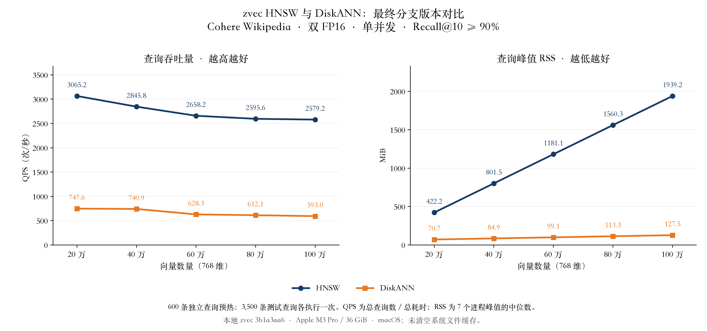

# zvec DiskANN 与 HNSW 测试报告

测试日期：2026-11-10。本轮使用本地 zvec 分支 `perf/diskann-bounded-read-cache` 的最终提交 `3b1a3aa62e8d5078960a013877ddc4b14a174093`，两种索引均重新建库并通过同一动态库的 `Collection::query` 测试。

## 结论

在 20 万至 100 万条 Cohere 向量上，DiskANN 的查询峰值 RSS 比 HNSW 低 **83.3%–93.4%**；QPS 为 HNSW 的 **0.23–0.26 倍**。两种索引各规模的整体 Recall@10 为 **92.10%–95.09%**，均超过 90%。表中保留实际召回率，并非宣称两边召回率完全相等。

## 查询结果

| 向量数 | HNSW QPS | DiskANN QPS | HNSW RSS（MiB） | DiskANN RSS（MiB） | HNSW Recall@10 | DiskANN Recall@10 |
|---|---:|---:|---:|---:|---:|---:|
| 20 万 | 3065.2 | 747.6 | 422.2 | 70.7 | 95.09% | 93.98% |
| 40 万 | 2845.8 | 740.9 | 801.5 | 84.9 | 94.49% | 92.10% |
| 60 万 | 2658.2 | 628.3 | 1181.1 | 99.1 | 94.26% | 93.68% |
| 80 万 | 2595.6 | 612.1 | 1560.3 | 113.3 | 93.97% | 93.57% |
| 100 万 | 2579.2 | 593.0 | 1939.2 | 127.5 | 93.65% | 93.35% |

QPS = 每种索引、每个规模的 3,500 次查询 / 7 个测试进程的总查询耗时。RSS = 7 个独立进程生命周期内峰值 RSS 的中位数，包含打开、预热和测试；不是稳态内存，也不是进程内存上限。单个 500 查询分片的最低 Recall@10 为 91.66%。每轮原始值及范围见 [测试记录](results/final-native/measure/runs.json) 和 [汇总](results/final-native/measure/summary.json)。

## 测试方法

- 数据来自 [Wikipedia-Cohere / Big ANN Benchmarks](https://comp21storage.z5.web.core.windows.net/wiki-cohere-35M/)，768 维。恢复此前同一百万样本，完整 FP32 文件 SHA-256 为 `cfdb2041e2bde4d93d5f2f75feb949701298817a51147512895da3c05ce03d2b`；五档规模取其前缀。
- 两边均存储 FP16、使用 Cosine、返回 top-10 文档 ID。GT 按实际抽样子集的 FP32 输入进行穷举 FP64 余弦计算；数据逐字节恢复后复用已校验的 GT，新增第 7 分片在 20/40 万上的 GT 重新穷举，并用独立标量计算核对。
- 600 条预热、400 条验证、3,500 条测试查询互不重叠，已检查源行号及 FP32/FP16 内容。正式测试分为 7 组，每组 500 条；每条测试查询在每种索引、每个规模下只执行一次，不参与该轮预热或调参。这些查询曾用于前轮比较，因此本轮是回归验证。
- 在验证集上按预先固定的递增候选列表，选择首个 Recall@10 ≥92% 的参数，为正式测试的 90% 门槛留出余量；随后冻结参数。测试交替索引顺序和数据规模顺序，不删除慢轮次，也不为了使曲线单调而替换数据。
- HNSW：`M=50`、`ef_construction=500`。DiskANN：构图 `R=64`、`L=200`、PQ64；每个图文件的读取与范数缓存合计 8 MiB、每个标量 IPC 文件页缓存 1 MiB、每个图 reader 24 个 I/O 工作线程。后一组是显式测试配置，不是默认参数。
- 单个并发查询、一个查询计算线程，建库两边均为 8 个工作线程。HNSW 保留当前分支原有 mmap 路径，DiskANN 使用分支中的有界缓存读取。两边均包含 Collection、文档 ID 映射和结果回填成本。
- Apple M3 Pro / 36 GiB / macOS。正式计时期间没有本任务的编译、下载或建库；其他应用正常运行，不清空系统文件缓存，结果不代表全冷启动或多并发吞吐。

| 向量数 | HNSW ef | DiskANN 查询 L |
|---|---:|---:|
| 20 万 | 48 | 80 |
| 40 万 | 48 | 64 |
| 60 万 | 48 | 80 |
| 80 万 | 48 | 80 |
| 100 万 | 48 | 80 |

## 建库峰值 RSS

| 向量数 | HNSW（MiB） | DiskANN（MiB） |
|---|---:|---:|
| 20 万 | 761.8 | 831.2 |
| 40 万 | 1484.8 | 1557.3 |
| 60 万 | 2136.5 | 2254.0 |
| 80 万 | 2835.5 | 3008.1 |
| 100 万 | 3539.8 | 3628.7 |

每种索引、每个规模新建一次，以 `/usr/bin/time -l` 记录完整建库进程峰值；这是单次观测。查询侧低 RSS 不意味着建库也同样低，建库与查询应分别评估。

## 本轮代码精简

合并节点缓存命中与并发发布检查中的重复查找和 Clock 更新；未命中读取共用同一逻辑，错误数组仅按未命中数量分配。保留缓存准入、淘汰、PQ 兼容与预算回退、线程池和诊断能力。预算、搜索策略、距离计算及文件格式均未改动。

这是小范围代码整理，本轮没有测精简前后差值，不能把 DiskANN 与 HNSW 的性能差异归因于这次精简。相关 C++ 测试 95 项通过、2 项跳过（x86 AVX 专用测试），详见 [测试结果](results/final-native/cpp-tests.json)。两种索引的小规模建库与 Collection 查询烟雾测试均通过。

## 复现与证据

- [构建与源码标识](results/final-native/source-build.json)、[冻结配置](results/final-native/configuration.json)、[调参结果](results/final-native/validation/runs.json)、[数据清单](results/final-native/dataset.json)、[索引文件哈希](results/final-native/index-files.json)。
- [完整原始返回 ID、GT 和日志](results/final-native/raw-evidence.json.gz)、[独立核验](results/final-native/report-audit.json)、[执行审计](results/final-native/measure/audit.json)、[SVG 曲线图](results/final-native/qps-memory.svg)。
- 脚本：`restore_cohere.py` 恢复数据，`native-harness` 链接指定的本地 zvec 库，`run_final_native.py` 分阶段建库／验证／测试，`report_final_native.py` 独立核算并生成本报告。运行目录：`/Users/xingrui/Documents/workspace/zvec/zvec_grep_diskann/.benchmarks/20261110-hnsw-diskann`。
