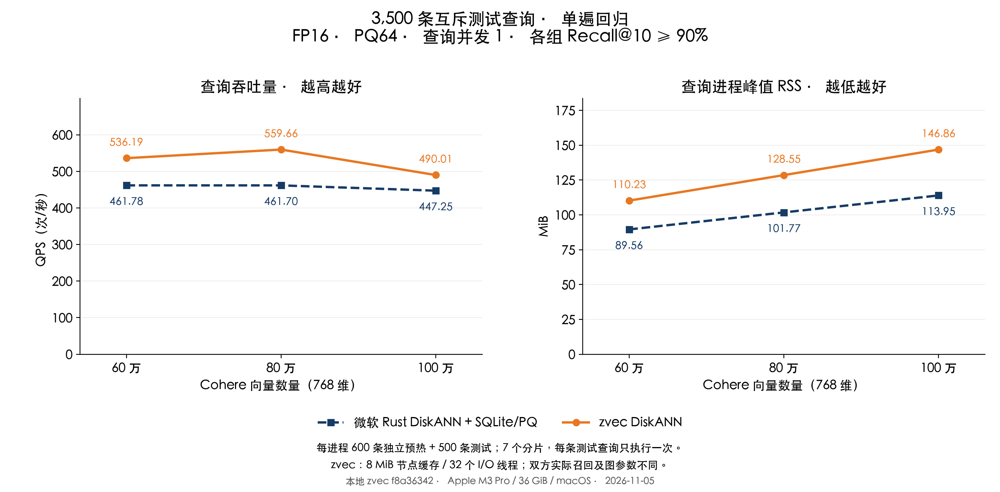

# Cohere：降低 zvec DiskANN RSS 后的单遍查询对比

测试日期：2026-11-05。Apple M3 Pro、36 GiB、macOS；本地 zvec 源码 `f8a36342`。

**三个规模均保持 QPS 领先、召回率超过 90%，同时显著降低 zvec 的 RSS。** 同轮独立验证对照中，相比上一版 64 MiB 缓存配置，RSS 从约 177／199／221 MiB 降至 110／128／146 MiB。正式 3,500 条单遍回归查询中，QPS 比微软适配层高 **9.56%–21.22%**。百万组 RSS 为 **146.86 对 113.95 MiB**，仍多 32.91 MiB，尚未达到相同内存占用。

## 正式结果

沿用相同 Cohere 60／80／100 万向量索引、768 维、cosine、FP16、PQ64、top-10。600 条预热、400 条验证与 3,500 条测试查询互不重叠。测试查询在此前轮次使用过，本轮只用于冻结后的回归，不称为全新盲测。七个互斥分片各 500 条，每个实现、每个规模下每条测试查询仅执行一次；每个进程先执行独立预热集一次。

QPS = 3,500 / 七个计时批次的总秒数；RSS 为七个查询进程峰值的中位数，包含加载、预热、查询和退出，不含建库。

| 向量数 | zvec DiskANN QPS | 微软 QPS | QPS 提升 | RSS：zvec / 微软（MiB） | Recall@10：zvec / 微软 |
|---|---:|---:|---:|---:|---:|
| 60 万 | 536.19 | 461.78 | 16.11% | 110.23 / 89.56 | 92.94% / 95.82% |
| 80 万 | 559.66 | 461.70 | 21.22% | 128.55 / 101.77 | 92.76% / 95.59% |
| 100 万 | 490.01 | 447.25 | 9.56% | 146.86 / 113.95 | 92.81% / 95.35% |



| 向量数 | zvec 分片 QPS 范围 | 微软分片 QPS 范围 | zvec 配对领先分片数 |
|---|---:|---:|---:|
| 60 万 | 491.72–576.93 | 417.17–489.01 | 7 / 7 |
| 80 万 | 514.84–580.91 | 436.61–481.65 | 7 / 7 |
| 100 万 | 434.65–539.92 | 423.77–462.15 | 6 / 7 |

全部 42 个正式进程最低 Recall@10 为 **92.20%**。所有分片均保留；汇总领先不代表每条请求都更快。不同分片使用不同查询，其范围不能当作重复测量置信区间。

## 内存减少在哪里

以下为同轮 400 条独立验证查询、各三轮新进程的对照。RSS 取峰值中位数，QPS 按总计时合并；旧版是源码 `047ebaf4`、64 MiB 缓存、24 个 I/O 线程，新版为 8 MiB、32 个线程。搜索批次策略和 L 也有调整，因此这是完整配置对照。

| 向量数 | 旧版 RSS（MiB） | 本轮 RSS（MiB） | 减少（MiB） | 降幅 | QPS：旧版 → 本轮 |
|---|---:|---:|---:|---:|---:|
| 60 万 | 176.77 | 109.56 | 67.20 | 38.02% | 541.34 → 543.28 |
| 80 万 | 199.00 | 127.80 | 71.20 | 35.78% | 547.13 → 561.49 |
| 100 万 | 221.05 | 146.06 | 74.98 | 33.92% | 505.23 → 523.54 |

1. **节点缓存从 64 MiB 缩至 8 MiB。** 每组用固定长度的偏移历史识别重复访问；组满后，大部分首次访问不占缓存，仅周期性放行以淘汰旧热点。历史元数据计入原预算。缓存保存的节点字节不变，不缓存查询答案。
2. **无损压缩规则 key 与 ID 映射，去掉整段临时拷贝。** 以 4 KiB 缓冲逐项校验；连续 key 只保存起始值，恒等映射无需数组。不符合条件时直接读取原数组作为最终缓冲，不改磁盘格式。百万条原数组本体约 11.44 MiB，另外省去加载临时块及其分配器驻留开销。隔离验证在相同 8 MiB 缓存、L=108、24 线程下，RSS 为 **165.09 → 145.75 MiB**，有序结果完全一致；该差额包含进程峰值与分配器行为，不能全部解释为仍存活对象的大小。
3. **用读取并行度补偿小缓存的未命中。** 32 个固定 I/O 线程；仅 macOS 节点读取且线程数至少 24 时，将批次宽度从 `min(max(8,L/5),32)` 调整为 `min(max(8,L/3),32)`，仍受扇区缓冲容量限制。较宽批次改变图探索顺序，因此重新在验证集选择 L=84／84／90，验证召回分别为 92.225%／92.00%／91.90%。默认窄线程池及其他存储路径保留原策略。

同 L=108、24 线程的独立读取诊断中，仅加入准入策略，8 MiB 缓存的 QPS 为 **474.88 → 492.16**，实际 pread 从 **145,188 → 135,919**，有序结果一致。此为单次验证诊断，含 600 条预热和 400 条验证，不能替代正式成绩或视为独立重复实验。

## 仍然存在的内存差距与取舍

双方百万条 PQ64 编码本体仍各约 **61.04 MiB**，本轮没有降低 PQ 精度、裁剪编码或把它移出常驻内存。zvec 还承担完整 Collection、主键正排、其他元数据、读取线程和缓冲的成本；微软组是 **Microsoft Rust DiskANN 0.61.0 + 自定义 SQLite/PQ 适配层**，并非官方原生 SSD 引擎。剩余差额未逐项完整归因，不能都算作节点缓存。

8 MiB 缓存是速度和内存的取舍。百万独立验证诊断中，关闭缓存为 139.78 MiB、392.71 QPS；4 MiB 为 142.03 MiB、493.71 QPS；8 MiB 为 146.05 MiB、522.82 QPS。保留 8 MiB 是为 QPS 领先留出余量，没有用正式测试结果选择预算。

zvec 保留 `F_NOCACHE`、关闭预读；微软仍为 SQLite 256 KiB 堆页缓存、最多 16 MiB mmap，可使用系统文件缓存。RSS 不包含进程外全部文件缓存，因此本报告证明的是进程 RSS 的下降，未测量对其他应用的全部影响。节点缓存预算有上限，整个进程 RSS 仍随 PQ 和数据规模增长。

## 验证边界与复现

- 同一采样基库、精确 GT 与图索引不变，核对数据摘要、源查询行号、FP32 和 FP16 内容互斥，索引文件大小及修改时间前后不变。查询并发为 1。微软 L=128、重排 128；双方实际召回、图出度和码本不同，属于均超过 90% 门槛的比较。
- 候选和预算试验只使用验证集；先完成三轮交替对照，再冻结源码、库、二进制与参数，之后执行七个正式分片。正式测试没有重新调参、重复执行或挑选慢分片。系统文件缓存没有清空，其他桌面应用未隔离；20／40 万本轮未测。
- 初次交替验证曾硬链接基线可执行文件，观察到召回和 RSS 不一致，疑似加载路径复用。该批 **27 个验证进程全部排除**并保留原记录。正式测试前改为独立可执行文件、绝对动态库依赖和正常代码签名；每个进程在任何查询前用 `dladdr` 核对实际加载路径，父进程核对库摘要。修复后同一验证配置的有序结果在三轮间完全一致。
- **46 项 C++ 测试通过**，覆盖跨块连续 key、非连续及乱序 key、uint64 边界、clone 后释放原对象、截断段拒绝、小缓存准入、热点过期淘汰、并发访问、读取错误回收及跨页建库查询。没有新增 ThreadSanitizer 通过的声明。
- Rust 测量程序构建和 Clippy 检查通过；沿用原测量程序的数组分块及枚举表示，以命令行豁免 `chunks_exact_to_as_chunks`、`large_enum_variant` 两项风格提示，其他警告按 `-D warnings` 检查，避免正式测量后更改已冻结的程序源码。
- 保存 **77 份加载路径已验证的有效进程记录**（27 验证、8 归因对照、42 正式），另保留 54 份探索记录及 27 份排除记录。探索阶段未逐进程验证加载路径，主要结论只依据修复后的记录。

本轮在打开集合前设置：

```bash
export ZVEC_DISKANN_READ_CACHE_MIB=8
export ZVEC_DISKANN_READ_WORKERS=32
```

源码默认仍为 32 MiB 缓存、4 个读取线程，需显式采用本轮配置；多个图文件各自计预算。已发布 Rust／Node SDK 尚未包含这些源码修改，需要链接本地重新编译的库。

[独立核验](results/memory-optimization/audit.json)、[正式汇总](results/memory-optimization/measure/summary.json)、[原始结果与 GT](results/memory-optimization/raw-evidence.json.gz)、[冻结配置](results/memory-optimization/measure/configuration.json)、[源码补丁](results/memory-optimization/measure/source.patch)、[归因对照](results/memory-optimization/controls/runs.json)、[排除说明](results/memory-optimization/excluded-records.json)、[C++ 测试](results/memory-optimization/cpp-tests.json)。

复现脚本：[构建](build_memory_variant.py)、[独立链接与加载校验](prepare_memory_binaries.py)、[验证预算](run_memory_pilot.py)、[归因对照](run_memory_controls.py)、[冻结对比](run_memory_comparison.py)、[核验与绘图](publish_memory_optimization.py)。入口程序为 [memory-bench.rs](harness/src/bin/memory-bench.rs)，绝对链接和签名信息见[加载隔离记录](results/memory-optimization/loader-isolation.json)；完整本机目录 `/tmp/zvec-memory-opt-20261105`。此前 64 MiB 配置的报告见[上一轮](REPORT_UNSEEN_SPEED_CN.md)。
