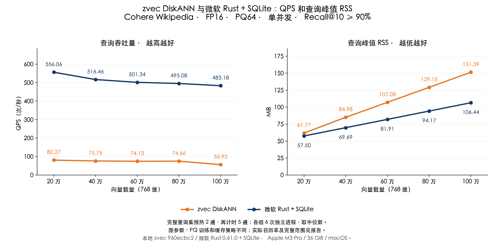

# zvec DiskANN 与微软 Rust DiskANN + SQLite 对比

测试日期：2026-11-04。设备：Apple M3 Pro、36 GiB 内存、macOS。

**微软组是此前的微软 Rust DiskANN + 自定义 SQLite/PQ 适配方案，不是微软官方原生 SSD 存储实现。** zvec 使用本地源码 `960ecbc2` 编译的原生库。本报告比较两套静态向量查询方案，不能据此给两种图算法或完整产品能力排位。

## 实测结果

相同 Cohere Wikipedia 样本，768 维、cosine、top-10、FP16 存储、查询先舍入 FP16、PQ64、单并发。沿用各自独立验证集已选参数，再次验证全部达到 92%；测试集目标为 Recall@10 ≥90%，未按测试结果调参。实际召回率不同，逐项列出。

两组均先用 20 条独立查询预热，再用完整 200 条测试查询预热 2 遍，最后计时 5 遍。每组 6 个新进程，按轮次交替规模和实现顺序；以下均为本轮中位数，没有拼接旧测试的计时数据。

| 向量数量 | zvec QPS | 微软 Rust + SQLite QPS | zvec RSS（MiB） | 微软 Rust + SQLite RSS（MiB） | zvec / 微软 Recall@10 |
|---|---:|---:|---:|---:|---:|
| 20 万 | 80.27 | 556.06 | 61.77 | 57.50 | 94.40% / 97.55% |
| 40 万 | 75.75 | 516.46 | 84.98 | 69.69 | 93.95% / 96.85% |
| 60 万 | 74.13 | 501.34 | 107.08 | 81.91 | 94.10% / 97.00% |
| 80 万 | 74.66 | 495.08 | 129.15 | 94.17 | 93.35% / 96.65% |
| 100 万 | 55.93 | 483.18 | 151.39 | 106.44 | 93.10% / 96.10% |



100 万条时，微软方案的 QPS 为 zvec 的 **8.64 倍**。这描述本机、当前参数和有限查询工作集的结果，不是通用性能倍数。两组实际 Recall@10 分别为 zvec **93.10%**、微软方案 **96.10%**。

## zvec QPS 是否有提升空间

本轮百万组每 1000 次查询的墙钟耗时中位数为 zvec **17.881 秒**、微软方案 **2.070 秒**；对应 CPU 时间为 **2.128 / 2.065 秒**，主动上下文切换为 **218545 / 0 次**。CPU 与墙钟时间不是同一种计量，也不把二者差额全部算成磁盘时间。

结合本地源码，**优先验证读盘与缓存优化的收益**更有依据：

- 当前 zvec DiskANN 的 macOS 读取路径默认请求 `F_NOCACHE`、关闭预读，读取批次走同步 `pread`；热点节点缓存默认值为 0。这有助于控制缓存占用，也可能增加重复查询的等待。`F_NOCACHE` 是请求内核尽量减少缓存，不保证每次读取都访问物理设备。
- 微软旧适配层采用 SQLite 256 KiB 堆页缓存和最多 16 MiB 文件映射，并可受益于系统文件缓存；PQ 编码常驻内存，前 128 个候选读取 FP16 原向量重排。其预热后优势不能仅归因于 PQ 算术或图搜索。
- 本地 zvec 已有 `BufferPoolAlignedFileReader` 和节点缓存路径，可以进一步测试有明确容量上限的热点页/节点缓存，例如 16／32／64 MiB，观察 QPS、RSS 和召回的变化。本轮未修改缓存策略，也未实测这些容量的收益。
- 应用当前默认 `L=max(300,topk)`，高于本轮 zvec 的 96／128。可将搜索候选数开放为配置，用真实工作区查询验证召回；不能直接把 Cohere 的最优参数当作应用通用参数。

以上是基于测量与代码的优化优先级判断，没有承诺优化后能达到微软组的 QPS。源码证据见 `zvec/src/core/algorithm/diskann/diskann_file_reader.cc`、`diskann_indexer.cc`、`diskann_searcher.cc`；微软适配见 [lib.rs](../../crates/zg-diskann/src/lib.rs)和[experimental_pq.rs](../../crates/zg-diskann/src/experimental_pq.rs)。

## 两套方案的差异

| 项目 | zvec DiskANN | 微软 Rust + SQLite |
|---|---|---|
| 实现 | 本地 zvec C++ `960ecbc2` | `diskann` / `diskann-quantization` 0.61.0，加自定义存储与 PQ 查询适配 |
| 图参数 | max_degree=32，build_list=100 | max_degree=48，build_list=100 |
| PQ | 内置 PQ64，各规模独立建库 | PQ64，共享从前 20 万条抽样训练的码本 |
| 存储 | zvec 原生磁盘布局 | SQLite 保存图边和完整 FP16 向量 |
| 场景 | 本轮只读、无过滤向量查询 | 实验性只读、无过滤、连续且全存活节点的静态 PQ 路径 |
| 动态功能 | 本轮未测增删改与过滤 | 该实验性 PQ 路径尚未实现增删改、过滤和码本更新 |

双方复用此前各自构建的索引，实验前后文件大小、修改时间一致；码本、编码、数据及 GT 哈希重新核对。图参数、PQ 训练、存储及缓存策略不同，因此这是同一最低召回目标下的方案比较，不是只替换算法内核的单变量实验。

| 向量数量 | zvec L | 微软 L / 重排数 | zvec / 微软验证集 Recall@10 |
|---|---:|---:|---:|
| 20 万 | 96 | 128 / 128 | 92.75% / 97.10% |
| 40 万 | 96 | 128 / 128 | 92.40% / 95.75% |
| 60 万 | 96 | 128 / 128 | 92.85% / 94.80% |
| 80 万 | 96 | 128 / 128 | 92.25% / 94.85% |
| 100 万 | 128 | 128 / 128 | 93.10% / 94.60% |

## 计量边界与波动

QPS = 1000 / 5 个计时遍次的累计秒数，含 FP16 查询转换、搜索、重排（微软组）、ID 提取和一致性检查，输入文件提前读入。两组都使用同一 zvec 库初始化单线程应用运行时；微软组的向量搜索调用微软 Rust 图/PQ 库。每遍结果 ID 一致，召回对照同一原始 FP32 的精确 cosine GT。

RSS 为 `/usr/bin/time -l` 的进程峰值驻留内存，包含打开、PQ 编码加载、预热和查询，不包含建库与训练。**RSS 不包含进程之外的全部系统文件缓存；微软组较低的 RSS 不能据此推导为较低的系统总内存占用。** 两组没有清空系统缓存或隔离其他应用，只报告固定查询工作集的预热后吞吐量，不代表冷启动、随机新查询或高并发。

| 向量数量 | zvec QPS 范围 | 微软方案 QPS 范围 | zvec RSS 范围（MiB） | 微软方案 RSS 范围（MiB） |
|---|---:|---:|---:|---:|
| 20 万 | 80.03–80.69 | 529.71–574.32 | 61.64–61.84 | 57.45–57.66 |
| 40 万 | 75.33–75.97 | 486.62–525.75 | 84.91–85.20 | 69.61–70.03 |
| 60 万 | 73.10–74.50 | 459.70–512.19 | 106.98–107.14 | 81.83–82.25 |
| 80 万 | 72.16–75.22 | 465.54–500.36 | 129.09–129.31 | 94.00–94.41 |
| 100 万 | 55.29–56.47 | 446.28–498.26 | 151.22–151.52 | 106.30–106.67 |

## 原始证据与复现

[configuration.json](results/microsoft-comparison/configuration.json) 保存全部参数、两份二进制、库和源文件摘要；[validation.json](results/microsoft-comparison/validation.json)、[runs.json](results/microsoft-comparison/runs.json)、[summary.json](results/microsoft-comparison/summary.json) 保存验证、60 次正式测量和汇总；[audit.json](results/microsoft-comparison/audit.json) 记录独立核验。[raw-evidence.json.gz](results/microsoft-comparison/raw-evidence.json.gz) 包含 70 个进程的返回 ID、对应 GT、分阶段计数与原始计时输出。

建库、码本来源分别见 [zvec 初次记录](REPORT_NATIVE_CN.md)和[微软方案 PQ 记录](REPORT_PQ_CN.md)。复现本次对比需要保留这些实验目录，输出目录必须不存在。运行前按 [zvec 复测说明](REPORT_RETEST_NATIVE_CN.md)构建并固定链接 `native-retest`；微软适配程序使用同一构建环境：

```bash
BASE=/tmp/zvec-local-cohere-20261104
ZVEC_LIB_DIR="$BASE/build/lib" ZVEC_INCLUDE_DIR="$PWD/../zvec/src/include" ZVEC_AUTO_BUILD=0 \
  RUSTFLAGS='-C link-arg=-Wl,-headerpad_max_install_names' \
  cargo build --offline --release --manifest-path rust/benchmarks/diskann/harness/Cargo.toml \
  --features experimental-pq --bin microsoft-retest --target-dir "$BASE/rust-target"
install_name_tool -change @rpath/libzvec_c_api.dylib "$BASE/build/lib/libzvec_c_api.dylib" \
  "$BASE/rust-target/release/microsoft-retest"
codesign --force --sign - "$BASE/rust-target/release/microsoft-retest"
python3 rust/benchmarks/diskann/run_microsoft_comparison.py \
  --native-binary "$BASE/rust-target/release/native-retest" \
  --microsoft-binary "$BASE/rust-target/release/microsoft-retest" \
  --data /tmp/zvec-cohere-million/data --native-experiment "$BASE/experiment" \
  --microsoft-experiment /tmp/zvec-cohere-million/experiment \
  --pq-experiment /tmp/zvec-cohere-pq64-20261104/experiment \
  --pq-preparation /tmp/zvec-cohere-pq64-20261104/preparation \
  --native-library "$BASE/build/lib/libzvec_c_api.dylib" --source-root "$PWD/../zvec" \
  --output /tmp/zvec-microsoft-comparison-reproduction
python3 rust/benchmarks/diskann/publish_microsoft_comparison.py \
  /tmp/zvec-microsoft-comparison-reproduction /tmp/zvec-cohere-million/data
```
