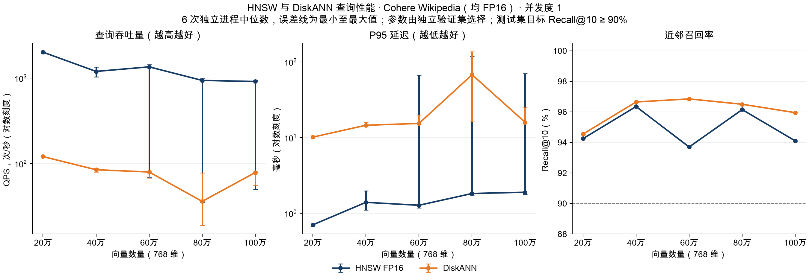
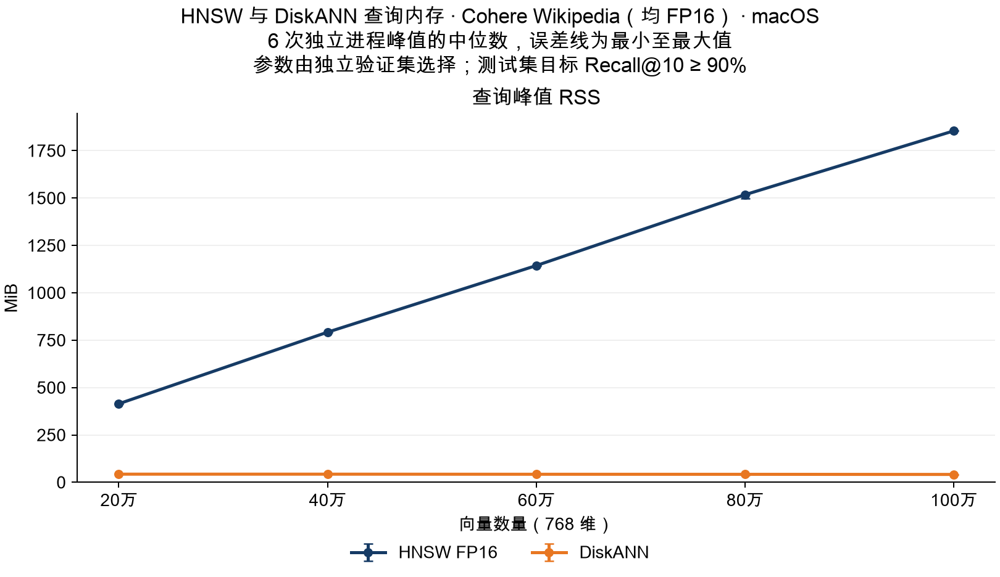

# HNSW 与 DiskANN：20 万至 100 万 Cohere 向量测试

> 历史测试：本文的 DiskANN 使用微软 Rust 库和 SQLite 存储，测试代码截至 `a885372`。2026-11-04 后主引擎已切换为 zvec 内置 DiskANN；本文数值不代表新后端性能。

测试日期：2026-11-03（Asia/Shanghai）。

本轮延续[原测试报告](REPORT_CN.md)的双 FP16、Recall@10 ≥ 90% 目标实验，增加 **20 万、40 万、60 万、80 万、100 万**五个规模。查询内存统一使用峰值 **RSS**；HNSW 为深蓝色，DiskANN 为橙色。FP16 后端实现版本为 `74c7d39`，扩展实验脚本版本为 `5200c7f`。

**80 万条补充复测已完成：** DiskANN 原 QPS 中位数 **36.23**，同协议交替复测为 **74.17**，随后单独复测为 **84.24**；测试 Recall@10 都为 **96.50%**，RSS 中位数仍约 **42.3 MiB**。原低谷在本次未重现，尚不能确定其具体原因。以下原始表格与曲线完整保留；新旧逐次数据、图表和审计见[80 万条复测报告](REPORT_RETEST800K_CN.md)。

## 主要观察

五个规模、两组引擎的测试召回率均达标，实际 Recall@10 为 **93.70%–96.85%**。100 万条时，两组均选到参数 48：HNSW / DiskANN 的 QPS 中位数为 **915.12 / 78.75**，查询峰值 RSS 中位数为 **1854.43 / 41.65 MiB**，实际召回率为 **94.10% / 95.95%**。

从 20 万扩展到 100 万，HNSW 的 RSS 中位数由 **414.58 增至 1854.43 MiB**，约为原来的 **4.47 倍**；DiskANN 在五个规模的中位数为 **41.65–43.06 MiB**。这支持当前 DiskANN 后端在本轮单并发协议下，查询进程 RSS 随库规模增长更平缓；小幅下降不应解释成库越大越省内存。100 万条时，DiskANN 的 RSS 低约 **97.75%**，HNSW 的 QPS 中位数约为其 **11.62 倍**。

RSS 曲线和吞吐量必须分开解读。60 万、80 万、100 万均出现过明显慢运行，尤其 80 万时 DiskANN 六次 QPS 为 18.98–78.17。全部运行保留在结果和误差线中；本轮没有固定文件缓存状态或隔离其他系统活动，因此不能把这些 QPS 中位数当作稳定容量承诺，也不能仅由曲线判定固定性能拐点。低进程 RSS 同样不等于没有系统文件缓存或磁盘 I/O 开销，尚未测量其他应用的响应。

<!-- MEASUREMENTS_START -->

## 实测结果

五个规模全部完成，共 60 个测试进程、12,000 次计时查询。两组在每个规模的全部运行均达到 Recall@10 ≥ 90% 目标。

下表为六次独立进程指标的中位数。

| 向量数 | 引擎 | 参数 | 验证 Recall@10 | 测试 Recall@10 | QPS ↑ | P50 ms ↓ | P95 ms ↓ | RSS MiB ↓ |
|---:|---|---|---:|---:|---:|---:|---:|---:|
| 200,000 | HNSW | ef=32 | 92.05% | 94.25% | 2016.25 | 0.49 | 0.71 | 414.58 |
| 200,000 | DiskANN | L=32 | 93.05% | 94.55% | 121.05 | 8.27 | 10.18 | 43.06 |
| 400,000 | HNSW | ef=48 | 94.00% | 96.35% | 1200.45 | 0.75 | 1.40 | 792.25 |
| 400,000 | DiskANN | L=48 | 94.40% | 96.65% | 84.97 | 11.88 | 14.61 | 43.02 |
| 600,000 | HNSW | ef=32 | 92.25% | 93.70% | 1356.58 | 0.68 | 1.28 | 1143.71 |
| 600,000 | DiskANN | L=48 | 94.40% | 96.85% | 79.97 | 12.64 | 15.44 | 42.55 |
| 800,000 | HNSW | ef=48 | 94.95% | 96.15% | 941.98 | 0.97 | 1.83 | 1517.68 |
| 800,000 | DiskANN | L=48 | 94.20% | 96.50% | 36.23 | 24.29 | 67.96 | 42.28 |
| 1,000,000 | HNSW | ef=48 | 94.55% | 94.10% | 915.12 | 1.00 | 1.90 | 1854.43 |
| 1,000,000 | DiskANN | L=48 | 94.60% | 95.95% | 78.75 | 12.66 | 15.98 | 41.65 |





[性能图 SVG](results/million/performance.svg) · [内存图 SVG](results/million/memory.svg)

## 计时波动

以下为同一组固定查询的六次独立进程 QPS 范围；完整 P95 和 RSS 范围也记录在汇总 CSV 中。

| 向量数 | HNSW QPS 范围 | DiskANN QPS 范围 |
|---:|---:|---:|
| 200,000 | 1993.41–2033.10 | 119.09–122.92 |
| 400,000 | 1039.32–1352.22 | 79.93–88.70 |
| 600,000 | 69.55–1446.68 | 67.95–81.66 |
| 800,000 | 35.06–999.92 | 18.98–78.17 |
| 1,000,000 | 49.95–945.58 | 56.25–80.40 |

60 万条 HNSW 的六次 QPS 范围为 **69.55–1446.68**，P95 为 **1.19–67.29 ms**。首次运行明显较慢，全部六次纳入统计，未丢弃慢运行或只报告最快值；本轮未隔离系统负载与文件缓存，尚未确定该次变慢的原因。

首次 HNSW 进程的 `/usr/bin/time -l` 日志记录 **69,780 次 page faults**，第二次为 **1 次**。这两次的缺页情况明显不同，是解释波动时必须考虑的证据；但计数覆盖打开索引、预热和测量的整个进程，不能全部归因到查询计时区间，也不足以单独证明全部减速的原因。完整进程计数见[诊断记录](results/million/process-diagnostics.json)。六次运行会复用系统文件缓存，20 条预热也不能保证整个索引的文件页均已驻留。

40 万到 60 万时，HNSW 验证集选择的 ef 从 48 降到 32，测试召回率也由 96.35% 变为 93.70%。因此 QPS 中位数回升不能解释为库越大越快；不同规模的 GT、独立构图和所选参数均可能不同。

80 万条的波动也明显：HNSW 六次 QPS 为 **35.06–999.92**，DiskANN 为 **18.98–78.17**；对应 P95 范围为 **1.71–118.16 ms** 和 **16.19–136.28 ms**。HNSW 第二次运行记录 94,995 次 page faults，第一次为 0 次。DiskANN 的部分慢运行却没有相同比例的缺页计数；本轮没有逐请求 I/O 和系统负载跟踪，不能仅凭这些计数拆分缓存、磁盘读取与调度各自的影响。这是本机交替运行协议下的完整观测，不是严格固定缓存状态的稳定吞吐量比较。

100 万条 HNSW 的首次运行也较慢：QPS 为 49.95，P95 为 70.58 ms，整个进程记录 95,945 次 page faults；六次 QPS 中位数为 915.12。DiskANN 六次 QPS 为 56.25–80.40，中位数 78.75。同为 L=48，DiskANN 的 QPS 中位数从 80 万的 36.23 回到 100 万的 78.75，进一步说明不能将 80 万的下降当作由数据量单独决定的固定拐点。
<!-- MEASUREMENTS_END -->

## 数据与精确真值

继续使用 [Big ANN Benchmarks 的 Wikipedia-Cohere 分发版本](https://github.com/harsha-simhadri/big-ann-benchmarks/blob/main/benchmark/datasets.py#L460-L501)：库为 3,500 万条英文 Wikipedia 文本的 768 维 Cohere 向量，查询来自独立的 5,000 条 Simple Wikipedia 文本向量。查询是文本段落向量，不是人工搜索问题或代码检索查询。

原来的 10 万条向量、文档 ID 与输入顺序全部保留，并用 SHA256 验证前缀字节完全相同。固定新种子 `20261105`，从未被原实验选中的数据块中再随机选择 1,100 个连续块，每块 1,000 条。下载校验同一源文件 ETag 和 HTTP Range 字节范围；用 FP64 归一化并保存为 FP32，将新增候选全局打乱，追加 90 万条唯一向量。选满前跳过 144 个重复向量，未遇到与测试或验证查询完全相同的新增向量。

这仍是分块抽样，不是对 3,500 万行逐行独立抽样。五个规模是同一百万样本的嵌套前缀；新增样本不会替换旧 10 万条，因此旧规模可以回归核对，但旧轮计时结果不与本轮合并。

测试和验证查询均沿用原实验：各 20 条预热、200 条正式查询，两组查询的源行号和向量不重叠。所有 440 条查询都用于排除库中的完全相同向量。每个库规模都重新生成精确 GT，具体方法为：

1. 在原始 FP32 库向量和查询向量上，以 FP64 计算 cosine 分数；每次扫描 4,000 条库向量，合并全部已扫描向量的精确 top-11。
2. 在 10 万及五个新增规模处保存各自 top-10；同分时按文档 ID 排序。记录第 10、11 名的最小分数差。
3. 10 万条处，200 个测试查询和 200 个验证查询的 top-10 与原有 GT 全部相同。
4. 每个检查点额外对测试、验证集各自的第 1 和第 200 个查询，用逐元素乘加求和复核，结果与矩阵乘法一致。分块 top-11 合并也经过含同分数据的完整排序交叉检查。

没有复用官方全库 GT，也没有从全库近邻中过滤抽样 ID。两组均对照原始 FP32 真值，保留 FP16 量化造成的召回损失。数据准备、GT 计算、文件哈希和存储校验均在查询计时之外。

## 测量协议

| 项目 | 设置 |
|---|---|
| 设备 | Apple M3 Pro，36 GiB RAM，macOS 26.6.2 |
| 输入 | 768 维，cosine，top-10，无元数据过滤，不返回向量 |
| HNSW | FP16，M=50，efConstruction=500，查询 mmap=true |
| DiskANN | FP16，degree=48，build L=100；只读 SQLite cache 目标 256 KiB，mmap 上限 16 MiB |
| 查询精度 | 两组查询均经过 FP16 舍入；DiskANN 解码为 FP32 后使用原有 FP64 距离累加 |
| 目标与选参 | 测试 Recall@10 ≥ 90%；独立验证集 ≥ 92% 后冻结参数 |
| HNSW 候选 ef | 10 / 16 / 24 / 32 / 48 / 64 / 96 / 128 / 192 / 256 / 512 |
| DiskANN 候选 L | 20 / 24 / 32 / 48 / 64 / 96 / 128 / 192 / 256 / 512 |
| 重复 | 每个规模、每个引擎 6 个独立进程；两轮各 3 次，交替引擎顺序 |
| 查询量 | 每进程预热 20 次，再测量 200 次；五个规模共 12,000 次计时查询 |
| 并发 | 单个在途查询；所有建库和查询进程顺序执行 |
| 系统缓存 | 不清空文件缓存，不人为制造内存压力 |
| RSS | `/usr/bin/time -l` 的进程峰值，包含索引打开和预热；MiB = 2²⁰ 字节 |

候选网格和选参规则在开始测量前确定。每个规模上，两组都按参数从小到大尝试，选第一个验证 Recall@10 ≥ 92% 的值；两组参数均冻结后才测该规模的测试集。2 个百分点的余量不是统计置信保证，不根据测试结果重新选参数。HNSW 显式关闭线性搜索和 refiner。

HNSW 在每个规模独立建库。DiskANN 从已经校验并关闭的 10 万条 FP16 数据库开始，复制快照并按输入顺序追加，依次保存各规模索引。每条活跃向量都核对文档 ID、1,536 字节 FP16 载荷，以及与 NumPy 独立 FP16 转换结果相同的字节哈希。该流程测量查询性能，不用增量建库耗时与 HNSW 全量建库耗时比较。

每个规模完成建库和存储校验后才选参、测量；查询完成后再构建下一个规模。建库采用较低进程优先级，查询采用正常优先级，没有并行建库干扰测量。脚本记录数据和可执行文件哈希，并支持从已提交的 SQLite 批次继续建库；未完成的查询批次保留在单独目录，整组重新测量，不挑选其中最快的运行。

**QPS = 200 / 计时批次秒数**，包含读取查询向量、查询调用和结果 ID 收集，不包含索引打开、预热及 JSON 输出。单次延迟包含查询调用和 ID 转换，不含读取查询向量。P50/P95 为每进程 200 次延迟排序后的零基下标 100、190；表中取六个进程指标的中位数，图中误差线为六次最小至最大值，不是置信区间。

DiskANN 保存的是实际的 2 字节 FP16 向量，按访问需要解码；这不是纯 FP16 距离内核，也不会把整库解码进查询进程。应用默认新建精度仍为 FP32，默认查询 L 仍为 512，本轮实验没有改变生产默认值。

## 结果的适用范围

本轮增加的是库规模，并没有增加独立查询样本数。每个规模只构建一份对应引擎的索引，六次运行复用同一份索引和同一组 200 个测试查询，能够观察计时波动，但不能当作 1,200 个独立查询来估计召回置信度，也没有评估多次构图的变异。实际 Recall@10 可能高于 90%，两组也不保证完全相等；这是同一最低召回目标下的固定网格实验，并非全参数空间的最优吞吐量搜索。

RSS 包含驻留的文件映射页，但不是全部系统文件缓存。即使某个引擎的查询 RSS 随规模增长较慢，也不能仅凭这一指标证明对浏览器、IDE 等其他应用没有影响。本轮没有测其他应用的响应时间，也没有进行持续高并发、受控冷缓存或人为系统内存压力实验。

这份报告只描述当前项目后端、设备、抽样和查询协议。测量仅覆盖原生向量后端，不包含 Node 运行时、嵌入模型、全文检索和服务排队。不能将差异泛化为所有 HNSW / DiskANN 实现，也不能把跨轮 QPS 的变化全部归因于库规模。

## 数据与复现

- [汇总 CSV](results/million/summary.csv)、[汇总 JSON](results/million/summary.json)、[每次进程指标](results/million/runs.json)。
- [验证选参记录](results/million/selection.json)、[分规模环境与二进制哈希](results/million/environment.json)。
- [百万样本清单](results/million/dataset.json)、[独立验证集清单](results/million/validation-dataset.json)。
- [结果复核](results/million/audit.json)、[FP16 存储校验](results/million/build-audit.json)、[原始日志哈希](results/million/raw-evidence.json)。
- [样本扩展与精确 GT](extend_cohere.py)、[顺序建库和测量](run_million.py)、[校验与导出](publish_million.py)、[绘图](plot.py)。

小体积结果由 `publish_million.py` 从原始日志重新校验后导出：召回率从返回 ID 与对应规模 GT 重算，QPS 和 RSS 从原始记录核对，汇总中位数及范围重新计算。库向量、源行号映射、精确 GT、逐查询返回 ID 和索引保留在本地，不把大文件提交到 Git。

以下命令接续[原报告](REPORT_CN.md#数据与复现)已经生成的 10 万条数据、独立验证集和 FP16 索引。需要 Python 3.11+、NumPy、curl、Matplotlib、macOS 和仓库 Rust 构建环境；基准目录应位于有充足空间的本地磁盘。

```bash
OPENBLAS_NUM_THREADS=2 VECLIB_MAXIMUM_THREADS=2 \
python3 rust/benchmarks/diskann/extend_cohere.py \
  --previous-data /absolute/path/to/cohere-data \
  --previous-validation /absolute/path/to/cohere-validation \
  --output /absolute/path/to/million-data

python3 rust/benchmarks/diskann/run_million.py \
  --binary "$PWD/native/target/release/zvec-qps-bench" \
  --builder "$PWD/native/target/release/build-index" \
  --data /absolute/path/to/million-data \
  --previous-fp16-index /absolute/path/to/fp16-indexes/diskann_fp16-100000-768/index \
  --output /absolute/path/to/million-experiment

python3 rust/benchmarks/diskann/publish_million.py \
  --data /absolute/path/to/million-data \
  --experiment /absolute/path/to/million-experiment \
  --output /absolute/path/to/million-results

python3 rust/benchmarks/diskann/plot.py \
  /absolute/path/to/million-results/summary.json /absolute/path/to/million-results \
  --dataset 'Cohere Wikipedia（均 FP16）' --recall-target 0.9 --xscale linear \
  --font '/System/Library/Fonts/Supplemental/Arial Unicode.ttf'
```

数据准备脚本可以复用已下载且校验通过的数据块；完整数据清单一旦生成便拒绝覆盖。实验运行器可以复用已完成阶段，继续时要求数据、二进制和测量脚本哈希不变。上述操作仅创建专用基准索引，不操作工作区检索索引。
