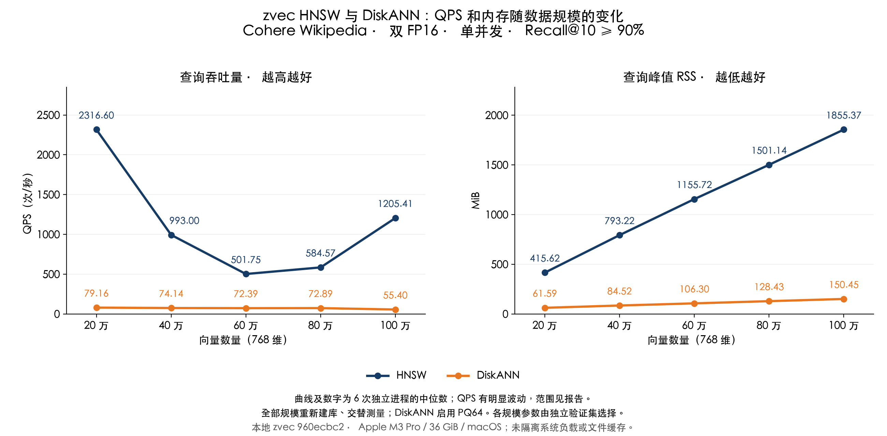

# zvec 原生 DiskANN / HNSW 初次测试详细记录

本轮完成于 2026-11-04T15:17:16.998717+08:00。本文保留首次测试，用于排查 HNSW QPS 回升；完整查询集尚未预热就开始计时，QPS 混合了缺页开销不同的运行状态。最新结果见 [复测记录](REPORT_RETEST_NATIVE_CN.md)和[简要报告](REPORT_BRIEF_CN.md)。



## 数据和 GT

沿用 [Big ANN Benchmarks 的 Wikipedia-Cohere 数据定义](https://github.com/harsha-simhadri/big-ann-benchmarks/blob/main/benchmark/datasets.py)。本地数据抽样、来源行号、随机种子和文件 SHA-256 均保存在 [dataset.json](results/native/dataset.json)，验证查询见 [validation-dataset.json](results/native/validation-dataset.json)。没有重新随机抽样。

对 100 万 FP32 输入执行分块 FP64 cosine 穷举，在每个目标前缀重新生成 top-10，与之前 GT 逐项匹配。并列得分以 ID 排序。独立验证集和测试集各 200 条计分查询，另各有 20 条预热查询。GT 使用原始 FP32；两组索引和查询均为 FP16，因此召回包含量化误差。[核对结果](results/native/data-audit.json)。

## 构建与查询

两种索引均由本地 zvec 源码提交 `960ecbc23f566df729429bdff655ece6dbb2261c` 编译的同一套 Release C++ 原生库执行。Rust 调用层为 `zvec-rust 0.8.0`，通过 `ZVEC_LIB_DIR` 链接本地库，可执行文件中的动态库依赖固定为本地库的绝对路径，并以 `otool` 校验。动态库 SHA-256 为 `d9ad81542a3b186a7caf68f9ae9bd3eba67ea4f9e414920fd7cbc944087e3496`；程序检查可执行文件旁的库与本地构建产物一致，并在实验结束后再次核验库与源码提交。编译器、CMake 参数及第三方依赖提交见 [native-build.json](results/native/native-build.json)。

每个规模从空集合新建，仅含相同的主键和 embedding 字段。测量范围为向量索引查询，不包含完整 zg 的 embedding、FTS、过滤和重排流程。SDK 预编译库的未完成实验未纳入本报告。

| 设置 | HNSW | DiskANN |
|---|---|---|
| 向量 / 查询 | FP16 / FP16 | FP16 / FP16 |
| 距离 | cosine | cosine |
| 图参数 | M=50，ef_construction=500 | max_degree=32，build_list=100 |
| PQ | 无 | 64 段，内置训练和编码 |
| 建库线程 | 8 | 8 |
| 查询线程 / 并发 | 1 / 1 | 1 / 1 |
| 打开方式 | 只读，mmap 开启 | 只读，mmap 开启 |

建库后 flush、optimize、flush，验证文档数量、索引完整度；查询时再检查 FP16 和索引类型。DiskANN 文件核对了 `diskann.vector`、`diskann.pq_data` 段，见 [build-audit.json](results/native/build-audit.json)。使用本地 zvec 的实现，未调用微软 Rust DiskANN 或自建 SQLite 向量存储。

## 参数选择

候选值为 `10, 12, 16, 20, 24, 32, 40, 48, 64, 96, 128, 192, 256, 384, 512, 768, 1024, 1536, 2048`。依升序选择独立验证集首次达到 92% Recall@10 的值，所有参数在查看本轮测试结果前冻结；测试结果不用于再次调参。目标为测试集至少 90%，保留 2 个百分点的验证余量。不同算法、规模的最终召回率不完全相同。

| 向量数量 | HNSW ef | DiskANN L | 验证集 Recall@10：HNSW / DiskANN |
|---|---:|---:|---:|
| 20 万 | 40 | 96 | 92.45% / 92.75% |
| 40 万 | 48 | 96 | 93.00% / 92.40% |
| 60 万 | 40 | 96 | 92.60% / 92.85% |
| 80 万 | 40 | 96 | 92.40% / 92.25% |
| 100 万 | 48 | 128 | 92.95% / 93.10% |

[全部验证试验与所选参数](results/native/selection.json)。基准独立调查询参数，未修改应用默认值。

## 计量与核验

6 轮，每轮每个规模、每种引擎启动新进程。奇数轮倒转规模与引擎顺序，减轻固定顺序偏差；建库和 GT 计算在全部查询测量前结束。每进程 20 次预热、200 条不同测试查询 × 5 遍；每遍返回 ID 一致性由程序断言。重复查询意味着这是有限工作集的预热后测试，不等于 1000 条不同查询或全库冷访问。

各进程 QPS = 1000 / 计时秒数。RSS 为新查询进程整个生命周期的 maximum resident set size，含索引加载和预热；报告分别取 QPS 与峰值 RSS 的中位数，二者不必来自同一进程。只用 RSS，不展示 footprint。未固定文件缓存及系统负载，保留每轮数据和极值供核查，曲线不添加误差棒。

[summary.json](results/native/summary.json) 含中位数与最小／最大值；[runs.json](results/native/runs.json) 含 60 次测量；[environment.json](results/native/environment.json) 含系统信息；[configuration.json](results/native/configuration.json) 含二进制和数据摘要。

以下为 6 个独立进程的最小值至最大值，未剔除慢运行。打开新进程不等于清空系统文件缓存，轮换规模也会改变缓存工作集；本轮没有控制系统缓存和其他应用负载，因此不能仅凭这些日志把波动归因于某一种因素。

| 向量数量 | HNSW QPS 范围 | DiskANN QPS 范围 | HNSW RSS 范围（MiB） | DiskANN RSS 范围（MiB） |
|---|---:|---:|---:|---:|
| 20 万 | 2013.15–3521.08 | 76.53–79.62 | 415.58–415.83 | 61.45–61.69 |
| 40 万 | 838.03–2639.98 | 71.67–75.10 | 793.14–793.27 | 84.44–84.77 |
| 60 万 | 442.07–2812.96 | 70.28–73.14 | 1155.67–1155.78 | 106.11–106.61 |
| 80 万 | 243.89–2680.09 | 72.05–74.46 | 1499.39–1501.30 | 128.22–128.58 |
| 100 万 | 153.94–2629.89 | 49.13–55.99 | 1853.89–1855.52 | 150.25–150.66 |

[raw-evidence.json.gz](results/native/raw-evidence.json.gz) 保存全部验证和测试返回 ID、对应 GT、计时输出及原始 `/usr/bin/time -l` 输出；可用 Python `gzip.open` 读取，无需下载完整向量即可复核召回。发布程序独立重算召回、RSS、QPS 和汇总，见 [audit.json](results/native/audit.json)。

## 复现

在仓库根目录运行；`DATA` 应指向此前保留的百万条 Cohere 数据（含 `base.f32`、查询、manifest、各规模 GT 和 validation 子目录），`OUT` 使用新目录。复现本文版本时，使用上述 zvec 提交的独立检出；脚本记录实际 HEAD。

```bash
DATA=/tmp/zvec-cohere-million/data
OUT=/tmp/zvec-native-cohere-reproduction
ZVEC_SOURCE="$PWD/../zvec"
CBUILD="$OUT/build"
git -C "$ZVEC_SOURCE" submodule update --init --depth 1
cmake -S "$ZVEC_SOURCE" -B "$CBUILD" -G Ninja -DCMAKE_BUILD_TYPE=Release \
  -DCMAKE_POLICY_VERSION_MINIMUM=3.5 -DUSE_OSS_MIRROR=ON \
  -DBUILD_C_BINDINGS=ON -DBUILD_PYTHON_BINDINGS=OFF -DBUILD_TOOLS=OFF \
  -DBUILD_ZVEC_SHARED=OFF -DBUILD_ZVEC_CORE_SHARED=OFF -DBUILD_ZVEC_AILEGO_SHARED=OFF
cmake --build "$CBUILD" --target zvec_c_api --parallel 4
ZVEC_LIB_DIR="$CBUILD/lib" ZVEC_INCLUDE_DIR="$ZVEC_SOURCE/src/include" ZVEC_AUTO_BUILD=0 \
  RUSTFLAGS="-C link-arg=-Wl,-headerpad_max_install_names" \
  cargo build --release --manifest-path rust/benchmarks/diskann/harness/Cargo.toml \
  --bin native-bench --target-dir "$OUT/rust-target"
install_name_tool -change @rpath/libzvec_c_api.dylib "$CBUILD/lib/libzvec_c_api.dylib" \
  "$OUT/rust-target/release/native-bench"
codesign --force --sign - "$OUT/rust-target/release/native-bench"
VECLIB_MAXIMUM_THREADS=4 OPENBLAS_NUM_THREADS=4 python3 rust/benchmarks/diskann/run_native.py \
  --binary "$OUT/rust-target/release/native-bench" --data "$DATA" --output "$OUT/experiment" \
  --source-root "$ZVEC_SOURCE" --native-library "$CBUILD/lib/libzvec_c_api.dylib"
python3 rust/benchmarks/diskann/publish_native.py "$OUT/experiment" "$DATA"
python3 rust/benchmarks/diskann/plot_brief.py rust/benchmarks/diskann/results --dataset native \
  --font '/System/Library/Fonts/STHeiti Light.ttc'
```

脚本只复用具有完成标记且输入摘要一致的阶段；未完成的索引不会静默复用。脚本不会删除旧实验。不同构建的图可能有差异，复测数值不保证逐位一致。
