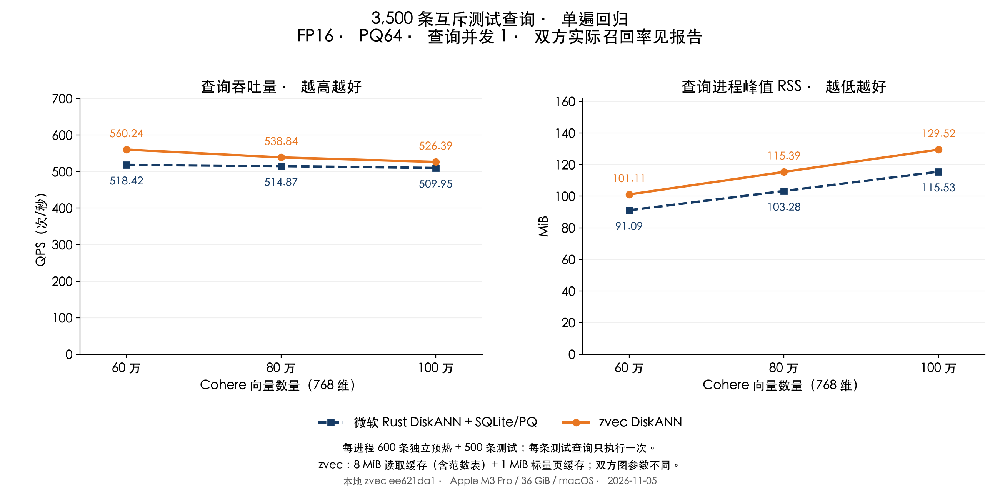

# Cohere：zvec DiskANN 与微软方案对比

测试日期：2026-11-05；Apple M3 Pro、36 GiB、macOS；本地 zvec `ee621da1`。

在双方召回率均 ≥90% 的门槛下，三个规模的汇总 QPS 均领先微软适配层。 下表同时列出双方实际 Recall@10；不同召回率不能视为完全相同的查询质量。

## 单遍测试结果

| 向量数 | zvec DiskANN QPS | 微软 QPS | QPS 差值 | RSS：zvec / 微软（MiB） | Recall@10：zvec / 微软 |
|---|---:|---:|---:|---:|---:|
| 60 万 | 560.24 | 518.42 | +8.07% | 101.11 / 91.09 | 94.62% / 95.82% |
| 80 万 | 538.84 | 514.87 | +4.66% | 115.39 / 103.28 | 94.75% / 95.59% |
| 100 万 | 526.39 | 509.95 | +3.23% | 129.52 / 115.53 | 94.55% / 95.35% |

QPS 为 3,500 条查询除以七个批次的总时间；RSS 为七个进程完整生命周期峰值的中位数，包含加载、预热、查询和退出。查询并发为 1。全部 42 个测试进程的最低召回率为 **94.14%**。所有分片均保留，未删除慢分片。“QPS 不低于微软的 95%”是预先设定的工程门槛，不是统计等价证明；汇总领先也不保证每条请求更快。

## 接近同召回率时仍有多少差距

以下为正式测试前、独立 400 条验证集的三轮交替对照。zvec 使用 L=144／112／136，微软保持 L=128。该组在 60 万、100 万未通过 QPS 相当门槛，完整保留；随后只用验证集选择上述正式配置。

| 向量数 | QPS：zvec / 微软 | QPS 差值 | Recall@10：zvec / 微软 |
|---|---:|---:|---:|
| 60 万 | 458.05 / 527.78 | -13.21% | 95.08% / 95.05% |
| 80 万 | 513.09 / 516.07 | -0.58% | 94.41% / 94.20% |
| 100 万 | 456.41 / 501.57 | -9.00% | 94.41% / 94.45% |

**提高 zvec 搜索宽度、把实际召回率拉近微软后，60 万和 100 万仍有性能差距。** 正式配置满足共同的 90% 下限，但更低的搜索宽度同时减少了查询工作量和召回率，不能据此宣称同召回率下全面超过微软。[完整对照](results/recall-parity/validation-matched-recall/summary.json)。

## 本轮改变

1. **让 PQ 导航使用重建向量的余弦分数。** 旧码本按 L2 初始化，重建向量长度变化会影响候选排序。现在计算归一化点积，最终仍用 FP16 原向量精确打分；未降低 PQ64 精度。
2. **在原预算内缓存重建向量的逆范数。** 百万条约 3.81 MiB，从 8 MiB 读取缓存总预算中扣除；剩余容量用于节点记录。表太大时使用融合计算，避免不断新增常驻内存。标量页缓存仍为 1 MiB。
3. **缓存命中后提前展开节点。** 已在缓存中的邻居可及时参与候选选择，减少不必要的后续读盘。读取仍保留 F_NOCACHE；这会改变遍历顺序，需要重新验证召回。
4. **单独提高构图质量。** 本轮 zvec 出度 64、构图 L=200，原基线为 32/100；微软维持 48/100。需要重建索引才能得到本轮图质量，不能把全部收益归因于代码修改。应用默认构图参数未自动修改。

下面单独比较代码变化：同一新图、相同 L=104、24 个读取线程和 8 MiB 读取／1 MiB 标量预算，在独立验证集交替运行三轮。基线为 `6473f807`，新版本为 `ee621da1`。三个规模均同时提高了 QPS 和召回；这部分收益无需用降低召回率解释。

| 向量数 | QPS：基线 → 本轮 | QPS 提升 | Recall@10：基线 → 本轮 |
|---|---:|---:|---:|
| 60 万 | 525.33 → 553.02 | +5.27% | 93.30% → 93.83% |
| 80 万 | 512.88 → 532.51 | +3.83% | 93.27% → 94.16% |
| 100 万 | 498.10 → 518.88 | +4.17% | 92.65% → 93.39% |

读取线程为 24；查询 L（60/80/100 万）为 104 / 104 / 104。微软 L=128、重排 128。线程调度、额外入口采样等未验证或无稳定收益的实验没有纳入最终代码；探索数据保留在原始证据中。C++ 改动尚未进入已发布的 0.8.0 SDK，需要重新编译并链接本地库。

## 数据与测量约束

沿用同一 Cohere 基库及按各规模重新计算的精确 GT：768 维、cosine、FP16、PQ64、top-10。600 条预热、400 条验证、3,500 条测试在源行号、FP32 和 FP16 内容上互不重叠。每个实现、每个规模下，每条测试查询只运行一次；每个进程先运行独立预热集一次。测试查询在此前轮次使用过，本轮属于回归验证，不是全新盲测。

参数仅在验证集选择，随后三轮交替验证并冻结源码、库和参数，再执行七个互斥测试分片。两边均使用在验证前创建的独立 APFS 索引副本；未清空系统文件缓存，也未隔离其他桌面应用。不能把刚建完索引后的高 QPS 当作稳定收益，也不能宣称这是严格冷盘测试。

微软组是 **Microsoft Rust DiskANN 0.61.0 + 自定义 SQLite/PQ 适配层**，SQLite 页缓存约 256 KiB、mmap 上限 16 MiB，并非微软官方原生 SSD 引擎。双方图、码本及接口成本不同。

缓存预算不是进程 RSS 上限。双方 PQ64 编码仍常驻；zvec 还承担 Collection、doc ID、元数据和读取线程等成本。RSS 不包含全部系统文件缓存，不能从进程 RSS 直接推导整机内存占用或对其他应用的影响。

## 验证与复现

95 项 C++ 测试通过、2 项跳过（详见测试记录）。覆盖 FP16/FP32 余弦重建参考值、零范数、非均分 chunk、码本导入与序列化、度量覆盖、缓存读写、线程池和 Collection 闭环。ThreadSanitizer 程序在启动阶段被终止，本轮没有可用的 TSan 结论。若干实验程序也在查询前启动失败，未产生 QPS 数据，单独保留原始记录。

每个进程在查询前检查实际加载的动态库路径，父进程核对 SHA-256；报告从实际结果 ID、精确 GT、计时和 RSS 原文独立复算。[核验记录](results/recall-parity/audit.json)、[正式汇总](results/recall-parity/measure/summary.json)、[三轮验证](results/recall-parity/validation/summary.json)、[原始证据](results/recall-parity/raw-evidence.json.gz)、[配置](results/recall-parity/measure/configuration.json)、[测试](results/recall-parity/cpp-tests.json)。

复现入口：[构建库](build_recall_variant.py)、[构建图](build_quality_graphs.py)、[验证试验](run_recall_pilot.py)、[冻结测量](run_recall_comparison.py)、[核验与绘图](publish_recall_comparison.py)。本机目录：`/tmp/zvec-recall-parity-20261105`。[上轮报告](REPORT_SCALAR_CACHE_CN.md)保留原测试结果。
