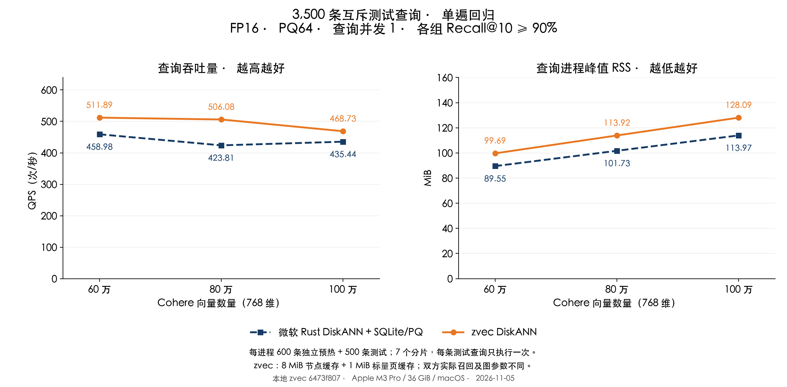

# Cohere：zvec DiskANN 有界标量缓存测试

测试日期：2026-11-05。Apple M3 Pro、36 GiB、macOS；本地 zvec 源码 `6473f807`。

**在 60／80／100 万向量下，减少 RSS 后仍保持 QPS 领先微软适配层、Recall@10 超过 90%。** 正式单遍回归中 QPS 领先 **7.64%–19.41%**。百万组 RSS 为 **128.09 对 113.97 MiB**，差额为 14.12 MiB，仍未达到相同内存占用。

## 正式结果

沿用同一 Cohere 采样基库、索引和精确 GT：768 维、cosine、FP16、PQ64、top-10。600 条预热、400 条验证与 3,500 条测试查询互不重叠，核对了源行号、FP32 和 FP16 内容。测试查询在之前轮次使用过，本轮是冻结参数后的回归，不称为全新盲测。七个互斥分片各 500 条，每个实现、每个规模下，每条测试查询只执行一次；每个新进程先运行独立预热集一次。

QPS = 3,500 / 七个测试批次总秒数；RSS 是七个查询进程完整生命周期峰值的中位数，包含加载、预热、查询和退出，不含建库。查询并发为 1。

| 向量数 | zvec DiskANN QPS | 微软 QPS | QPS 提升 | RSS：zvec / 微软（MiB） | Recall@10：zvec / 微软 |
|---|---:|---:|---:|---:|---:|
| 60 万 | 511.89 | 458.98 | 11.53% | 99.69 / 89.55 | 92.94% / 95.82% |
| 80 万 | 506.08 | 423.81 | 19.41% | 113.92 / 101.73 | 92.76% / 95.59% |
| 100 万 | 468.73 | 435.44 | 7.64% | 128.09 / 113.97 | 92.81% / 95.35% |



| 向量数 | zvec 分片 QPS 范围 | 微软分片 QPS 范围 | zvec 配对领先分片数 |
|---|---:|---:|---:|
| 60 万 | 455.08–553.39 | 428.92–494.23 | 6 / 7 |
| 80 万 | 457.14–548.62 | 305.44–483.67 | 7 / 7 |
| 100 万 | 357.11–512.34 | 391.91–457.27 | 6 / 7 |

全部 42 个正式进程的最低 Recall@10 为 **92.20%**。所有分片都保留，汇总领先不代表每条请求都更快；分片范围包含查询差异，不能当作重复测量置信区间。双方实际召回率不同，这是均超过 90% 门槛的比较。

## 相比上轮减少了多少内存

以下是同轮 400 条独立验证查询、各三次新进程的交替对照。基线为上轮 `f8a36342`，原有 8 MiB 节点缓存、32 个 I/O 线程及 L=84／84／90 全部保持不变。本轮只额外启用 1 MiB 标量缓存；QPS 按总计时合并，RSS 取峰值中位数。

| 向量数 | 基线 RSS（MiB） | 本轮 RSS（MiB） | 减少（MiB） | 降幅 | QPS：基线 → 本轮 |
|---|---:|---:|---:|---:|---:|
| 60 万 | 109.41 | 98.78 | 10.62 | 9.71% | 569.14 → 537.89 |
| 80 万 | 127.66 | 113.08 | 14.58 | 11.42% | 554.85 → 530.91 |
| 100 万 | 146.08 | 127.38 | 18.70 | 12.80% | 537.84 → 507.23 |

这是一项用少量额外读取换取较低 RSS 的优化；与自身 mmap 基线相比，验证 QPS 有所下降，但仍超过同轮微软方案。验证集有序结果与基线完全一致；正式测试的全部有序 top-10 结果也与上一轮相同配置一致，未靠降低召回率换取内存收益。

## 修改了什么

1. **标量文件不再长期保持整文件映射。** 打开时临时读取 Arrow 布局，保留行号和文件偏移，复制同一文件描述符后释放映射。已有索引无需重建。
2. **主键与全局 ID 按 4 KiB 页读取，LRU 缓存为 1 MiB。** 当 IPC 文件仅包含未压缩的 uint64/string 列时，只读取所需的有效位、字符串偏移及内容；页面与每项记账开销计入缓存预算。无需为了取一个主键读入整个约 80 KiB 批次。
3. **保留通用读取和对象生命周期。** 其他类型或压缩缓冲区使用有界批次缓存，超大批次绕过缓存；扫描不填充点查缓存，结果复制到自己的缓冲区。并发读取和淘汰受锁保护，文件路径替换不会切换已经打开的底层文件。

图搜索、FP16、PQ64、码本、重排参数及节点缓存均未改变。双方百万条 PQ64 编码本体仍各约 61.04 MiB。zvec 还保留 Collection、doc ID 数组、元数据和读取线程等成本，本轮没有逐项分解剩余 RSS 差额。

## 使用配置和边界

在打开只读集合前设置，并链接本地编译的 zvec 库：

```bash
export ZVEC_DISKANN_READ_CACHE_MIB=8
export ZVEC_DISKANN_READ_WORKERS=32
export ZVEC_DISKANN_SCALAR_CACHE_MIB=1
```

新增标量缓存默认 0，即保留原有 mmap 策略，范围 0–64 MiB；正值只作用于含 DiskANN 的只读集合，每个 IPC 文件分别计预算。图节点缓存仍是单独预算。已发布的 Rust／Node SDK 尚未包含本轮源码变更。

微软组仍是 **Microsoft Rust DiskANN 0.61.0 + 自定义 SQLite/PQ 适配层**，SQLite 页缓存约 256 KiB、mmap 上限 16 MiB；并非微软官方原生 SSD 引擎。微软 L=128、重排 128，两边图参数和码本不同。

**缓存预算不是整个进程 RSS 的硬上限。** Arrow 元数据、活动批次、并发结果、PQ、线程及分配器另占内存。标量普通文件读取会使用系统文件缓存；本轮降低的是进程 RSS，不能据此声称整机物理内存等量下降或已证明其他应用不受影响。图节点读取保留 `F_NOCACHE`，未清空系统文件缓存，其他桌面应用未隔离。

## 验证与复现

- 先在独立验证集试验，再做三轮交替对照，随后冻结源码、库、测量程序和参数。正式测试不调参、不复跑、不挑选慢分片。源数据摘要与索引文件大小、修改时间前后核对一致。
- 每个有效进程在任何查询前用 `dladdr` 检查实际动态库路径，使用独立可执行文件和绝对依赖；父进程检查库和程序 SHA-256。保留 82 份有效原始记录：13 次试验、27 次验证、42 次正式测试。一次原型启动在进入测量程序前失败，没有产生查询结果，单独保留。
- **136 项 C++ 测试通过，1 项跳过**：正排存储 47 项、Collection 4 项、分段行号 16 项、索引关闭回归 69 项。覆盖页淘汰、并发、乱序与重复行、空值、空字符串、跨页长字符串、结果生命周期、截断读取失败与类型回退。压缩回退测试因本地 Arrow 未构建压缩 codec 而跳过，未声称该路径在当前环境已测。未运行新的 ThreadSanitizer。
- Rust 查询循环沿用上轮程序，没有修改计时、预热或结果获取逻辑。Python 报告脚本从原始 JSONL 和 GT 独立复算 QPS、RSS、召回及结果摘要，并验证查询集合互斥。

[核验记录](results/scalar-cache/audit.json)、[正式汇总](results/scalar-cache/measure/summary.json)、[原始结果与 GT](results/scalar-cache/raw-evidence.json.gz)、[冻结配置](results/scalar-cache/measure/configuration.json)、[源码补丁](results/scalar-cache/measure/source.patch)、[三轮验证](results/scalar-cache/validation/summary.json)、[C++ 测试](results/scalar-cache/cpp-tests.json)。

复现入口：[构建](build_scalar_variant.py)、[预算试验](run_scalar_pilot.py)、[冻结对比](run_scalar_comparison.py)、[核验与绘图](publish_scalar_optimization.py)。本机完整目录为 `/tmp/zvec-bounded-scalar-20261105`。[上一轮报告](REPORT_MEMORY_BASELINE_CN.md)保留原有数据和内存优化说明。
