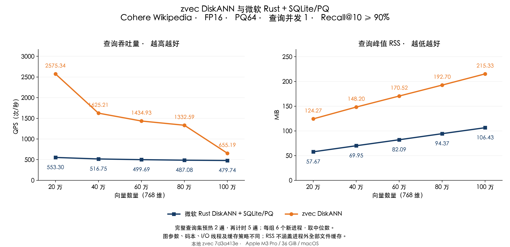
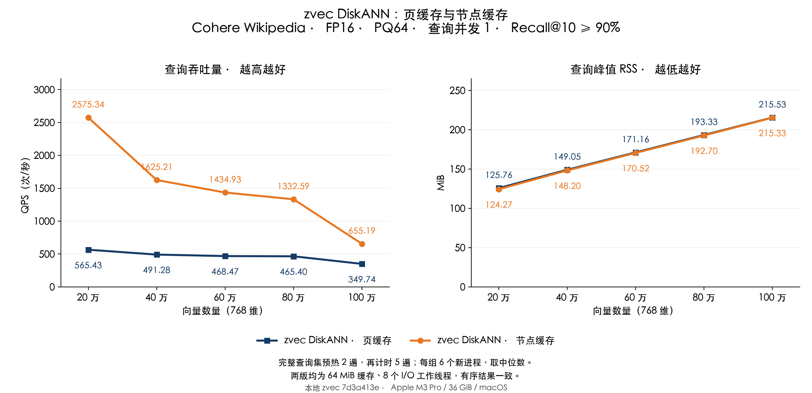

> 历史重复热查询结果。独立预热、单遍未知查询的最新结果见 [当前报告](REPORT_NODE_CN.md)。

# Cohere：zvec DiskANN 与微软方案测试报告

测试日期：2026-11-04。Apple M3 Pro、36 GiB 内存、macOS；使用本地 zvec 源码 `7d3a413e`。

在同一 Cohere 20 万至 100 万样本、相同预热与计时流程下，**五个规模的 zvec DiskANN QPS 中位数全部超过微软 Rust/SQLite/PQ 方案，为其 1.37–4.65 倍**。百万组为 **655.19 对 479.74 QPS**。zvec 的 Recall@10 为 **93.10%–94.40%**，有序 top-10 与上一版逐项相同。

缓存预算仍为每个图文件 **64 MiB**，I/O 工作线程仍为 **8**。百万组 zvec RSS 为 **215.33 MiB**，微软为 **106.43 MiB**；QPS 领先并不表示 zvec 的进程 RSS 也更低。本结论适用于本机、单查询并发、固定查询集预热后的这套负载。

## QPS 与 RSS

每个规模、每种实现各跑 6 个新进程，表中取中位数。全部数据来自本轮，未拼接旧计时结果。

| 向量数量 | zvec DiskANN QPS | 微软 QPS | QPS 倍数 | zvec RSS（MiB） | 微软 RSS（MiB） | zvec / 微软 Recall@10 |
|---|---:|---:|---:|---:|---:|---:|
| 20 万 | 2575.34 | 553.30 | 4.65× | 124.27 | 57.67 | 94.40% / 97.55% |
| 40 万 | 1625.21 | 516.75 | 3.15× | 148.20 | 69.95 | 93.95% / 96.85% |
| 60 万 | 1434.93 | 499.69 | 2.87× | 170.52 | 82.09 | 94.10% / 97.00% |
| 80 万 | 1332.59 | 487.08 | 2.74× | 192.70 | 94.37 | 93.35% / 96.65% |
| 100 万 | 655.19 | 479.74 | 1.37× | 215.33 | 106.43 | 93.10% / 96.10% |



## 具体原因

**先解决串行等待。** 之前 macOS 的缓存未命中逐个执行 `pread`，大量时间花在读取等待。[上一轮](REPORT_READ_CN.md) 用有上限的线程池并行读取，将百万组从约 81 提升到 337 QPS，但仍落后于同轮微软约 475 QPS。本轮在这一版上继续改动，两版都固定为 8 个 I/O 工作线程，查询并发仍为 1。

**再提高固定缓存的有效容量。** 原缓存为每次请求保留整个 4096 字节页，页里还可能有未访问的邻近节点和填充。本轮只缓存目标节点的完整记录；百万索引实际记录长 **1708 字节**，来自索引元数据，包含 FP16 原向量和邻接信息。缓存条目的数据区缩小约 **58.3%**；没有改变向量精度、PQ、图结构或距离计算。旧页也可能同时服务多个节点，所以不能简单把字节比例当作所有负载的加速比。

**减少缓存冲突淘汰。** 记录采用紧凑数据区和最多 16 路组相联的 second-chance 策略；小预算会自适应减少路数。16 路是每组可选缓存槽位数，不是 16 个线程。更多槽位减少热点节点因哈希冲突被过早淘汰，仍由同一个字节预算约束。

**磁盘传输与内存保留使用不同粒度。** 直接把磁盘请求缩到节点大小，在本机并没有得到同等幅度的加速。诊断中，小尺寸读盘平均每次约 **136.4 微秒**；保留原扇区范围与整页长度后约 **101.5 微秒**。最终方案未命中时仍按原扇区读盘，内存只留下节点记录；命中在调用线程直接复制，只有多个未命中才调度工作线程。具体内核路径未做跟踪，不能把这项差异全部归因于某一个 macOS 内核机制。

百万向量的独立验证诊断如下，全部固定 64 MiB 与 8 个工作线程，逻辑节点请求均为 **311,339 次**，返回结果相同：

| 百万验证组的读取方式 | pread 次数 | API 读取量（MiB） | 批次累计等待（秒） |
|---|---:|---:|---:|
| 4 KiB 页缓存，4 路 | 212,768 | 831.12 | 3.408 |
| 节点缓存，4 路，小尺寸读盘 | 109,476 | 178.32 | 3.083 |
| 节点缓存，4 路，整页读盘 | 109,476 | 427.64 | 2.300 |
| 节点缓存，16 路，整页读盘 | 72,128 | 281.75 | 1.851 |

最终相对页缓存，真实 `pread` 调用数减少 **66.1%**，API 读取量从 **831.12** 降到 **281.75 MiB**，批次等待从 **3.408** 降到 **1.851 秒**。只看 4 路到 16 路的节点缓存，调用数还减少了 **34.1%**。读取函数计时包含等待和调度，字节数是 API 返回的数据量，不等于物理 SSD 的纯服务时间或真实介质流量。

这些诊断包含初始化读取、20 条独立预热、完整 200 条查询的 2 遍预热与 5 遍计时；每个候选是一份额外诊断进程，不能与正式 1000 次查询的计时范围混算。页缓存诊断来自上一轮相同验证集；其余三份保留了对应源码补丁和库摘要。正式 QPS 表关闭诊断，并另做六轮测量。

## 同轮验证改动收益

以下两组都是本地 zvec，复用同一索引、FP16、PQ64、L、64 MiB 预算与 8 个读取工作线程。页缓存版本为 `37ff6bd5`，节点缓存版本为 `7d3a413e`；搜索结果没有变化。

| 向量数量 | 页缓存 QPS | 节点缓存 QPS | 提升 | 页缓存 RSS（MiB） | 节点缓存 RSS（MiB） |
|---|---:|---:|---:|---:|---:|
| 20 万 | 565.43 | 2575.34 | 4.55× | 125.76 | 124.27 |
| 40 万 | 491.28 | 1625.21 | 3.31× | 149.05 | 148.20 |
| 60 万 | 468.47 | 1434.93 | 3.06× | 171.16 | 170.52 |
| 80 万 | 465.40 | 1332.59 | 2.86× | 193.33 | 192.70 |
| 100 万 | 349.74 | 655.19 | 1.87× | 215.53 | 215.33 |



正式百万组每 1000 次查询，zvec 墙钟时间为 **2.859 → 1.526 秒**，CPU 时间为 **2.833 → 1.256 秒**；微软分别为 **2.084 / 2.082 秒**。RSS 变化为 **-0.20 MiB**。缓存上限包含数据、条目和锁，不包括 PQ、键映射、线程栈或其他内存；多个图文件会累加，不能承诺进程总 RSS 固定。

百万组与较小规模的 QPS 差距仍比较大：百万组 L=128，其他组 L=96，访问的节点工作集不同；固定预算下的缓存命中也可能出现明显变化。因此这条曲线不是仅由向量总数决定的复杂度曲线。

## 对比口径与限制

- 沿用之前的 Wikipedia-Cohere / Big ANN 样本，20／40／60／80／100 万、768 维、cosine、FP16、PQ64、top-10。GT 对各样本规模精确计算，沿用原 FP32 cosine GT。本轮重新核验数据、GT、PQ 文件摘要；索引未重建，文件大小和修改时间前后一致。
- zvec 的构图出度配置为 32、构图候选数 100，各规模独立训练 PQ；L=96／96／96／96／128。微软图出度配置为 48、构图候选数 100、L=128、FP16 重排 128，使用此前共享的 PQ64 码本。双方都超过 90%，实际召回率不同。
- 微软组为 **微软 Rust DiskANN 0.61.0 + 自定义 SQLite/PQ 适配层**，并非微软官方原生 SSD 存储引擎；实验路径限静态、只读、无过滤查询。不能据此给完整产品或算法做普遍排名。
- zvec 保留 `F_NOCACHE` 和关闭预读；微软使用 SQLite 256 KiB 堆页缓存、最多 16 MiB mmap，并可受益于系统文件缓存。RSS 不包括进程外全部文件缓存；比较 RSS 不能直接推断系统总内存压力。
- 查询并发均为 1；zvec 额外使用 8 个 I/O 工作线程，微软实验查询路径为同步 SQLite 读取。因此这不是同线程数或同缓存策略的效率对比。参数 8 沿用上一轮独立验证选择，本轮未通过正式测试集再调 L、线程数或缓存预算。
- 每进程先跑 20 条独立预热查询，再把完整 200 条计分查询预热 2 遍，计时 5 遍，共 1000 次。QPS 包含 FP16 转换、向量查询、结果提取与一致性检查，不含打开与预热。RSS 是 `/usr/bin/time -l` 的整个查询进程峰值，包含打开、PQ／缓存加载、预热和查询，不含建库。
- 三组最终二进制先做 15 次验证，再做 90 次正式测量；六轮交替规模顺序，并轮换／反转实现顺序。未清空系统文件缓存，也未隔离其他桌面应用。正式测量时没有构建任务。重复固定查询集有利于缓存，不能外推到首次查询、持续变化的工作集、多查询并发或完整 zvec-grep 请求流程。

| 向量数量 | zvec QPS 范围 | 微软 QPS 范围 | zvec RSS 范围（MiB） | 微软 RSS 范围（MiB） | zvec 配对获胜轮数 |
|---|---:|---:|---:|---:|---:|
| 20 万 | 2197.50–2612.86 | 546.13–562.21 | 123.86–124.41 | 57.50–57.83 | 6 / 6 |
| 40 万 | 1611.64–1637.40 | 502.57–518.25 | 148.17–148.31 | 69.67–70.05 | 6 / 6 |
| 60 万 | 1322.99–1439.09 | 480.69–507.68 | 170.42–170.72 | 81.91–82.73 | 6 / 6 |
| 80 万 | 1245.61–1348.71 | 479.23–497.01 | 192.58–192.84 | 94.06–94.95 | 6 / 6 |
| 100 万 | 615.74–657.70 | 467.34–488.33 | 215.25–215.44 | 106.34–106.64 | 6 / 6 |

微软百万组的一次计时进程记录到 5 次 major faults，主表保留了这次结果。只比较双方计时阶段均无 major faults 的配对后，五个规模仍全部领先；百万组剩余 **5 组配对全部胜出**，最小 QPS 比值仍为 **1.29 倍**。该敏感性检查没有替换主表数据。

## 使用与复现证据

本地重新编译 zvec 后，在打开集合前设置：

```bash
export ZVEC_DISKANN_READ_CACHE_MIB=64
export ZVEC_DISKANN_READ_WORKERS=8
```

源码默认值仍是 32 MiB 与 4 个工作线程，上述为本次显式配置；设工作线程为 1 可使用串行读取。节点记录大小来自索引元数据，已有索引不用重建。**已发布的 Rust／Node SDK 0.8.0 二进制尚未替换。**

[正式逐次记录](results/node-comparison/measure/runs.json)、[配置与源码摘要](results/node-comparison/measure/configuration.json)、[QPS 目标检查](results/node-comparison/measure/comparison.json)、[独立核验](results/node-comparison/audit.json)、[读取诊断](results/node-comparison/profile/summary.json)、[本轮源码补丁](results/node-comparison/measure/source.patch)、[原始结果及 GT](results/node-comparison/raw-evidence.json.gz)、[构建记录](results/node-comparison/build.json)。105 个主对比进程全部核验通过，另保留 6 次较早四路缓存的百万验证预检查和 4 份诊断记录，其中一份诊断沿用上一轮。

[40 项 C++ 测试](results/node-comparison/cpp-tests.json)通过，覆盖缓存边界、并发淘汰、整页与节点范围、错误回收、重开文件及小节点／跨页节点的建库加载查询。ThreadSanitizer 在本机的前次尝试于运行时初始化、进入 main 前崩溃，本轮没有获得 TSan 验证。

复现脚本为 [run_node_comparison.py](run_node_comparison.py) 和 [publish_node_comparison.py](publish_node_comparison.py)。保留原数据、索引和配置对应的二进制与库，在新的实验目录运行 `run_node_comparison.py --base BASE --data DATA --indexes INDEXES --source ZVEC_SOURCE --stage measure`；`BASE/measure` 必须不存在。发布脚本另需构建、C++ 测试及诊断记录。首次执行时路径检查曾误将上一版程序的 `@rpath` 链接当成绝对链接，已在任何查询开始前修正；这次预检查失败不计为有效测量。
