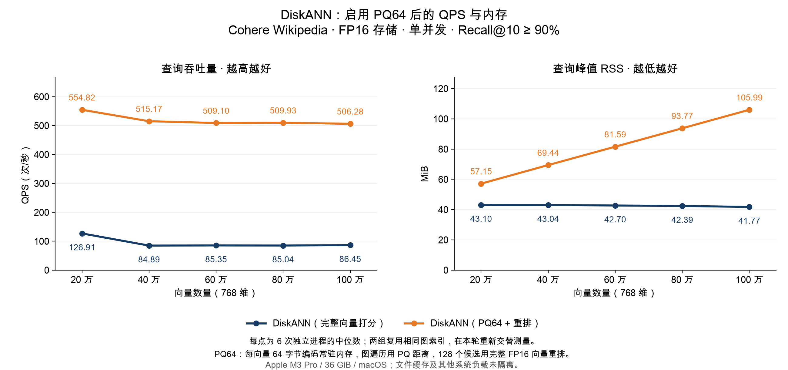

# DiskANN：PQ64 查询对照测试

> 历史测试：本文的 DiskANN 使用微软 Rust 库和 SQLite 存储，测试代码截至 `a885372`。2026-11-04 后主引擎已切换为 zvec 内置 DiskANN；本文数值不代表新后端性能。

测试日期：2026-11-04。设备：Apple M3 Pro、36 GiB RAM、macOS 26.6.2。

本次实际接入了 PQ 编码和查表打分，并与原来的完整向量打分模式重新对测。**100 万条时，QPS 中位数从 86.45 提高到 506.28，约为 5.86 倍；查询峰值 RSS 从 41.77 增至 105.99 MiB。** 测试 Recall@10 分别为 95.95%、96.10%，均达到 90% 目标。

结果说明：这版 PQ 查询路径用更多常驻内存换取了更高吞吐量。全库 PQ 编码加载进内存后，RSS 随向量数量增长，符合每条向量都需要保存编码的预期。

## 对比结果

两组均使用同一份 Cohere Wikipedia 768 维数据和同一份 FP16 图索引，底层仍由 SQLite 保存图边和完整向量。区别是：

- **完整向量打分：** 图遍历时按需读取 FP16 向量，解码后计算完整维度的 cosine 距离。
- **PQ64 + 重排：** 每条向量的 64 字节 PQ 编码常驻内存；图遍历采用 PQ 近似 cosine 距离，再读取前 128 个候选的完整 FP16 向量重排。

以下均为本轮六个独立进程的中位数，没有使用旧轮计时结果。

| 向量数量 | 完整向量 QPS | PQ64 QPS | 完整向量 RSS（MiB） | PQ64 RSS（MiB） |
|---|---:|---:|---:|---:|
| 20 万 | 126.91 | 554.82 | 43.10 | 57.15 |
| 40 万 | 84.89 | 515.17 | 43.04 | 69.44 |
| 60 万 | 85.35 | 509.10 | 42.70 | 81.59 |
| 80 万 | 85.04 | 509.93 | 42.39 | 93.77 |
| 100 万 | 86.45 | 506.28 | 41.77 | 105.99 |



| 向量数量 | 完整向量 Recall@10 | PQ64 Recall@10 | 完整向量 P95（ms） | PQ64 P95（ms） |
|---|---:|---:|---:|---:|
| 20 万 | 94.55% | 97.55% | 9.67 | 1.98 |
| 40 万 | 96.65% | 96.85% | 14.61 | 2.12 |
| 60 万 | 96.85% | 97.00% | 14.30 | 2.16 |
| 80 万 | 96.50% | 96.65% | 14.87 | 2.16 |
| 100 万 | 95.95% | 96.10% | 14.34 | 2.15 |

PQ64 的纯编码内存从 20 万条的 **12.21 MiB** 增至 100 万条的 **61.04 MiB**；进程还包含码本、查询查找表、SQLite 缓存、文件映射和运行时。100 万条时，实测 RSS 比完整向量模式多 **64.23 MiB**，与新增编码内存的量级一致。

## 实验方法

使用微软 `diskann-quantization 0.61.0` 的训练、编码和 cosine 查表实现。768 维分为 64 段，每段 12 维、256 个中心、1 字节编码；没有使用 OPQ。固定种子 `20261104`，从前 20 万条库向量抽取 32,768 条训练样本，采用 k-means++ 初始化和最多 20 次 Lloyd 迭代，训练与编码均使用 FP16 舍入后的向量。五个规模共享同一码本，训练不使用测试或验证查询。

复用已有五份图索引；本轮仅增加 PQ 编码文件，没有重新构图。沿用原始 FP32 数据上计算的各规模精确 GT，不针对 PQ 结果重新定义真值。逐前缀核对 FP16 向量字节哈希与原建库记录；用独立 FP64 距离计算抽查编码的最近中心，并验证 PQ 查表距离和完整向量重排。

查询为 cosine、top-10、单并发，每个进程 20 条预热 + 200 条计时查询；每规模、每模式 6 个独立进程，交替执行顺序，共 **60 个测试进程、12,000 次计时查询**。全部训练、编码和代码检查完成后才进行正式计时。

完整向量模式沿用原独立验证集选定的参数：20 万条 `L=32`，其余 `L=48`，本轮重新验证召回率。PQ 模式预先固定重排数 128，候选 `L` 为 `128/192/256/384/512/768/1024`，选择第一个验证 Recall@10 ≥ 92% 的值；五个规模均在 `L=128` 达标。所有参数冻结后才运行测试集，未按测试结果重新调参。

QPS 为 `200 / 计时批次秒数`，包含查询文件读取、FP16 查询舍入、PQ 查找表生成、图搜索、重排和结果 ID 收集，不包含索引打开、PQ 编码加载、预热及 JSON 输出。RSS 来自 `/usr/bin/time -l` 的进程峰值，包含打开、全部编码加载和预热；训练与编码在另一个进程完成，不计入查询 RSS。

## 波动与适用范围

所有慢运行均纳入六次统计，未删除或重跑后择优。图中只展示中位数，逐次数据和完整范围保留在结果文件。

| 向量数量 | 完整向量 QPS 范围 | PQ64 QPS 范围 |
|---|---:|---:|
| 20 万 | 72.27–127.82 | 390.47–578.30 |
| 40 万 | 33.35–87.68 | 496.83–537.51 |
| 60 万 | 25.70–86.65 | 493.29–513.14 |
| 80 万 | 19.95–87.40 | 481.10–520.41 |
| 100 万 | 17.79–86.88 | 472.30–508.56 |

每个规模首个测试进程是完整向量模式，之后交替模式顺序。系统文件缓存没有清空，其他系统活动没有隔离；PQ 打开时还会加载编码并检查索引，因此倍数不代表严格固定冷缓存条件下的收益，也不能作为稳定吞吐量承诺。

这是同一最低召回目标下的对照，两组实际召回率和搜索参数并不完全相等。PQ64 的码长、训练样本数和重排数均固定，尚未搜索最佳配置。六次重复复用同一组 200 条测试查询，不是 1,200 条独立查询。

实验通过 `experimental-pq` 特性启用，**默认查询路径仍为完整向量打分**。PQ 路径只支持本次只读、无过滤、节点连续且全部存活的静态索引：打开时验证节点范围，查询时使用无需 SQL 的存活判断。它还没有实现动态增删改、过滤检索及码本更新流程。测到的是整条新增查询路径的效果，不能把收益完全归因于 PQ 算术本身。

本轮仍使用原有 SQLite 图存储，并未接入专用 SSD 文件布局或异步 I/O 流水线；结果仅适用于当前实现和测试条件。

## 结果与复现

- [汇总 CSV](results/pq64/summary.csv)、[逐次结果](results/pq64/runs.json)、[选参记录](results/pq64/selection.json)、[图表 SVG](results/pq64/qps-memory.svg)。
- [结果审计](results/pq64/audit.json)、[训练与编码校验](results/pq64/preparation.json)、[原始日志哈希](results/pq64/raw-evidence.json)、[运行配置](results/pq64/configuration.json)。
- 复核了 60 次测试和 10 次验证的返回 ID、召回率、QPS、RSS 与汇总统计；完整向量模式的测试结果 ID 与原测试一致，所有图索引文件大小和修改时间保持不变。
- 原后端 9 项测试、新增 2 项 PQ 测试及启用实验特性的 Clippy 检查通过。
- 用格式化后重新构建的程序训练和编码，训练样本、码本及百万条编码的字节哈希与实际测试所用产物完全相同；复现发生在计时结束后，见[复现校验](results/pq64/reproduction.json)。

以下命令接续已有[百万规模实验](REPORT_MILLION_CN.md#数据与复现)的数据及索引，输出目录必须不存在。向量、训练样本、PQ 编码和原始返回 ID 保存在本地，不提交大文件。

```bash
cargo build --release --manifest-path rust/benchmarks/diskann/harness/Cargo.toml \
  --features experimental-pq --bin pq-prepare --bin pq-bench --target-dir native/target

python3 rust/benchmarks/diskann/prepare_pq.py \
  --binary "$PWD/native/target/release/pq-prepare" \
  --data /absolute/path/to/million-data \
  --experiment /absolute/path/to/million-experiment \
  --output /absolute/path/to/pq-preparation

python3 rust/benchmarks/diskann/run_pq.py \
  --binary "$PWD/native/target/release/pq-bench" \
  --data /absolute/path/to/million-data \
  --experiment /absolute/path/to/million-experiment \
  --preparation /absolute/path/to/pq-preparation \
  --output /absolute/path/to/pq-experiment

python3 rust/benchmarks/diskann/publish_pq.py \
  --binary "$PWD/native/target/release/pq-bench" \
  --data /absolute/path/to/million-data \
  --experiment /absolute/path/to/pq-experiment \
  --preparation /absolute/path/to/pq-preparation \
  --output /absolute/path/to/pq-results

python3 rust/benchmarks/diskann/plot_pq.py /absolute/path/to/pq-results \
  --font '/System/Library/Fonts/Supplemental/Arial Unicode.ttf'
```
