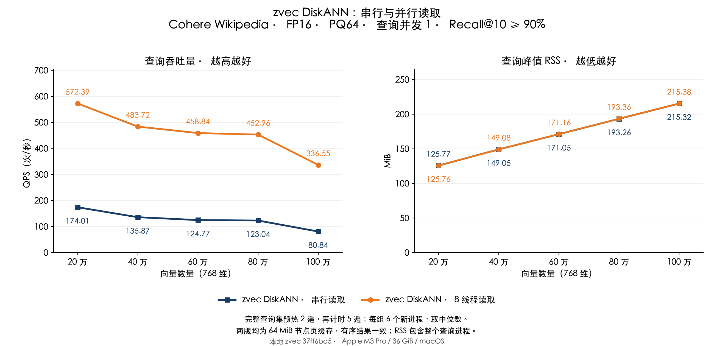
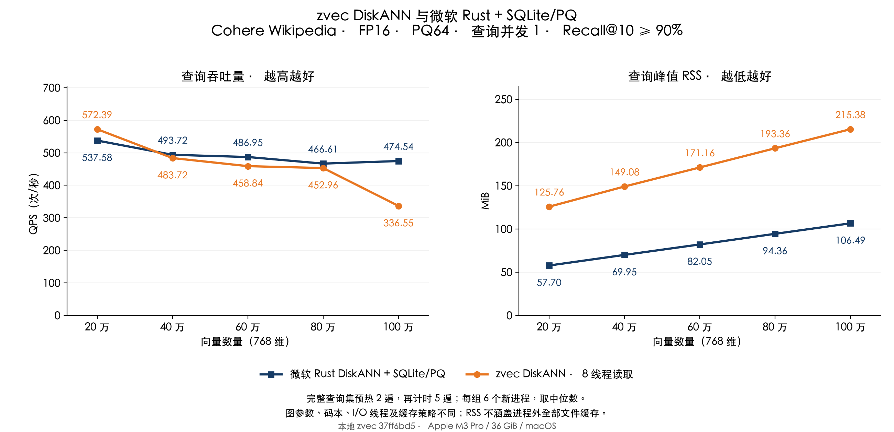

# zvec DiskANN 读取瓶颈与 QPS/RSS 对比

后续[节点缓存测试](REPORT_NODE_WARM_CN.md)、[未知查询基线](REPORT_UNSEEN_BASELINE_CN.md)及[64 MiB 配置](REPORT_UNSEEN_SPEED_CN.md)继续定位瓶颈。最新[内存优化与单遍查询报告](REPORT_NODE_CN.md)使用源码 `f8a36342`，在 60 万至 100 万规模下降低 RSS，并保持汇总 QPS 超过微软适配层、召回率超过 90%。本文保留此前并行读取阶段的数据。

测试日期：2026-11-04。Apple M3 Pro、36 GiB 内存、macOS。本地 zvec 源码从 `e31ce799` 到 `37ff6bd5`，两版均使用 **64 MiB 节点页缓存**。

上一版缓存已经减少了重复读取，但 macOS 上剩余的节点页仍逐个同步读取。这轮加入有上限的读取线程池，在不改变索引、PQ、L 和结果顺序的情况下，20 万至 100 万向量的 QPS 提升 **3.29–4.16 倍**。百万组从 **80.84** 提升到 **336.55 QPS**，RSS 从 **215.32** 到 **215.38 MiB**，变化 **+0.05 MiB**。

同轮微软方案为 **474.54 QPS**，与 zvec 的差距由 **5.87 倍**缩小到 **1.41 倍**。两版 zvec 的有序 top-10 逐项一致，测试集 Recall@10 为 **93.10%–94.40%**，没有降低召回来换速度。

## 同轮结果

三组在每个规模各跑 6 个新进程，以下均取中位数。串行组是上一轮已经开启缓存的 zvec；并行组为本轮 zvec，使用验证集选出的 **8 个 I/O 工作线程**。查询并发数仍为 1，但工作线程资源不同，因此不是同线程数的效率对比。

| 向量数量 | zvec 串行 QPS | zvec 并行 QPS | 提升 | 微软 QPS | zvec / 微软 Recall@10 |
|---|---:|---:|---:|---:|---:|
| 20 万 | 174.01 | 572.39 | 3.29× | 537.58 | 94.40% / 97.55% |
| 40 万 | 135.87 | 483.72 | 3.56× | 493.72 | 93.95% / 96.85% |
| 60 万 | 124.77 | 458.84 | 3.68× | 486.95 | 94.10% / 97.00% |
| 80 万 | 123.04 | 452.96 | 3.68× | 466.61 | 93.35% / 96.65% |
| 100 万 | 80.84 | 336.55 | 4.16× | 474.54 | 93.10% / 96.10% |

| 向量数量 | zvec 串行 RSS（MiB） | zvec 并行 RSS（MiB） | 微软 RSS（MiB） |
|---|---:|---:|---:|
| 20 万 | 125.77 | 125.76 | 57.70 |
| 40 万 | 149.05 | 149.08 | 69.95 |
| 60 万 | 171.05 | 171.16 | 82.05 |
| 80 万 | 193.26 | 193.36 | 94.36 |
| 100 万 | 215.32 | 215.38 | 106.49 |





## 定位到的瓶颈

单独在百万向量的独立验证集打开读取诊断。该统计覆盖打开后的读取、20 条独立预热及 200 条查询的 7 遍执行，不能与正式计时的 1000 次查询混算；诊断开销也不纳入正式 QPS 表。

| 指标 | 串行读取 | 8 线程读取 |
|---|---:|---:|
| 逻辑节点页请求数 | 311,339 | 311,339 |
| 实际 pread 调用数 | 212,829 | 212,768 |
| pread 成功读取字节（MiB） | 831.36 | 831.12 |
| 各线程读取函数累计耗时（秒） | 17.063 | 20.176 |
| 读取批次累计墙钟时间（秒） | 17.275 | 3.408 |

串行组中，**68.4%** 的逻辑页请求仍进入 `pread`；读取函数耗时占批次墙钟时间的 **98.8%**，每次 `pread` 平均约 **80.2 微秒**。并行后逻辑请求数不变，实际读取量接近，但批次等待缩短到 **19.7%**。这直接支持本轮主要收益来自重叠读取等待，而不是更少的图遍历或更低的精度。并发导致缓存淘汰时序不同，实际未命中数允许略有差异。

这些计时包含系统调用、等待和线程调度，不是纯 SSD 延迟；读取字节是 API 返回的数据量，也不等于物理介质实际读取量。并行的读取累计耗时是多线程相加，可能大于墙钟时间。

正式百万组每 1000 次查询的墙钟时间为 **12.370 → 2.972 秒**，CPU 时间为 **1.844 → 2.899 秒**；微软分别为 **2.107 / 2.104 秒**。读取并行需要额外调度与同步，CPU 成本和 QPS 应一起看。

## 为什么与微软仍有差距

1. **缓存策略不同。** zvec 保留 `F_NOCACHE` 和关闭预读，64 MiB 用户态节点缓存未命中后仍需读取；微软 SQLite 适配层使用普通文件读取，可受益于系统文件缓存。其 SQLite 堆页缓存为 256 KiB、mmap 上限为 16 MiB，这些上限不限制整个系统文件缓存。固定查询反复预热会放大缓存带来的收益，微软较低的 RSS 不能解释为系统总内存也更低。
2. **搜索和数据布局不同。** zvec 读取的页包含 FP16 向量与邻接表，并为展开节点计算完整向量距离；微软实验路径先做 PQ 遍历，只对最后 128 个候选做 FP16 重排。两者的图出度为 32 / 48，PQ 码本也不同。这些差异可能影响剩余差距，但本轮没有逐项消融，不能为每项分配精确贡献。
3. **本轮没有消除读取依赖。** 同一批可以并行，但下一批仍依赖本批的图搜索结果；有限的并行度不能让磁盘等待完全消失。

这里的微软方案是 **微软 Rust DiskANN 0.61.0 + 自定义 SQLite/PQ 适配层**，不是微软官方原生 SSD 存储引擎。该 PQ 路径仅支持静态、只读、无过滤的本轮测试；不宜把本表解释为完整产品能力或算法本身的公平排名。两边都超过 90%，但实际召回率不同。

## 本轮代码修改

- 每个 macOS FileReadStorage 图文件复用固定工作线程，默认 4 个，可配置 1–8；同一 reader 的多个查询共享线程池。线程栈与调度开销不属于 64 MiB 节点缓存预算。
- 批次轮转分配任务，不为每个节点创建线程或分配任务对象。读取完成后仍按原提交顺序处理节点，保持原搜索行为。
- 批次出错后先等待所有任务结束，再返回错误，避免释放缓冲区后仍有后台写入。重叠目标缓冲区保持串行，关闭文件时先回收线程。
- 增加可关闭的读取诊断。正式测试关闭诊断；没有扩大缓存、开启全文件 mmap、调整 L 或重建索引。已有 BufferPool、Linux、Windows、iOS 默认路径不自动启用此线程池。

## 参数选择与测试口径

固定缓存 64 MiB，在独立验证集对 1／2／4／8 个工作线程各测 2 个新进程、覆盖五个规模，并另测 5 个上一版进程。预先固定规则：选择五规模 QPS 几何平均达到最高值 90% 的最少线程数。该性能阈值与 Recall@10 ≥ 90% 是两个独立条件。

| 向量数量 | 1 线程 QPS | 2 线程 QPS | 4 线程 QPS | 8 线程 QPS | 验证 Recall@10 |
|---|---:|---:|---:|---:|---:|
| 20 万 | 180.39 | 298.23 | 416.50 | 382.28 | 92.75% |
| 40 万 | 137.08 | 228.69 | 352.12 | 465.35 | 92.40% |
| 60 万 | 123.90 | 217.47 | 347.89 | 477.37 | 92.85% |
| 80 万 | 119.32 | 208.22 | 328.67 | 453.55 | 92.25% |
| 100 万 | 78.79 | 141.48 | 233.74 | 340.78 | 93.10% |

1／2／4／8 线程的几何平均 QPS 分别为 **123.56／212.85／330.10／420.36**，选择 **8 线程**。所有线程配置的有序结果一致；随后冻结配置，未用正式测试集选参数。

沿用之前的 Wikipedia-Cohere / Big ANN 样本：20／40／60／80／100 万，768 维、cosine、FP16、PQ64、top-10。精确 GT 针对各样本规模计算，沿用原 FP32 cosine GT；本轮重新核验数据、GT 和 PQ 文件摘要。zvec 的 L 为 96／96／96／96／128，最大出度 32、构图候选数 100；微软 L=128、重排 128、最大出度 48、构图候选数 100。zvec 各规模独立训练 PQ，微软共享此前训练的 PQ64 码本。索引文件大小和修改时间前后一致。

每个进程先跑 20 条独立预热查询，再把完整 200 条计分查询预热 2 遍，最后计时 5 遍，共 1000 次。QPS 包含 FP16 转换、向量查询、结果提取与一致性检查，不包含打开和预热。RSS 为 `/usr/bin/time -l` 的整个查询进程峰值，包含打开、PQ／缓存加载、预热和查询，不含建库。

正式阶段先重新验证三组全部 15 个配置，再做 90 次测量；6 轮中交替规模顺序，并轮换／反转实现顺序。全部三组均为本轮重新测量，没有拼接历史计时。未清空系统文件缓存，未隔离桌面其他应用；正式测量期间没有构建任务。完整查询集重复预热的结果不代表首次访问、不断变化的工作集或多查询并发。

| 向量数量 | 串行 QPS 范围 | 并行 QPS 范围 | 微软 QPS 范围 |
|---|---:|---:|---:|
| 20 万 | 167.31–177.09 | 565.48–575.14 | 497.98–549.85 |
| 40 万 | 133.85–138.82 | 472.84–491.35 | 481.01–506.39 |
| 60 万 | 122.88–126.38 | 440.23–467.52 | 472.84–494.02 |
| 80 万 | 116.51–124.04 | 405.53–461.94 | 457.52–488.90 |
| 100 万 | 76.29–81.20 | 319.25–352.71 | 448.38–479.71 |

| 向量数量 | 串行 RSS 范围（MiB） | 并行 RSS 范围（MiB） | 微软 RSS 范围（MiB） |
|---|---:|---:|---:|
| 20 万 | 125.61–125.88 | 125.69–126.83 | 57.52–57.78 |
| 40 万 | 148.83–150.53 | 148.97–149.19 | 69.59–70.03 |
| 60 万 | 170.98–171.17 | 170.94–171.27 | 81.80–82.19 |
| 80 万 | 193.06–193.38 | 193.25–193.45 | 94.09–94.47 |
| 100 万 | 215.23–215.44 | 215.25–215.47 | 106.23–106.64 |

## 使用与证据

本地重新编译 zvec 后，在打开集合前设置：

```bash
export ZVEC_DISKANN_READ_CACHE_MIB=64
export ZVEC_DISKANN_READ_WORKERS=8
```

源码默认缓存为 32 MiB、读取工作线程为 4；上述值是本轮显式配置。设 `ZVEC_DISKANN_READ_WORKERS=1` 可恢复串行读取。线程和缓存预算按图文件累加，不是整个进程的总资源上限。已发布的 Rust／Node SDK 0.8.0 二进制尚未替换。

[正式记录](results/read-comparison/measure/runs.json)、[配置与源码摘要](results/read-comparison/measure/configuration.json)、[构建与加载路径](results/read-comparison/build.json)、[验证参数选择](results/read-comparison/pilot/selection.json)、[读取诊断](results/read-comparison/profile/summary.json)、[独立核验](results/read-comparison/audit.json)、[源码补丁](results/read-comparison/measure/source.patch)、[全部计时原始记录与 GT](results/read-comparison/raw-evidence.json.gz)。150 个有效基准进程及 3 个额外诊断进程独立核验通过。

[33 项 C++ 测试](results/read-comparison/cpp-tests.json)通过。ThreadSanitizer 在运行时初始化、进入 main 前崩溃，连列出测试也失败，因此未获得 TSan 验证，不能将其记为通过。最初复制并改写链接路径的程序被 macOS 完整性检查拒绝启动；随后从源码正常重新链接程序和库，核对实际加载路径后再开始基准。[失败启动记录](results/read-comparison/startup-failed/parallel4-1m.stderr)不计入有效查询结果。

复现脚本为 [run_read_comparison.py](run_read_comparison.py) 和 [publish_read_comparison.py](publish_read_comparison.py)。保留原数据和索引路径，准备配置中对应的固定二进制与库；新实验目录中的 `pilot`、`measure` 必须不存在。脚本先运行 `--stage pilot` 再运行 `--stage measure`，发布脚本另需 `cpp-tests.json` 与 `profile` 中的诊断记录。具体绝对路径、库摘要、源文件摘要和参数均保存在配置中。
