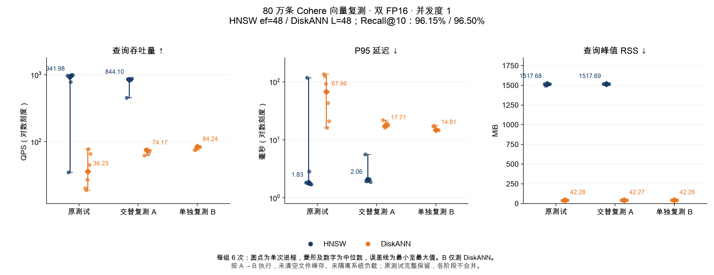

# 80 万条 Cohere 向量 QPS 复测

> 历史测试：本文的 DiskANN 使用微软 Rust 库和 SQLite 存储，测试代码截至 `a885372`。2026-11-04 后主引擎已切换为 zvec 内置 DiskANN；本文数值不代表新后端性能。

测试日期：2026-11-03（Asia/Shanghai），19:16–19:18。沿用[百万规模实验](REPORT_MILLION_CN.md)的数据、索引和可执行文件，两组均为 FP16。

**原来 80 万条 DiskANN 的低 QPS 在本次复测中没有重现。** 相同交替运行协议下，六次 QPS 中位数由原测试的 **36.23** 变为 **74.17**；随后单独连续运行六次的中位数为 **84.24**。测试 Recall@10 始终为 **96.50%**，查询峰值 RSS 中位数仍约 **42.3 MiB**。本次未改后端实现或查询参数，不将速度变化解释成代码优化收益。

这支持将原 80 万点视为需要结合运行状态解释的波动，**不能据此认定 80 万是 DiskANN 的固定性能拐点**。复测没有固定文件缓存或隔离系统负载，尚未确定原低谷的具体原因，也不能断言是引擎 bug 或认定原计时错误。

## 结果

每行均为六个独立进程指标的中位数；范围包含全部六次，没有删去慢运行。P95 先在每个进程内计算，再取六次中位数。

| 阶段 | 引擎 | QPS ↑ | QPS 范围 | P95 ms ↓ | RSS MiB ↓ | Recall@10 |
|---|---|---:|---:|---:|---:|---:|
| 原测试 | HNSW | 941.98 | 35.06–999.92 | 1.83 | 1517.68 | 96.15% |
| 原测试 | DiskANN | 36.23 | 18.98–78.17 | 67.96 | 42.28 | 96.50% |
| 交替复测 A | HNSW | 844.10 | 457.37–879.98 | 2.06 | 1517.69 | 96.15% |
| 交替复测 A | DiskANN | 74.17 | 62.76–76.55 | 17.71 | 42.27 | 96.50% |
| 单独复测 B | DiskANN | 84.24 | 75.98–85.41 | 14.81 | 42.26 | 96.50% |



[图表 SVG](results/retest800k/comparison.svg) · [汇总 CSV](results/retest800k/summary.csv) · [每次进程指标](results/retest800k/runs.json)

DiskANN 的六次 QPS 按执行顺序列出：

| 次数 | 原测试 | 交替复测 A | 单独复测 B |
|---:|---:|---:|---:|
| 1 | 20.40 | 62.76 | 75.98 |
| 2 | 18.98 | 76.17 | 76.62 |
| 3 | 27.25 | 76.55 | 85.01 |
| 4 | 78.17 | 74.85 | 85.41 |
| 5 | 45.21 | 67.14 | 84.38 |
| 6 | 66.08 | 73.50 | 84.11 |

交替复测 A 的 DiskANN P95 范围为 **16.27–21.99 ms**，单独复测 B 为 **14.61–17.50 ms**；原测试为 **16.19–136.28 ms**。本次长尾明显减轻，但仍只覆盖相同的 200 个测试查询。

## 复测协议与解释边界

运行前固定两阶段计划，新增 **18 个测试进程、3,600 次计时查询**：

1. **交替复测 A：** 调用原 `run_recall90.py`，重放原验证序列，然后两轮各三次、交替 HNSW / DiskANN 顺序，每个引擎共六个新进程。九个验证候选的召回率及最终参数与原记录完全一致：HNSW `ef=48`、DiskANN `L=48`，验证 Recall@10 分别为 94.95%、94.20%。
2. **单独复测 B：** 随后仅连续运行 DiskANN 六个新进程，保持 `L=48`，不增加预热或重新选参。

每个进程仍是 **20 条预热 + 200 条计时查询**，单并发、cosine、top-10。QPS 为 `200 / 批次秒数`，不含打开索引、预热与 JSON 输出；单次延迟口径沿用原脚本。RSS 来自 `/usr/bin/time -l`，覆盖整个进程，包括索引打开和预热。硬件为 Apple M3 Pro、36 GiB RAM、macOS 26.6.2。

复用同一 80 万前缀、原 FP32 精确 GT、同一测试/验证查询和原索引路径；没有重新抽样、重建索引、调整生产默认值或修改二进制。验证与测量脚本哈希同原实验；原脚本的数据文件校验仍保留。索引内容扫描和额外诊断查询放在全部计时结束之后，避免这些检查提前加载索引文件页。

没有清空系统文件缓存或人为改变其他应用。**B 固定在 A 之后，继承前面的缓存状态**；B 的中位数较高，不能单独证明交替 HNSW 导致 DiskANN 变慢。六个新进程也不代表六次冷缓存运行。系统快照是整机数据，不能把其变化归因到某个引擎；page faults 计数覆盖整个进程，且不能充分表示 SQLite 的所有读取 I/O。

原来的五规模表格、曲线和慢运行全部保留；本次另列复测结果，不把更快的数据替换进原曲线，也不合并 A、B 来得到一个有利的中位数。当前项目后端在本次 A 阶段仍表现为 HNSW 吞吐量更高、DiskANN 进程 RSS 更低；尚未测量对其他应用响应的实际影响。

## 数据复核与索引文件变化

重新从原始返回 ID 和精确 GT 计算了原测试 12 次、新测试 18 次及新验证 9 次的召回率；所有 18 次新测试的完整返回 ID 序列都与对应引擎原测试首轮完全相同。校验 QPS 公式、原始 RSS、全部中位数/范围和数据文件 SHA256。DiskANN 的 80 万条存储向量 ID、FP16 长度和字节哈希与建库记录相同。

收尾时，最初的“全部索引文件大小和修改时间不变”断言失败：HNSW 的 `0/embedding.index.3.proxima` 修改时间变化；所有文件大小、文件集合以及 DiskANN 文件元数据均未变。全部 18 次测量已经完成，**没有因该断言重跑或丢弃测量**。后续将完成检查改为记录 HNSW 变化，并单独约束文件集合、大小和 DiskANN 元数据。

为核实情况，计时结束后复制该 HNSW 文件，再用设置了 `read_only=true` 的相同程序额外查询一次。该 **1,568,292,864 字节**文件前后有 **8 个字节**不同，具体偏移记录在[内容差异](results/retest800k/hnsw-content-probe-diff.json)，前后 SHA256 记录在[诊断结果](results/retest800k/hnsw-content-probe.json)。该查询及复制、哈希均不计入性能统计。这表明只读 API 并不保证此文件字节不变；尚未确认这些字节的含义，不能直接认定为无影响的元数据。复测前未记录全文件内容哈希，因此不能证明 HNSW 在整个复测期间字节完全不变；返回 ID 相同仅验证了本次查询的输出一致性。

- [复核结果](results/retest800k/audit.json)、[文件元数据审计](results/retest800k/index-metadata-audit.json)、[测量后文件快照](results/retest800k/index-files-after.json)。
- [固定配置与初始文件快照](results/retest800k/configuration.json)、[运行环境](results/retest800k/environment.json)、[验证选参](results/retest800k/selection.json)。
- [原始日志哈希](results/retest800k/raw-evidence.json)、[进程诊断](results/retest800k/process-diagnostics.json)、[系统快照](results/retest800k/system-snapshots.json)。

## 复现

在[百万规模实验](REPORT_MILLION_CN.md#数据与复现)已生成的数据和索引上运行，输出目录必须不存在。原始向量、索引、逐查询返回 ID 保存在本地，不提交大文件。

```bash
python3 rust/benchmarks/diskann/retest800k.py \
  --binary "$PWD/native/target/release/zvec-qps-bench" \
  --data /absolute/path/to/million-data \
  --experiment /absolute/path/to/million-experiment \
  --output /absolute/path/to/retest800k

python3 rust/benchmarks/diskann/publish_retest800k.py \
  --data /absolute/path/to/million-data \
  --experiment /absolute/path/to/million-experiment \
  --retest /absolute/path/to/retest800k \
  --output /absolute/path/to/retest800k-results

python3 rust/benchmarks/diskann/plot_retest800k.py \
  /absolute/path/to/retest800k-results \
  --font '/System/Library/Fonts/Supplemental/Arial Unicode.ttf'
```
