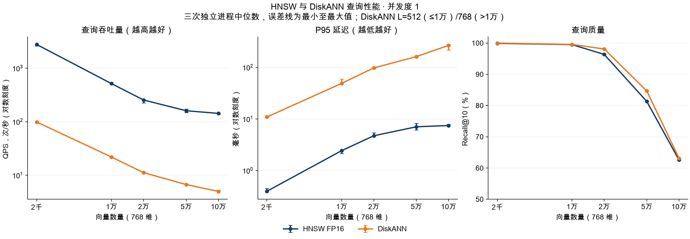
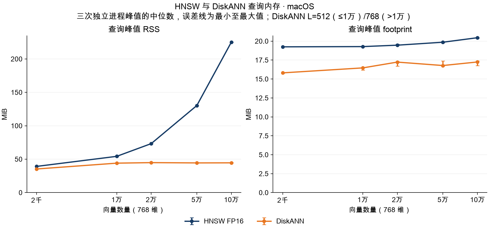

# HNSW 与 DiskANN 合成随机向量测试报告（历史基准）

> 历史测试：本文的 DiskANN 使用微软 Rust 库和 SQLite 存储，测试代码截至 `a885372`。2026-11-04 后主引擎已切换为 zvec 内置 DiskANN；本文数值不代表新后端性能。

测试日期：2026-11-03（Asia/Shanghai）。实现基线：`4d6c155`。当前 Cohere 数据测试见 [主报告](REPORT_CN.md)。本文只比较 **HNSW** 与 **DiskANN**，存储精度分别为 FP16 和 FP32，所有性能数据来自本轮重新运行的查询基准。

## 结论

DiskANN 在五个已测规模的查询 RSS 都低于 HNSW，但单并发 QPS 明显更低。10 万条时，RSS 从 HNSW 的 225.12 MiB 降到 44.56 MiB，降幅约 **80.2%**。对应吞吐量为 **142.80 对 4.99 QPS**，HNSW 约高 **28.6 倍**。

这一结果支持把当前实现作为优先控制向量查询内存的方案。对低延迟或高吞吐量要求较强的场景，当前性能差距仍然重要。两者在 10 万条高维随机向量上的 Recall@10 只有约 63%；本轮结果不代表两者达到高召回业务目标后的容量。

## 测试设计

| 项目 | 设置 |
|---|---|
| 硬件与系统 | Apple M3 Pro，36 GiB RAM，macOS 26.6.2 |
| 编译 | Rust 1.98.0，release；两个引擎使用同一个基准二进制 |
| 输入 | 确定性随机向量，768 维，归一化，cosine，top-10 |
| 数据规模 | 2,000 / 10,000 / 20,000 / 50,000 / 100,000 |
| 并发度 | 1；每次仅一个查询在执行 |
| 重复次数 | 每个规模、每个引擎启动 3 个独立进程，共 30 个进程 |
| 查询数量 | 每进程先预热 20 次，再测量相同的 200 次查询；合计 6,000 次计时查询 |
| 执行顺序 | 逐进程执行，各轮交替引擎顺序；没有同时运行建库任务 |
| 缓存 | 未清空系统文件缓存，未人为制造内存压力 |
| 查询过滤 | 无元数据过滤；返回文档 ID，不返回向量 |
| HNSW | FP16，M=50，efConstruction=500，mmap=true，使用原有 API 默认查询参数 |
| DiskANN | FP32，degree=48，build L=100；查询 L 在 2k/10k 为 512，在 20k/50k/100k 为 768 |
| 读取配置 | DiskANN 只读 SQLite cache 目标 256 KiB，mmap 上限 16 MiB |

DiskANN 的产品默认查询 L 仍为 512。本次在较大规模使用 768，使同一组查询上的召回率不低于 HNSW。这里是调参后的质量对照，不代表两者都已经达到各自最优的 recall-latency 工作点，也不是所有规模都使用产品默认参数。

HNSW 对照采用迁移前 Rust 引擎的 FP16 配置；两组存储精度不同。虽然 Rust 和 TypeScript 共享 DiskANN 后端，本测试不包含 Node 运行时，也不是旧 TypeScript FP32 引擎的端到端对照。

### 指标口径

**QPS = 200 / 计时批次耗时（秒）**。计时从第 21 个查询开始，在第 220 个查询完成后结束；包含本地查询向量生成、查询调用及结果收集，不包含进程启动、打开索引、预热、JSON 输出和关闭。没有使用 `1000 / P50` 估算 QPS。

P50/P95 单独计时每次查询调用，包含查询对象准备和结果 ID 转换，不包含本地向量生成。每次进程内将 200 个延迟排序，使用零基下标 100、190 对应的值。表中延迟是三次进程指标的中位数，并非把 600 个延迟合并后重新计算分位数。

RSS 来自 macOS `/usr/bin/time -l` 的进程峰值，**包含打开和预热阶段**。单位 MiB 为 2²⁰ 字节。图中点为三次测量的中位数，误差线为最小值至最大值，不是置信区间。

Recall@10 使用实际 FP32 向量计算的全量精确 cosine top-10 作为真值，累计 200 次查询的 2,000 个目标。参数选择和测量使用同一固定查询集，因此没有独立测试集上的泛化保证。

### 固定索引来源

本轮只重跑查询，复用前一轮的固定索引与精确真值，不把建库耗时或内存算入结果。50k/100k 的 DiskANN 查询夹具使用离线加速 builder：额外缓存向量与图边，最后统一刷边；100k builder 还使用带 `live=1` 的替换语句。图参数和输入顺序保持一致。

离线 builder 在 2k 上与生产构建逐节点比较一致；优化后的生产 writer 在 10k 上的向量、图边、ID、归属与存活状态也逐行一致。未另建一份完整的大库做逐节点等价对照，所以本报告不能用来证明生产大库的建库性能。

## QPS 与延迟结果

| 向量数 | 引擎 | 查询 L | QPS ↑ | P50 ms ↓ | P95 ms ↓ | Recall@10 ↑ |
|---:|---|---:|---:|---:|---:|---:|
| 2,000 | HNSW | API 默认 | 2765.27 | 0.36 | 0.40 | 99.90% |
| 2,000 | DiskANN | 512 | 98.61 | 10.07 | 10.89 | 100.00% |
| 10,000 | HNSW | API 默认 | 514.49 | 1.91 | 2.42 | 99.50% |
| 10,000 | DiskANN | 512 | 21.88 | 44.86 | 48.87 | 99.55% |
| 20,000 | HNSW | API 默认 | 253.92 | 3.87 | 4.72 | 96.35% |
| 20,000 | DiskANN | 768 | 11.17 | 87.85 | 97.43 | 98.10% |
| 50,000 | HNSW | API 默认 | 160.12 | 6.14 | 7.04 | 81.30% |
| 50,000 | DiskANN | 768 | 6.69 | 147.65 | 161.34 | 84.65% |
| 100,000 | HNSW | API 默认 | 142.80 | 6.98 | 7.45 | 62.60% |
| 100,000 | DiskANN | 768 | 4.99 | 189.26 | 266.33 | 63.15% |



吞吐量和延迟图使用对数纵轴，方便同时展示两条差距较大的曲线。QPS 随规模增加而降低；本次数据没有显示 DiskANN 在查询吞吐量上反超的趋势。较大规模还改变了 DiskANN 的 L，因此曲线同时体现数据量和搜索工作量的变化，不能把斜率全部归因于向量数量。

## 查询内存结果

| 向量数 | HNSW RSS MiB | DiskANN RSS MiB |
|---:|---:|---:|
| 2,000 | 39.22 | 35.34 |
| 10,000 | 54.27 | 44.08 |
| 20,000 | 73.31 | 44.86 |
| 50,000 | 130.30 | 44.44 |
| 100,000 | 225.12 | 44.56 |



HNSW 的 RSS 随规模显著上升，DiskANN 的 RSS 在 10k–100k 间变化较小。HNSW 开启 mmap，RSS 包含驻留文件页；这里没有测量系统内存压力及对其他应用的影响。

DiskANN 的缓存目标、有限映射、按需读取和局部工作集设计与这条较平缓的内存曲线相符，但本次没有逐项消融实验，不能把节省量精确分摊给某一个优化。20k 与 50k 等点存在小幅非单调波动，应结合三次范围理解，不应解释成精确的规模阈值。

## 如何解释与使用结果

**内存收益和吞吐量损失同时成立。** 10 万条时，DiskANN 将 RSS 降低约 80%，但完成同样数量串行查询需要更长时间。若请求率接近本测试的约 5 QPS，已经很难留出排队和负载波动余量；不能直接把这个数字当成可承诺的线上吞吐量。

**当前图算法与存储实现共同决定性能。** 遍历仍需要多次 SQLite 读取和 FP32 距离计算，且一个索引实例的完整查询受互斥锁保护。这些是后续分析方向；本次没有查询热点剖析，尚不能定量判断 SQLite、距离核或 I/O 各占多少，也不能据此推广为 DiskANN 算法本身固有的 QPS 差距。

**相对召回对齐不等于满足高召回要求。** 10 万条的两组 Recall@10 都只有约 63%。如果业务需要 95% 或更高召回率，应为双方分别调参达到目标后，再比较吞吐量、尾延迟和内存。

**单并发结果不等于最大并发容量。** 本次每进程只有一个在途查询，未测试 2/4/8 并发，也未测试服务排队或 Node 阻塞。连接池及线程数增加后，还需要重新评估每连接缓存、锁竞争和读写一致性。

本轮测试支持继续围绕内存预算优化当前后端，并优先分析查询热点、批量读取和距离核。具体方案、已实现内容与未实现工作见[中文设计说明](../../crates/zg-diskann/DESIGN_CN.md)。真实代码嵌入、元数据过滤、冷缓存、多模型以及长期增删后的表现需要独立实验。

## 数据与重跑

- [汇总 CSV](results/synthetic/summary.csv)：图表与表格输入，含三次范围。
- [汇总 JSON](results/synthetic/summary.json)、[30 次逐进程指标](results/synthetic/runs.json)、[环境与二进制 SHA256](results/synthetic/environment.json)。
- [Rust 查询程序](harness/src/main.rs)、[配对运行器](run.py)、[绘图程序](plot.py)。
- [性能图 SVG](results/synthetic/performance.svg)、[内存图 SVG](results/synthetic/memory.svg)：可用于文档排版。

本仓库保留查询程序、逐进程指标和图表；大型索引、精确真值以及逐查询 ID 日志保留在本地原始资料归档。以下运行器只重放已有索引，不会创建或重建工作区索引。重跑需要提供同一数据生成规则和配置的固定夹具：

```text
INDEX_ROOT/
  hnsw_fp16-2000-768/index
  diskann-2000-768/index
  ... 对应五种规模
TRUTH_ROOT/
  truth-2000.json
  ... 每份为 200 个精确 top-10 文档 ID 集合
```

按仓库 Rust 开发环境完成依赖配置后，在仓库根目录执行：

```bash
cargo build --release --manifest-path rust/benchmarks/diskann/harness/Cargo.toml --target-dir native/target
python3 rust/benchmarks/diskann/run.py \
  --binary "$PWD/native/target/release/zvec-qps-bench" \
  --index-roots /absolute/path/to/indexes \
  --truth-root /absolute/path/to/truth \
  --output /absolute/path/to/new-run
```

绘图需要 Python 与 Matplotlib，以及支持中文的字体。仅重画已提交的数据无需索引：

```bash
python3 rust/benchmarks/diskann/plot.py \
  rust/benchmarks/diskann/results/synthetic/summary.json /absolute/path/to/figures \
  --font '/System/Library/Fonts/Supplemental/Arial Unicode.ttf'
```

验收检查：30 次查询进程全部成功；每次测量均返回 200 组 top-10；DiskANN 在各规模的固定查询集上召回率不低于 HNSW；汇总公式、中文图表、文档链接与格式已检查。本次没有修改生产引擎代码。
