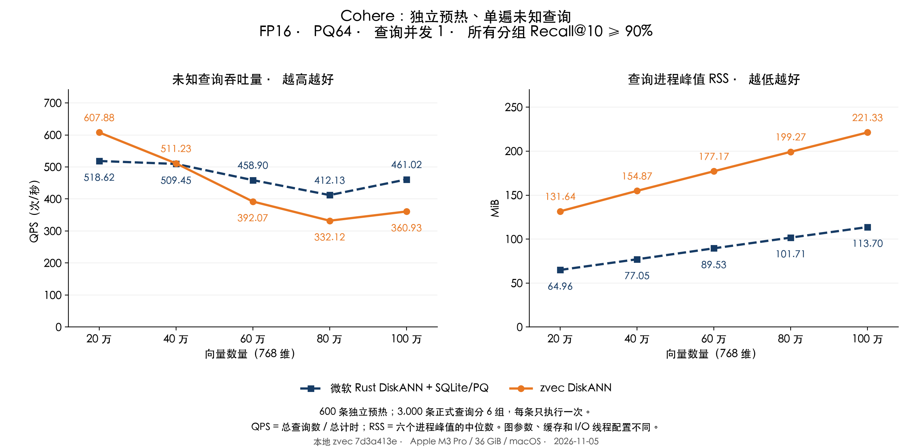

# Cohere：独立预热、单遍未知查询的 DiskANN 对比

历史基线：本文使用源码 `7d3a413e`，保留首次未知查询测试的数据和当时结论。后续源码 `047ebaf4` 在 60 万至 100 万下的优化、全新查询确认及单遍回归见[最新报告](REPORT_NODE_CN.md)。

测试日期：2026-11-05。Apple M3 Pro、36 GiB、macOS，本地 zvec 源码 `7d3a413e`。

本轮使用互不重叠的 **600 条预热查询、400 条参数验证查询和 3,000 条正式查询**。正式查询分成六组，每组 500 条，在新的查询进程中只执行一遍。两种实现使用相同分组与顺序，正式查询没有用于预热或调参。

本轮结果为：**20 万时 zvec 更快，40 万基本持平，60 万至 100 万时微软方案更快。** 百万组为 **360.93 对 461.02 QPS**，zvec 为微软方案的 **0.78 倍**。全部 60 个正式进程的 Recall@10 均超过 90%，最低为 **92.24%**。此前“全部规模超过微软”的结论仅适用于[重复热查询测试](REPORT_NODE_WARM_CN.md)，不能沿用到本轮未知查询。

40 万组的合并 QPS 仅相差 **0.35%**，六个分组 zvec 胜出 4 组、落后 2 组，应视为本轮基本持平，不能声称稳定领先。

## QPS、RSS 与召回率

QPS = 3,000 / 六个分组的计时秒数之和；RSS 为六个新进程的查询进程峰值中位数，单位 MiB。Recall@10 按 3,000 × 10 个真实邻居合并计算。

| 向量数量 | zvec DiskANN QPS | 微软 QPS | zvec RSS（MiB） | 微软 RSS（MiB） | zvec / 微软 Recall@10 |
|---|---:|---:|---:|---:|---:|
| 20 万 | 607.88 | 518.62 | 131.64 | 64.96 | 93.82% / 96.78% |
| 40 万 | 511.23 | 509.45 | 154.87 | 77.05 | 92.73% / 96.13% |
| 60 万 | 392.07 | 458.90 | 177.17 | 89.53 | 94.40% / 95.86% |
| 80 万 | 332.12 | 412.13 | 199.27 | 101.71 | 94.09% / 95.64% |
| 100 万 | 360.93 | 461.02 | 221.33 | 113.70 | 93.66% / 95.36% |

| 向量数量 | zvec 分组 QPS 范围 | 微软分组 QPS 范围 | 分组最低 Recall：zvec / 微软 | zvec 配对领先组数 |
|---|---:|---:|---:|---:|
| 20 万 | 588.70–616.63 | 474.67–547.17 | 93.54% / 96.54% | 6 / 6 |
| 40 万 | 481.68–525.85 | 481.49–523.68 | 92.24% / 95.80% | 4 / 6 |
| 60 万 | 381.42–397.07 | 405.35–493.93 | 93.98% / 95.38% | 0 / 6 |
| 80 万 | 256.29–387.87 | 302.47–497.46 | 93.66% / 95.42% | 0 / 6 |
| 100 万 | 342.86–375.16 | 413.06–484.87 | 93.18% / 95.02% | 0 / 6 |

这里的六组使用不同查询，范围同时反映查询难度差异和系统波动，不是同一查询集的重复测量置信区间。2 个正式进程在计时阶段记录到 major faults，全部保留，没有按结果筛选进程。

80 万组波动较大：zvec 有两个分组低于 300 QPS，微软也有一个分组约 302 QPS，均未出现计时阶段 major faults，且这些分组的 CPU 用时也增加了。这使合并 QPS 低于百万组；现有记录不能区分查询工作量、CPU 调度等因素的各自贡献。全部慢分组仍计入结果，这条曲线不能解释为“增加到百万向量会提高性能”。

## 为什么结果与此前不同

此前先把计分查询完整预热两遍，再重复计时五遍，缓存可以反复复用这些查询的热点节点。本轮每个测试查询此前都未在该进程执行过，缓存只能受益于独立预热和其他不同查询共享的节点。原来测出的 1.37–4.65 倍优势不能代表这样的未知查询负载。

本轮还更换了查询样本，并基于独立验证集把 60 万、80 万的 zvec L 从 96 提高到 128；其他规模保持原 L。更大的 L 通常需要搜索更多候选。因此两轮差额包含预热方式、查询难度和部分搜索参数变化，不能把差额全部归因于缓存。图、PQ、向量精度和缓存实现沿用上一轮，全部正式测试结果保留。

## 为什么微软方案 RSS 较低

百万组 zvec 为 **221.33 MiB**，微软为 **113.70 MiB**，相差 **107.62 MiB**。已确认的原因包括：

1. zvec 有额外的 **64 MiB 节点缓存预算**。微软适配层的 [SQLite 读取配置](../../crates/zg-diskann/src/lib.rs) 为 256 KiB 堆页缓存、最多 16 MiB mmap，没有同样的 64 MiB 节点缓存。
2. 两边都使用 PQ64，百万条 PQ 编码本体都是约 **61.04 MiB**；微软的 [PqIndex](../../crates/zg-diskann/src/experimental_pq.rs) 将这些编码放在常驻 `Vec<u8>` 中。因此微软 RSS 较低不能解释为“没有加载 PQ”。
3. zvec 还加载节点 key 和 key→ID 映射，[源码](https://github.com/richyreachy/zvec/blob/7d3a413e1f1e5367dc45402b2e28a9ed254343f3/src/core/algorithm/diskann/diskann_searcher_entity.cc#L243)中分别为每条 8 和 4 字节，百万条合计约 **11.44 MiB** 的数组数据。完整 Collection 的其他元数据、读取临时缓冲、线程及分配器也会进入进程 RSS，但本轮没有把剩余部分逐项归因。

另外在百万索引上，用独立验证查询做了三组缓存开关对照，均为 8 个读取工作线程、有序结果一致：

| zvec 缓存预算 | 查询进程峰值 RSS 中位数（MiB） | 验证查询 QPS 中位数 |
|---|---:|---:|
| 0 MiB | 156.61 | 259.73 |
| 64 MiB | 220.70 | 369.06 |

关闭这项缓存后 RSS 降低 **64.09 MiB**。这直接验证了节点缓存的主要内存代价；上表使用验证查询，不能替代主表的正式查询成绩。

百万组的阶段累计峰值中位数如下。数值为进程从启动至该阶段的最高 RSS，不能当作该阶段新增分配量：

| 实现 | 打开索引后（MiB） | 独立预热后（MiB） | 整个进程峰值（MiB） |
|---|---:|---:|---:|
| zvec | 152.61 | 220.73 | 221.33 |
| microsoft | 112.79 | 113.08 | 113.70 |

zvec 保留 `F_NOCACHE`、关闭预读；微软 SQLite 读取仍可使用系统文件缓存。RSS 不覆盖进程外全部系统文件缓存，主表证明的是进程 RSS 差异，不能单独据此比较对整机其他应用的全部内存影响。

## 数据、参数与计时口径

- 沿用此前 Wikipedia-Cohere / Big ANN 的同一组 20／40／60／80／100 万样本索引，768 维、cosine、FP16、PQ64、top-10。索引文件大小与修改时间前后未变。
- 从已有的官方 5,000 条查询中，固定 PCG64 seed=20261105，排除此前使用的 440 条查询、与库内向量完全相同的查询、重复查询，再抽取 4,000 条。预热、验证及六个测试分片在原始行号、归一化 FP32 内容和 FP16 内容三个层面互不重叠。这里只排除完全相同的向量，不承诺语义相近查询彼此独立。
- 每个规模均重新计算精确 GT：对实际 FP32 样本重新以 FP64 归一化，穷举 cosine，保留 top-10，平分时按 ID 排序。生成阶段每个规模用 4 条查询独立计算标量点积交叉检查；发布核验另用一条不同查询对每个规模做标量点积与全排序检查。
- 参数只在 400 条验证查询上选择：从原 L 开始，验证 Recall@10 达到 92% 后冻结，为正式分组的 90% 要求留余量。正式查询不用于选择参数。双方实际召回不同，本报告不声称完全相同召回率。

| 向量数量 | zvec L | zvec 验证 Recall | 微软 L | 微软验证 Recall |
|---|---:|---:|---:|---:|
| 20 万 | 96 | 93.10% | 128 | 96.43% |
| 40 万 | 96 | 92.10% | 128 | 95.47% |
| 60 万 | 128 | 93.53% | 128 | 95.05% |
| 80 万 | 128 | 93.03% | 128 | 94.20% |
| 100 万 | 128 | 92.77% | 128 | 94.45% |

- zvec 图出度配置 32、构图候选数 100、每个规模独立 PQ；微软图出度配置 48、构图候选数 100、FP16 重排 128、共享此前训练的 PQ64。微软组仍是 **微软 Rust DiskANN 0.61.0 + 自定义 SQLite/PQ 适配层**，并非官方原生 SSD 存储引擎。
- zvec 固定 64 MiB 节点缓存、8 个 I/O 工作线程；微软查询路径是同步 SQLite。查询并发均为 1，不能将本报告称为同线程数、同缓存策略的比较。
- 新测试程序对双方复用相同本地 zvec 动态库及运行时初始化，微软的向量搜索仍调用原 Rust/SQLite/PQ 路径，相关源码摘要与上一轮一致。
- 每个正式进程先执行独立预热集 600 条一次，然后执行自己的 500 条测试查询一次。不同测试查询之间可以自然共享缓存；这代表持续接收新查询的场景，没有在每条查询之间清空缓存。
- QPS 包含 FP16 转换、搜索和结果 ID 提取，不含索引打开、输入校验、独立预热及离线 GT 比较。RSS 使用 `/usr/bin/time -l` 的完整查询进程峰值，包含打开、查询数据加载、预热、搜索及退出，不含建库或 GT 计算。
- 六个分片交替规模顺序，并交替双方顺序。每次均为新进程；没有清空系统文件缓存，因此不是完全冷盘测试，也不是单个长进程的长期稳态测试。正式计时时没有并行构建或 GT 计算；其他桌面应用未隔离。

## 复现与核验

正式查询共 60 个进程、每个实现每个规模 3,000 条；本轮总共核验 79 份有效进程记录，包括独立验证、内存对照与单独的读取诊断。额外诊断统计覆盖 600 条预热加 400 条验证，不能与正式计时混用：逻辑请求 217,861 次，`pread` 139,464 次，API 读取 544.78 MiB。

[原始结果、GT 与查询指纹](results/disjoint-comparison/raw-evidence.json.gz)、[数据分组与摘要](results/disjoint-comparison/data-manifest.json)、[逐进程记录](results/disjoint-comparison/runs.json)、[汇总](results/disjoint-comparison/summary.json)、[独立核验](results/disjoint-comparison/audit.json)、[冻结参数](results/disjoint-comparison/selection.json)、[构建记录](results/disjoint-comparison/build.json)。

程序 [disjoint-bench.rs](harness/src/bin/disjoint-bench.rs) 在查询开始前拒绝重叠或重复输入；该拒绝路径已实际验证。复现依次使用 [prepare_disjoint.py](prepare_disjoint.py)、[run_disjoint_comparison.py](run_disjoint_comparison.py) 和 [publish_disjoint_comparison.py](publish_disjoint_comparison.py)，参数见 `--help`，保留原 Cohere 数据、索引和记录中的本地库路径。测量脚本需要 `BASE/data`、`BASE/rust-target/release` 中编译的程序及动态库，以及直接启动程序记录的 `loader.json`；本次完整实验目录为 `/tmp/zvec-disjoint-cohere-20261105`。输入摘要、动态库加载路径、返回 ID、召回率、计时和汇总均独立检查。

初次准备时修正了历史查询文件路径和清单来源；首次加载检查由于 `/usr/bin/time` 未传递 dyld 输出而失败，改为直接启动的加载检查后确认了库路径。这些[预检查记录](results/disjoint-comparison/preflight-record.json)发生在正式查询之前，未计为正式成绩。

本轮未改动 zvec 核心库，复用此前已通过 [40 项 C++ 测试](results/node-comparison/cpp-tests.json)的 `7d3a413e` 动态库。已发布 Rust／Node SDK 二进制尚未替换。
