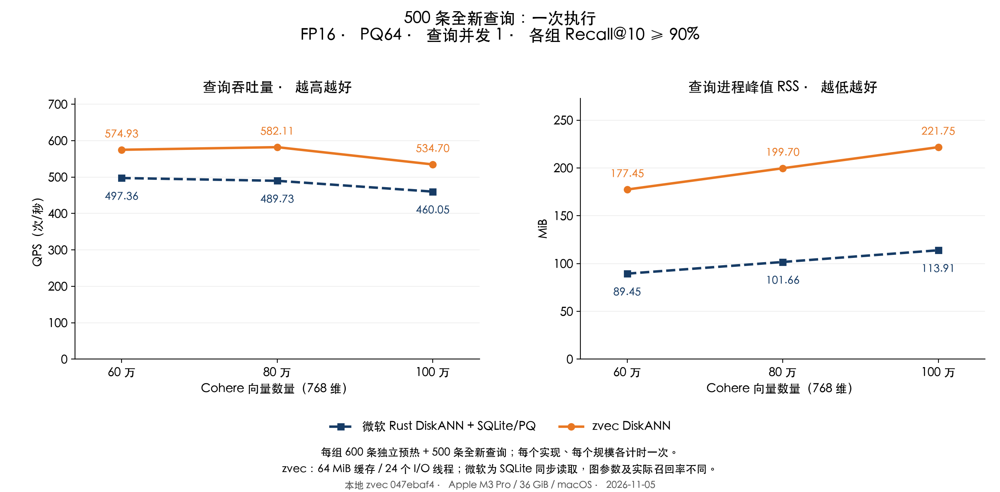
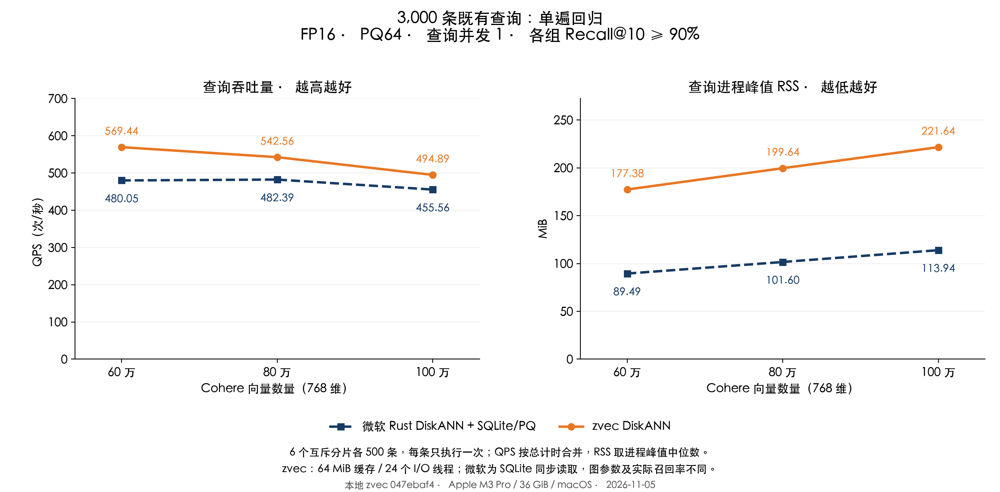

# Cohere：zvec DiskANN 未知查询优化验证

历史配置：本文保留源码 `047ebaf4`、64 MiB 缓存的结果；后续降低 RSS 的配置与单遍回归见[最新报告](REPORT_NODE_CN.md)。

测试日期：2026-11-05。Apple M3 Pro、36 GiB、macOS；本地 zvec 源码 `047ebaf4`。

**60 万、80 万、100 万三个规模均达到本轮目标。** 在代码和参数冻结后，用此前从未使用的 500 条查询单遍确认，zvec 的 QPS 比微软方案高 **15.60%–18.86%**，Recall@10 为 **91.96%–93.20%**。随后对既有 3,000 条查询做单遍回归，三个规模合并 QPS 仍高 **8.63%–18.62%**。此前[未知查询基线](REPORT_UNSEEN_BASELINE_CN.md)中大规模落后的结论已由本轮结果更新。

缓存预算仍为每个图文件 **64 MiB**，保留 `F_NOCACHE` 和关闭预读。测试使用 **24 个有上限的 I/O 工作线程**，查询并发仍为 1。百万新查询组 RSS 为 **221.75 对 113.91 MiB**，zvec 的进程内存仍高于微软方案。

## 全新查询：独立确认

这 500 条查询来自同一 Cohere 官方查询池，排除了此前使用的 4,440 条源查询，未参与任何候选版本测试、参数选择或预热。每个实现、每个规模均开新进程，先执行独立预热集 600 条一次，再执行这 500 条一次。每组只有一次计时，不把它称为多轮复测。

| 向量数 | zvec DiskANN QPS | 微软 QPS | zvec QPS 提升 | RSS：zvec / 微软（MiB） | Recall@10：zvec / 微软 |
|---|---:|---:|---:|---:|---:|
| 60 万 | 574.93 | 497.36 | 15.60% | 177.45 / 89.45 | 92.48% / 95.58% |
| 80 万 | 582.11 | 489.73 | 18.86% | 199.70 / 101.66 | 91.96% / 95.28% |
| 100 万 | 534.70 | 460.05 | 16.23% | 221.75 / 113.91 | 93.20% / 95.28% |



## 既有查询：单遍回归

既有 3,000 条查询曾在上一轮测试中使用，因此单列为回归集，不称为新的盲测集。本轮没有使用这些查询调参。六个互不重叠的分片各 500 条，每个新进程先执行 600 条独立预热，再执行自己的分片一次。QPS = 3,000 / 六个计时批次的总秒数；RSS 为六个进程峰值中位数。

| 向量数 | zvec DiskANN QPS | 微软 QPS | zvec QPS 提升 | RSS：zvec / 微软（MiB） | Recall@10：zvec / 微软 |
|---|---:|---:|---:|---:|---:|
| 60 万 | 569.44 | 480.05 | 18.62% | 177.38 / 89.49 | 92.86% / 95.86% |
| 80 万 | 542.56 | 482.39 | 12.47% | 199.64 / 101.60 | 92.52% / 95.64% |
| 100 万 | 494.89 | 455.56 | 8.63% | 221.64 / 113.94 | 92.78% / 95.36% |



| 向量数 | zvec 分片 QPS 范围 | 微软分片 QPS 范围 | zvec 配对领先分片数 |
|---|---:|---:|---:|
| 60 万 | 529.05–593.25 | 463.36–502.61 | 6 / 6 |
| 80 万 | 467.45–589.02 | 458.52–502.70 | 5 / 6 |
| 100 万 | 457.38–538.16 | 426.06–480.26 | 5 / 6 |

三个规模的合并吞吐量均领先，但 80 万、100 万各有一个分片略低于微软；这不代表每个分片或每条请求都更快。六个分片使用不同查询，范围也包含查询难度差异，不能当作重复测量置信区间。百万微软回归组的一次计时记录到 1 次 major fault，所有记录均保留。全部 42 个正式进程的最低 Recall@10 为 **91.96%**。

## 定位到的瓶颈与代码改动

**主要瓶颈是读取批次的串行等待。** 原版允许最多 8 个读取工作线程，但 L=128 时一个搜索批次最多扩展约 25 个候选，未命中时经常要分几轮读取。本轮把可配置上限扩展到 32，并在独立验证集选择 24。验证中继续增到 32 没有持续提高性能，未采用无上限线程数。

**降低线程池调度开销。** 工作线程按批次领取任务，再用批次内原子索引领取请求，避免每次读取前后争用全局队列锁。小批次只唤醒所需线程。仍在所有读取完成后才返回，错误也会完整回收，保持原节点处理顺序。

**减少热点节点被一次性访问淘汰。** 固定预算、最多 16 路的缓存采用有上限的多次 Clock 保留机会：新节点 1 次，重复命中最多 3 次，扫描时逐次扣减。没有扩大缓存，也没有缓存查询答案。

**消除重复计算和分配。** 访问过的邻居在 PQ 计算前排除，复用邻居和距离临时数组；只有可能进入 top-k 的候选才复制原向量。相同 L 的旧版与新版返回有序结果逐项一致。只做这类 CPU 改动时 QPS 提升很小，主要收益仍来自提高读取并发。

百万独立验证诊断固定 L=128，均包含 600 条预热和 400 条验证，逻辑请求都是 217,861 次：

| 指标 | 旧版：8 个 I/O 线程 | 新版：24 个 I/O 线程 |
|---|---:|---:|
| 实际 pread 次数 | 139,464 | 136,790 |
| API 读取量（MiB） | 544.78 | 534.34 |
| 读取批次累计墙钟（秒） | 2.289 | 1.756 |
| 各读取线程耗时之和（秒） | 13.324 | 15.689 |

批次等待降低 **23.29%**，实际读取次数降低 **1.92%**。线程耗时之和没有下降，说明收益主要来自等待重叠，不能解释为每次 SSD 读取都变快。诊断覆盖预热和验证全过程，正式 QPS 测量关闭诊断。

## 区分代码收益与搜索参数收益

下表在同轮独立验证集上比较，每组各 3 个新进程，QPS 按总查询数 / 总计时计算。两版使用同一 L、同一图、PQ、精度和 64 MiB 缓存，旧版 8 个、新版 24 个 I/O 工作线程；有序结果相同。因此这里的提升来自代码与读取并发配置，不依赖降低召回率。

| 向量数 | 两版共同 L | 旧版 QPS | 新版 QPS | 提升 | 两版共同 Recall@10 |
|---|---:|---:|---:|---:|---:|
| 60 万 | 96 | 464.37 | 559.23 | 20.43% | 91.88% |
| 80 万 | 96 | 440.60 | 531.52 | 20.64% | 91.70% |
| 100 万 | 108 | 388.08 | 516.32 | 33.04% | 91.57% |

另固定百万组 L=128 的单次验证对照为 **355.21 → 472.41 QPS**，两版 Recall@10 都是 **92.78%**，有序结果相同。这份对照与正式新查询成绩单列。

正式配置则按本轮 90% 召回目标，在独立 400 条验证集上选择 L=**96／96／108**，验证门槛为 **91.5%**，给正式查询留余量；上一轮对应三个规模均为 L=128、验证门槛为 92%。因此，相比上一轮报告的全部提升还包含降低搜索工作量的收益和召回率取舍，不能全部归因于代码。微软仍为 L=128、重排 128，实际召回高于 zvec；这是双方超过 90% 门槛的比较，不是完全相同召回率或线程数的比较。

## 方法与适用范围

- 沿用同一组 Cohere 60／80／100 万样本，768 维、cosine、FP16、PQ64、top-10；索引未重建，文件大小与修改时间前后不变。20 万、40 万本轮未重测，历史结果见[上一轮报告](REPORT_UNSEEN_BASELINE_CN.md)。
- zvec 图出度配置为 32、构图候选数 100、各规模独立 PQ；微软图出度配置为 48、构图候选数 100、沿用共享 PQ64 码本。微软组是 **微软 Rust DiskANN 0.61.0 + 自定义 SQLite/PQ 适配层**，并非官方原生 SSD 存储引擎。
- 600 条预热、400 条验证、500 条全新查询及 3,000 条回归查询互不重叠；核对源行号、归一化 FP32 内容和 FP16 内容。新查询固定 seed=20261107，精确 GT 针对每个样本规模重新计算 FP64 cosine，并独立检查 3 条查询的标量点积和全排序。
- 候选试验只访问验证集。先做三轮交替验证和同 L 对照，再冻结源码、二进制、64 MiB 缓存、24 个工作线程及 L；先执行全新查询，后执行单遍回归，没有根据正式成绩再调整参数或替换慢分片。
- 每个实现、每个规模下，每条正式查询只执行一次。不同查询自然共享缓存，没有在每条查询之间清缓存；查询并发为 1。QPS 包含 FP16 转换、向量查询和 ID 提取，不含打开、输入校验、独立预热和离线 GT 比较。
- RSS 是 `/usr/bin/time -l` 的完整查询进程峰值，包含加载、预热、查询和退出，不含建库。zvec 保留不缓存文件读取；微软 SQLite 使用 256 KiB 堆页缓存、最多 16 MiB mmap，并可受益于系统文件缓存。没有清空系统文件缓存，RSS 也不覆盖进程外全部文件缓存。
- 正式测量期间没有构建或 GT 计算；其他桌面应用未隔离。500 条新查询每组只有一次计时，且仅涵盖本机和当前分布；本报告不承诺所有机器、数据、并发场景均领先。

## 使用与复现

本地源码默认仍为 4 个读取线程、32 MiB 缓存。本轮在打开集合前显式设置：

```bash
export ZVEC_DISKANN_READ_CACHE_MIB=64
export ZVEC_DISKANN_READ_WORKERS=24
```

搜索 L 按上述各规模配置。索引无需重建。**已发布 Rust／Node SDK 二进制尚未替换，使用这些改动需要链接本地重新编译的库。**

43 项 C++ 测试通过，包括宽线程池的逐请求执行、短批次错误回收、热点保留与过期淘汰、并发读、固定预算和跨页节点建库加载查询。本轮未获得 ThreadSanitizer 验证；此前该运行时在进入 main 前初始化失败。

共保存并核验 **153 份有效进程记录**：76 次候选验证、35 次最终验证与对照、42 次正式测量。缩小搜索批次等未采用方案也保留。首次复制旧程序到新路径时进程在启动阶段被终止，随后使用原始可运行基线路径和重新编译的候选程序；该失败没有正式查询成绩。

[独立核验](results/unseen-optimization/audit.json)、[正式汇总](results/unseen-optimization/measure/summary.json)、[逐次记录](results/unseen-optimization/measure/runs.json)、[配置与摘要](results/unseen-optimization/measure/configuration.json)、[新查询来源与 GT 摘要](results/unseen-optimization/holdout-manifest.json)、[原始结果与 GT](results/unseen-optimization/raw-evidence.json.gz)、[源码补丁](results/unseen-optimization/measure/source.patch)、[C++ 测试](results/unseen-optimization/cpp-tests.json)。

复现脚本：[候选构建](build_unseen_variant.py)、[候选验证](run_unseen_pilot.py)、[新查询与 GT](prepare_unseen_holdout.py)、[冻结对比](run_unseen_comparison.py)、[报告核验与绘图](publish_unseen_optimization.py)。参数见 `--help`；本机完整实验目录为 `/tmp/zvec-unseen-opt-20261105`，需保留配置记录中的 Cohere 数据、索引、基线程序和本地动态库。
