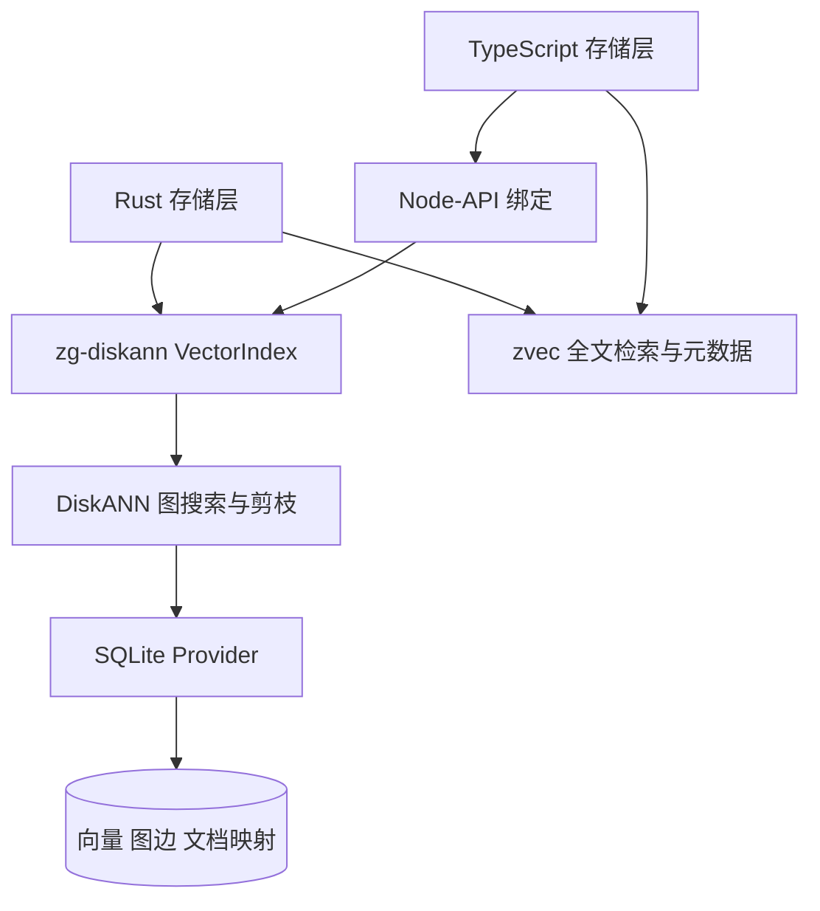

# DiskANN 向量后端设计

更新日期：2026-11-03。实现基线：`4d6c155`。

Rust 和 TypeScript 共用 `zg-diskann` 原生向量后端，使用 DiskANN 图搜索和 SQLite 持久化向量、图边。设计优先控制查询私有内存，保留增删改、过滤和显式重建语义。当前实现仍存在显著的查询吞吐量差距；内存收益与 QPS 必须结合召回率评估。

本文描述已实现的设计，并单独列出后续性能工作。[测试报告](../../benchmarks/diskann/REPORT_CN.md)只比较 HNSW 与 DiskANN。

## 目标与边界

- 两种语言使用同一套向量索引、距离计算和过滤语义。
- 按需读取向量和图边，控制每个索引连接的堆缓存。
- 一次向量写入事务同时提交向量、文档映射和图边；失败时回滚。
- 用实际批次耗时度量 QPS，同时报告延迟、内存和召回率。

当前采用 DiskANN 的 Rust 图算法和自定义 SQLite provider。官方 DiskANN 常见的 PQ 压缩、专用 SSD 文件布局及异步 I/O 流水线并未因此自动具备。全文检索、元数据、嵌入模型和服务协议也不包含在纯向量微基准内。

## 模块结构

Rust 的 `storage/fragments` 按模型持有 `VectorIndex`；TypeScript 通过 `src/engine/storage/diskann.ts` 加载同一后端的 Node-API 绑定。后端暴露打开、写入、删除、查询和关闭能力。原生 Rust API 另提供 `search_with_list_size`，用于显式调节搜索候选数；当前 TypeScript 包装层没有透出这个参数。

关键实现：[`lib.rs`](src/lib.rs)、[`provider.rs`](src/provider.rs)、[TypeScript 适配器](../../../src/engine/storage/diskann.ts)。

## 数据与事务

SQLite 的 `settings` 表保存格式版本、维度和距离类型；`nodes` 表保存节点 ID、文档 ID、文件 ID、FP32 向量、邻接列表和 `live` 标志。节点 0 是搜索起点。文档和文件查找使用仅覆盖 `live = 1` 记录的部分索引。

插入或替换时分配新的节点 ID，执行图插入，再将同一文档的旧节点标记为失活，最后写入新节点的文档归属。上述更新位于同一 SQLite 事务内。替换 SQL 带有 `live = 1` 条件，使 SQLite 能使用已有的 `live_document` 索引，避免每次插入都扫描整张表。

删除只将节点置为失活。失活节点仍可作为图遍历路径，但不会作为有效结果返回。长期反复替换会积累失活节点和磁盘空间；当前方案需要通过显式重建回收，不能据此认为索引体积始终只随存活文档增长。

事务原子性覆盖这份 SQLite 向量库。zvec 的全文、元数据投影属于另一份存储，不能把单库事务扩大解释成跨存储事务。HNSW 索引的格式迁移需要显式重建；本轮缓存和读取优化可直接用于已有 DiskANN 数据库。

## 查询流程

1. 校验向量维度、有限值、top-k 和候选数，处理空过滤集合。
2. 锁定当前索引实例，清空上一轮查询的临时存活状态；最多计数到 top-k，以判断可返回的结果上限。
3. 执行带存活状态与文档集合过滤的 DiskANN 图遍历。候选列表至少为 `max(2 × top-k, L)`，过滤搜索可自适应扩大搜索范围。
4. SQLite provider 按需读取候选向量和邻接列表。对齐且字节序合适的 BLOB 可直接借用；其他情况解码为临时向量。
5. 只解析排名靠前和边界同分候选的文档 ID，按分数与文档 ID 确定性排序，截断为 top-k。

默认 `L = 512`。L 增大会扩大搜索工作量，通常改善召回率，同时增加延迟与临时内存。当前 Cohere Wikipedia 基准在所有规模统一使用默认的 512，不根据测量查询调大参数。早期合成随机向量实验的 512/768 配置保存在[历史报告](../../benchmarks/diskann/REPORT_SYNTHETIC_CN.md)，不与当前数据混合统计。

## 内存设计

| 项目 | 只读连接 | 写入连接 |
|---|---:|---:|
| SQLite page-cache 目标 | 256 KiB | 2 MiB |
| SQLite mmap 上限 | 16 MiB | 关闭 |
| 向量读取 | 尽量借用 BLOB | 剪枝工作集按需持有向量 |

读取映射允许部分文件页以干净映射页形式驻留，减少 SQLite 私有堆中的副本。映射仅覆盖文件前缀，超出部分仍走普通读取。写入连接关闭映射，避免构建过程中同时保留额外映射页。

这些是每个连接的缓存参数，不是进程总内存硬上限。查询候选集、结果、过滤集合、剪枝工作集、运行时以及多个模型都消耗额外内存。RSS 包含驻留映射页，macOS footprint 的计量不同，因此两个指标需要分别展示。

另外复用以下局部计算结果：每次查询的向量范数、剪枝工作集内的范数，以及刚读取节点的存活状态。距离累加使用多个独立的 f64 累加器；有限值校验、距离转换和同分排序语义保持不变。

## 并发与吞吐量约束

当前 `VectorIndex` 用互斥锁保护一次完整搜索，provider 的 SQLite 连接也受互斥锁保护。同一索引实例上的搜索会串行执行。增加调用线程数不能直接按线程数倍增吞吐量。

遍历仍会产生大量细粒度 SQLite 读取，并执行 FP32 向量距离计算。它们是值得分析的开销来源，但尚未用查询热点剖析量化各自占比。本轮测试只测并发度 1；该结果不能解释为服务的最大并发 QPS。

## 后续 QPS 优化设计

以下工作尚未实现，应逐项测量后决定是否采用。

| 优先级 | 方案 | 验证重点 |
|---|---|---|
| 1 | 记录每次查询访问节点数、SQL 调用数、BLOB 解码量和距离计算耗时 | 先定位 CPU、SQLite 或 I/O 的主要占比，诊断开销不计入正式基准 |
| 2 | 在 provider 中批量读取一组候选向量和邻接信息，使用有字节预算的临时缓冲 | 减少 SQL 调用；保持遍历和过滤语义，检查峰值内存是否回升 |
| 3 | 对距离核进行 SIMD 优化，评估精度和范数存储方案 | 对齐、非有限值、极值、同分结果及跨架构兼容性；不直接假定 FP16/PQ 无召回损失 |
| 4 | 评估不可变查询状态与有上限的只读连接池 | 先验证 DiskANN/provider 的并发契约与读写一致性，再测 1/2/4/8 并发；计入每连接缓存 |
| 5 | 把 L 作为两种语言一致的查询配置暴露，并做 recall-latency 曲线 | 显式呈现速度与质量选择，避免用降低召回率换取表面 QPS |

验收时固定数据、距离、top-k、查询集合和精度口径，同时检查 QPS、P50/P95、Recall@10、RSS 与 footprint。至少保留当前召回水平；引入缓存或连接池时，还需检查模型数和并发数增长时的内存。

## 已有验证与范围

优化代码已通过后端 7 项测试、TypeScript 存储 11 项测试、Rust 存储套件 145 项测试（2 项忽略）、workspace 类型检查、Clippy 和格式检查。最后追加的写入谓词与 mmap 调整再次通过后端和 TypeScript 存储测试。

优化后的生产 writer 与此前 10k 数据库比较，包含起点的 10,001 个逻辑节点在向量、图边、ID、归属和 live 状态上完全一致。本轮设计文档与基准不修改生产搜索行为。真实代码嵌入、过滤查询、冷缓存、并发、端到端 Node 开销及长期增删后的性能仍需单独验证。
